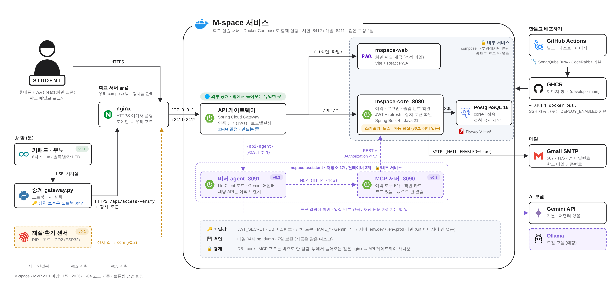
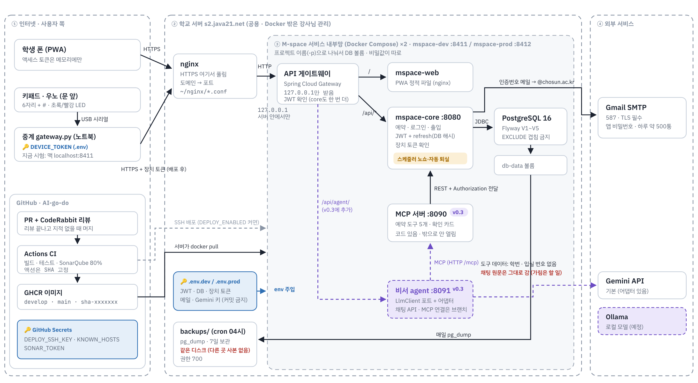

# 시스템 아키텍처

> 2026-11-02 처음 그림. 11-04에 다시 그렸어요(아키텍처 점검과 토론팀 회의 반영, 배포·보안 그림 추가). 11-04 밤에 강사님 멘토링을 반영해 우리 입구 nginx를 **API 게이트웨이(Spring Cloud Gateway)**로 바꿨어요. 각 저장소 develop/main 코드와 맞췄어요. **실선은 지금 연결된 것, 점선은 계획**이에요. 상자의 v0.1~v0.3은 요구사항 버전이에요.

배포와 보안까지 넣은 상세 그림이에요. 🔑는 비밀값이 있는 곳이에요.

## 한 줄 요약

- 밖에서 들어오면 nginx(학교 서버)를 지나 **API 게이트웨이 하나**로 들어와요. 밖에 열린 문은 이것뿐이고, 나머지(web · core · agent · MCP · DB)는 모두 내부 서비스예요.
- 게이트웨이가 로그인 토큰(JWT)을 먼저 확인하고 길을 나눠요. `/api/agent/**`는 비서 agent로 바로, 나머지 `/api/**`는 core로, `/`는 화면(web)으로 보내요.
- DB에는 **core만** 닿아요. 비서도 DB를 직접 보지 않고 MCP 서버를 거쳐 core API만 불러요.
- 키패드는 번호를 판단하지 않아요. 입력을 서버로 보내고 결과(LED)만 보여 줘요.

## 경계와 비밀값

| 경계 | 무엇을 지키나 | 어떻게 |
|---|---|---|
| 인터넷 → nginx | 엿보기 | HTTPS는 nginx에서 풀어요 |
| nginx → API 게이트웨이 | 뒷문(HTTPS를 건너뛰는 직접 접속) | 게이트웨이 포트를 `127.0.0.1`에만 열어요. Docker가 연 포트는 서버 방화벽(ufw)을 건너뛰어서 compose에서 막아야 해요 (infra #8) |
| API 게이트웨이 → core · agent | 아무나 API 부르기 | 게이트웨이가 학생 토큰(JWT, core와 같은 `JWT_SECRET`)을 먼저 확인해요. 로그인 · 빈방 조회 · 키패드 확인 같은 공개 API만 토큰 없이 통과해요. core도 토큰과 장치 토큰을 한 번 더 확인해요 |
| agent → MCP 서버 | 비서 도구를 밖에서 부르기 | MCP 서버는 내부 전용이에요. 게이트웨이에 길이 없어서 밖에서 닿지 않아요 |
| core → DB | DB 직접 접속 | DB 포트는 밖으로 안 열어요. compose 안에서 core만 닿아요 |
| 비서 → 모델(Gemini) | 개인정보가 밖으로 나감 | 도구 결과에 학번·입실 번호를 넣지 않아요. 채팅 원문은 그대로 가요(가리기는 할 일) |

| 비밀값 | 어디에 있나 | 넣으면 안 되는 곳 |
|---|---|---|
| `JWT_SECRET`(core · 게이트웨이 같은 값), DB 비밀번호, `MSPACE_DEVICE_TOKEN`, `MAIL_*`, Gemini 키 | 학교 서버 `~/infra/.env.dev` · `.env.prod` (compose가 컨테이너에 넣어 줌) | Git, 이미지, 채팅방 |
| 장치 토큰 (`DEVICE_TOKEN`) | 중계 노트북 `.env` | 펌웨어(우노), Git |
| `DEPLOY_SSH_KEY`, `KNOWN_HOSTS`, `SONAR_TOKEN` | GitHub Secrets | 워크플로 파일 |

## nginx와 API 게이트웨이

요청은 `휴대폰 → nginx(학교 서버) → API 게이트웨이 → web · core · agent` 순서로 들어와요. nginx는 하나뿐이고, 우리 서비스의 입구는 게이트웨이예요.

| | nginx | API 게이트웨이 (`gateway`) |
|---|---|---|
| 어디에 | 학교 서버, **우리 Docker 밖** (Nginx Proxy Manager) | 우리 compose 안 컨테이너 (`mspace-gateway` 저장소, Spring Cloud Gateway) |
| 누가 관리 | 강사님 (학교 서버 공용) | 우리 팀 (재웅) |
| 하는 일 | 도메인 → 우리 포트. `mspace.java21.net` → 8412(시연), `dev-mspace.java21.net` → 8411(개발). HTTPS 처리 | 토큰(JWT) 확인, 길 나누기, 로드밸런싱. `/api/agent/**` → agent, `/api/**` · `/actuator/health` → core, 나머지 → web |
| 비유 | 건물 정문 안내 데스크 ("M-space 팀은 8412호") | 우리 사무실 입구 보안 데스크 (출입증 확인 후 "화면은 왼쪽, API는 오른쪽, 비서는 안쪽") |

- **비서는 게이트웨이에서 agent로 바로 가요.** core를 거쳐 agent로 가면 core와 비서가 묶여서, 강사님 멘토링(11-04)대로 게이트웨이가 길을 나눠요.
- **MCP 서버는 내부 전용**이에요. agent만 MCP를 부르고, MCP는 학생 본인 토큰으로 core API를 불러요.
- 공개 API(토큰 없이 통과): `POST /api/auth/email-codes` · `login` · `refresh` · `logout`, `POST /api/access/verify`(장치 토큰은 core가 확인), `GET /api/rooms` · `/api/rooms/availability`, `/actuator/health`. 공개 길에서는 `Authorization` 헤더를 보지 않아서, 토큰이 만료돼도 refresh가 돼요.
- core는 토큰 확인을 그대로 해요. 게이트웨이를 건너뛰는 길이 생겨도 막히게 두 번 확인해요.
- 둘 다 거치기 때문에 화면과 API가 같은 주소를 써요. 그래서 CORS 설정이 필요 없어요.
- 게이트웨이 포트는 서버 자신(`127.0.0.1`)에서만 받아요. 맥에서 폰 · 키패드로 시험할 때만 `.env`에 `BIND_ADDR=0.0.0.0`을 넣어요.
- 버전: Spring Boot 4.0.9 + Spring Cloud 2025.1.4. core(4.1.2)와 다른 이유는 Boot 4.1용 Spring Cloud가 아직 정식이 아니어서예요. 따로 도는 서비스라 괜찮아요.
- 상태(11-04): 게이트웨이 코드 [mspace-gateway #1](https://github.com/AI-go-do/mspace-gateway/pull/1), compose 교체 [infra #9](https://github.com/AI-go-do/infra/pull/9) 머지 대기. 머지 전까지 서버는 nginx 입구 컨테이너로 돌아가요.

## MVP (v0.1) 범위

> [!IMPORTANT]
> **MVP(v0.1)는 이번 주 안에 반드시 끝내요. 마감은 11/5(목)이에요.**
> v0.1이 끝나기 전에는 v0.2 · v0.3을 시작하지 않아요. 일정이 밀리면 v0.2 · v0.3을 줄이고, v0.1은 줄이지 않아요.

v0.1은 아래 다섯 가지를 **순서대로** 만들어요. 위 그림 중 비서·센서·Jetson 쪽은 v0.1 다음이에요.

| 순서 | 기능 | 핵심 규칙 | 그림의 상자 | 상태 (11-04) |
|---|---|---|---|---|
| 1 | 배포 파이프라인 | PR → CI → GHCR 이미지 → 서버 compose | GitHub Actions · GHCR · nginx · API 게이트웨이 | ✅ CI/CD·GHCR 완료. 학교 서버 배포는 강사님 안내 대기 |
| 2 | 학번 로그인 | 학교 메일(`@chosun.ac.kr`) 인증 → JWT + refresh | web · core | ✅ core 머지. 화면은 web PR 리뷰 중. 서버 `.env`에 `MAIL_ENABLED=true`와 Gmail 앱 비밀번호를 넣어야 메일이 가요 |
| 3 | 방 목록 · 예약 | 2시간 단위, 7일 이내, 대표자 1건, 시간 겹침 금지(DB 제약) | web · core · PostgreSQL | 진행 중 |
| 4 | 내 예약 · 퇴실 | 시작 전 취소, 퇴실 버튼 = 바로 퇴실(대표자). 시간이 끝나면 자동 퇴실은 v0.2(코드는 이미 core에 있음) | web · core | 진행 중 |
| 5 | 6자리 번호 · 키패드 입실 | 잠깐 나갔다 오면 같은 번호 다시 사용. 노쇼(15분)는 v0.2(코드는 이미 core에 있음) | 키패드 · 중계 · core | core `/api/access/verify` 머지 |

**v0.1에 안 넣는 것**: 비서 에이전트(agent·MCP), 재실 센서, Jetson 보드 B. 다음 버전(v0.2~)에 상자를 덧붙여요.

서비스마다 무엇을 열고(API) 무엇을 부르는지는 [MVP 서비스별 구조 · API](mvp-services.md)에 있어요.

## 버전별 계획

자세한 기능 목록은 [요구사항 3장 버전별 범위](../requirements/requirements.md#3-버전별-범위)와 8장에 있어요. 여기서는 **그림에 무엇이 붙는지**만 봐요.

| 버전 | 기간 | 한 줄 | 들어가는 것 | 그림에 새로 붙는 상자 · 길 |
|---|---|---|---|---|
| **v0.1 (MVP)** | 11/2 – **11/5 마감** | 예약 한 바퀴. **이번 주 안에 반드시** | 위 MVP 표 5가지 | nginx(학교 서버), API 게이트웨이, web, core, PostgreSQL, 키패드 · 중계 |
| **v0.2** | 11/6 – 11/10 | 사람 없이 돌아감 | 자동 퇴실, 노쇼, 지금 바로 쓰기, 연장하기(1회), 알림(시작 · 퇴실 안내, 앱 알림함), 방 현황 화면, 재실 · 환기 센서, 자리 비움 자동 퇴실 | 재실 센서(ESP32 · 아두이노) → core. core 안 스케줄러(자동 퇴실 · 노쇼)는 먼저 들어와 있어요(`MSPACE_SWEEP_ENABLED` 기본 켜짐) |
| **v0.3** | 11/11 – 11/13 | 운영 · AI | 신고, 사진 체크인 · 아웃, 허위 신고 판정 · 관리자 화면, AI 비서 스페이시(MCP), 내 시간표(선택) | agent · MCP 서버, 모델(Gemini · Ollama). 게이트웨이의 `/api/agent/` 길은 먼저 들어와 있어요 |
| 그 뒤 | 필수 기능이 다 된 뒤 | 더 똑똑하게 | Jetson 보드 B(후보: 환기 예측, 로컬 모델 Ollama, 이용 규칙 질문 답변). 학과 일정 앱은 설계도만 | Jetson 보드 B, 학사 정보 서버(설계만) |

- **대회 일정** (공고문 기준)

  | 날짜 | 할 일 |
  |---|---|
  | **11/5 (목)** | MVP(v0.1) 마감 |
  | 11/13 (금) | 기능 동결 |
  | 11/14 – 11/15 | 시연 영상 촬영 · 과제설명서 |
  | **11/16 (월) 16:00** | 1차 제출 마감: 5분 발표 영상 + 과제설명서. 영상으로 1차 사전 심사 |
  | **11/19 (목)** | 본선 발표 (IT 페스티벌 당일) |
- 일정이 밀리면 v0.3 → v0.2 순서로 줄여요. v0.1 예약 한 바퀴는 자르지 않아요.
- **하지 않는 것**: 카메라 · 영상, 키박스, 학교 학사 DB 직접 연동, 실제 도어락 · QR(어댑터 설계만).
- 버전이 하나 끝나면 위 그림에 그 버전 상자를 실선으로 바꿔요.

## 구성 요소

| 상자 | 저장소 | 기술 | 하는 일 |
|---|---|---|---|
| 휴대폰 (PWA) · 화면 web | `mspace-web` | PWA | 로그인, 빈방, 예약, 내 예약, 6자리 번호, 비서 채팅 |
| nginx | (학교 서버, compose 밖) | nginx (Nginx Proxy Manager) | 도메인(`mspace.java21.net`, `dev-mspace.java21.net`)을 우리 포트(8412, 8411)로 넘김. HTTPS |
| API 게이트웨이 | `mspace-gateway` (compose는 `infra`) | Java 21 · Spring Cloud Gateway (WebFlux) | 밖에서 들어오는 유일한 문. JWT 확인, `/api/agent/**` → agent, `/api/**` → core, `/` → web, 로드밸런싱 |
| mspace-core | `mspace-core` | Java 21 · Spring Boot 4 · 모듈러 모놀리스 | 예약 규칙, 로그인, 출입 번호 확인. 포트와 어댑터 구조 |
| PostgreSQL | `infra` (compose) | PostgreSQL 16 · Flyway | 겹침 금지(EXCLUDE) 제약, 테이블 버전 관리. 밖으로 포트 안 열림 |
| 비서 agent | `mspace-assistant` | Java · Spring Boot | 사용자 말 → 모델 → 도구. 쓰기 작업은 확인 버튼 뒤에만. 채팅 API와 MCP 연결은 아직 브랜치(#33) |
| MCP 서버 | `mspace-assistant` | Spring AI MCP | core API를 MCP 도구로 감쌈 |
| 키패드 + 우노 | `mspace-device` | Arduino | 6자리 + `#` 입력, 초록·빨강 LED |
| 중계 gateway.py | `mspace-device` | Python | 입력을 `POST /api/access/verify`로 전달. 나중에 Jetson 보드 B로 옮김 |
| 재실 센서 (v0.2) | `mspace-device` | PIR · 조도 · 레이더 · CO2 | 빈 방 판단 보조 |
| Gemini / Ollama | (외부) | `LlmClient` 포트 + 어댑터 2개 | Gemini는 시연용, Ollama는 로컬(보드 B 후보). 학번은 모델로 보내지 않음. (11-04 코드: develop에는 Gemini 어댑터만, Ollama는 브랜치 #34) |
| GitHub Actions → GHCR | 각 저장소 `.github` | Actions · GHCR | 빌드·테스트 → 이미지 → SSH로 학교 서버에 배포. 서버 배포는 `DEPLOY_ENABLED`를 켠 뒤부터 ([인프라 · CI/CD](../infra/infra-cicd.md)) |

## AI 비서는 저장소 하나, 컨테이너 둘 (v0.3)

비서 서비스는 `mspace-assistant` 저장소 **하나**예요. 그 안에 프로그램(모듈)이 두 개 있고, compose에서도 컨테이너 두 개로 따로 떠요(GHCR 이미지 `mspace-assistant-agent`, `mspace-assistant-mcp`).

| | 비서 agent (`:8091`) | MCP 서버 (`:8090`) |
|---|---|---|
| 하는 일 | 학생 말을 받아 AI 모델(Gemini)에 묻고, 모델이 고른 도구를 불러요 | 예약 도구 5개(빈방 찾기, 내 예약, 예약 · 취소 · 퇴실)를 들고 core API를 대신 불러요 |
| 비유 | 상담원 | 상담원이 쓰는 업무 단말기 |
| 아는 것 | 모델과 대화하는 법 | core API, 예약 규칙, 확인 카드 |

- **나눈 이유 1**: 모델이 core를 직접 못 건드리게 해요. 모델은 MCP 도구만 쓸 수 있고, 쓰기 작업은 학생이 확인 버튼을 눌러야만 실행돼요.
- **나눈 이유 2**: MCP는 표준 규격이라, 모델이나 비서를 바꿔도 같은 도구를 그대로 써요.
- 그림에서는 두 상자를 점선 테두리 `mspace-assistant`로 묶어 하나의 서비스임을 보여요.

## 누가 누구를 어떻게 부르나

| 보내는 쪽 → 받는 쪽 | 방법 |
|---|---|
| web 컨테이너 → 브라우저 | 화면 파일(HTML · JS)만 내려줘요. web과 core는 서로 부르지 않아요 |
| 브라우저(화면) → core | `fetch('/api/...')`, HTTP REST + JSON, `Authorization: Bearer <액세스 토큰>`. 같은 주소라 CORS 필요 없음. API 타입 자동 생성(OpenAPI)은 계획 |
| 중계 → core | HTTP `POST /api/access/verify` |
| agent → MCP 서버 | MCP (Streamable HTTP, `/mcp`). 브랜치(#33)에만 |
| MCP 서버 → core | Spring `RestClient` (REST). OpenFeign은 쓰지 않음 |
| core → DB | JDBC · SQL |
| core → Gmail SMTP | 587 포트, STARTTLS 필수, 앱 비밀번호. 인증번호 메일 |
| 브라우저 → agent (v0.3) | `/api/agent/...` → 게이트웨이 → agent (core를 거치지 않음) |
| agent → 모델 | `LlmClient` 포트 (Gemini API / Ollama) |

## 그림과 코드가 아직 다른 곳 (2026-11-04 점검)

| 어디 | 지금 | 맞추는 법 | 누가 |
|---|---|---|---|
| 노쇼 · 자동 퇴실 | 요구사항은 v0.2인데 core에 이미 있고 켜져 있음 | 그림에 "v0.2, 이미 있음"으로 표시. 시연 전 동작 확인 | — |
| 비서 경로 | 지금 서버 입구(nginx 컨테이너)는 `/api/`를 전부 core로 보냄 | 게이트웨이(mspace-gateway #1 · infra #9)가 머지되면 `/api/agent/` → agent 길이 생김 | 재웅 |
| 비서 채팅 · MCP 연결 | agent 채팅 API와 확인 카드(`/api/agent/confirmations/{token}` → MCP `/api/confirmations/{token}`)는 브랜치(#33)에만 | 머지되면 그림의 점선을 실선으로 | 비서 담당 |
| 비서가 넘기는 헤더 | MCP 서버가 `Authorization`과 함께 `X-User-Id`도 넘김. core는 `MSPACE_DEV_HEADER=true`일 때만 `X-User-Id`를 받음 | 운영에서는 `Authorization`만 넘기기 | 비서 담당 |
| 모델 | develop에는 Gemini 어댑터만. Ollama는 브랜치(#34) | 머지 뒤 그림 갱신 | 비서 담당 |
| 채팅 원문 | 모델로 그대로 감 | 학번 같은 숫자 가리기 | 비서 담당 |
| agent `CORE_BASE_URL` | compose가 넘기지만 agent가 안 씀 | compose에서 빼기 | 재웅 |
| 중계 `gateway.py` | 기본 주소 `http://localhost:8080`, 실행 예시도 `:8080` | 맥은 `http://localhost:8411`, 서버는 `https://dev-mspace.java21.net` | 디바이스 담당 |
| 키패드 잠금 | 틀린 횟수가 줄어들지 않음(잠금 풀린 뒤에도 쌓임) | 시연 전 `keypad_lock` 초기화, 이후 core에서 고치기 | core 담당 |
| refresh 토큰 쿠키 | core #48 · web #4가 짝, 둘 다 미머지 | core 먼저, 그다음 web #4 | core · web |
| 비서 채널 | 1차 회의는 텔레그램, 비서 설계는 웹 채팅 + 확인 카드 | 시연할 채널 하나 정하기 | 팀 |

## 고치는 규칙

- 새 상자나 화살표가 생기면 이 문서와 그림을 같이 고쳐요. 버전(v0.2, v0.3)마다 상자를 덧붙여요.
- 새 기능 PR에는 "그림의 어느 상자에 붙나"를 한 줄 적어요.
