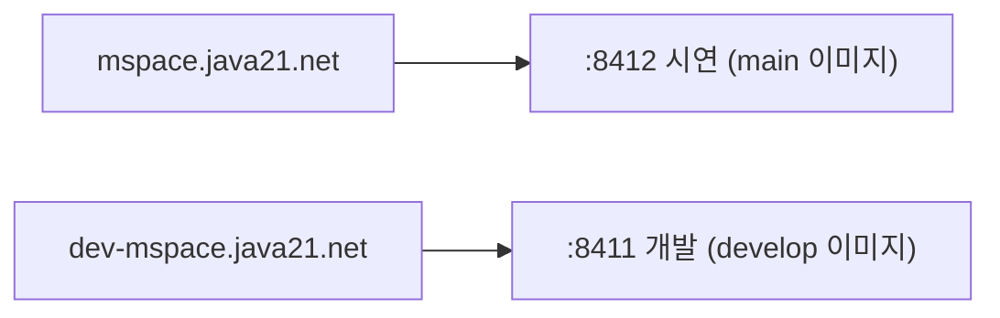
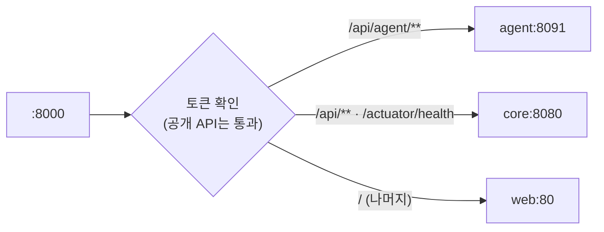
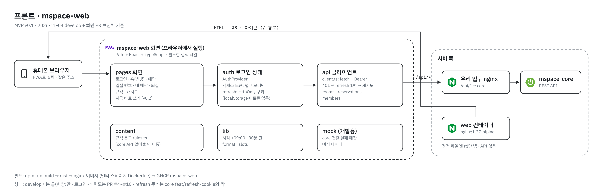
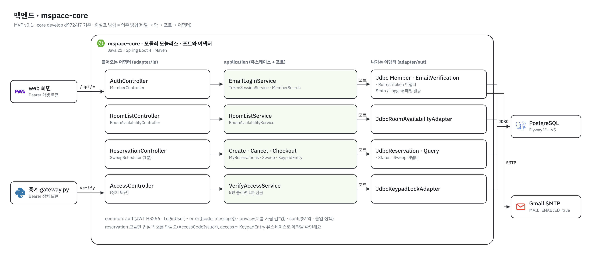
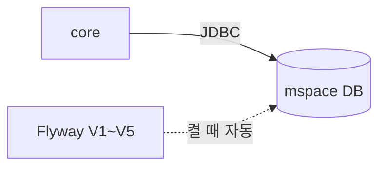
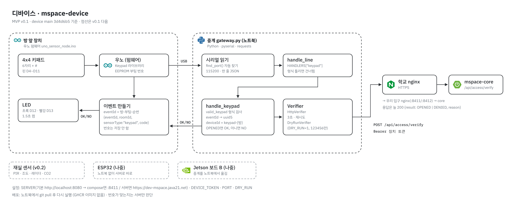
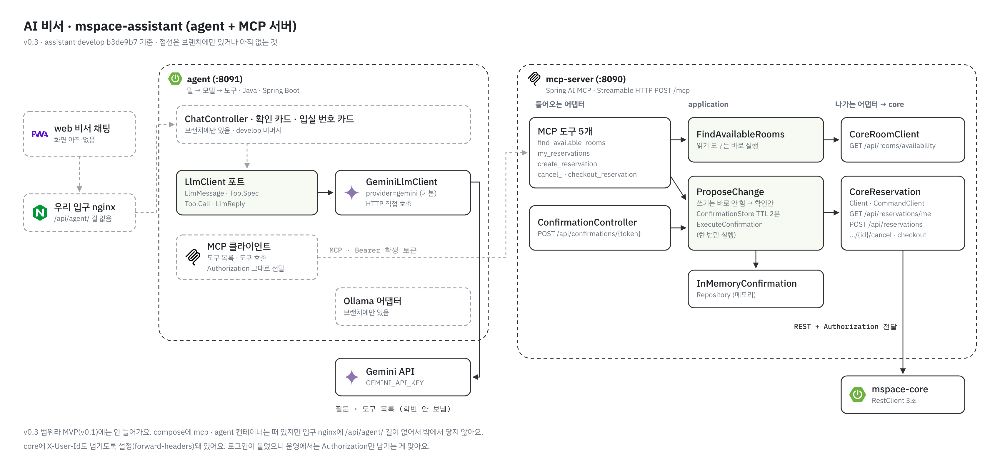

# MVP (v0.1) 서비스별 구조 · API

> 2026-11-04 기준 코드: core `develop` d9724f7 (Flyway V1~V5), device `main` 3d4d6b5, infra `main` 8aec2a8, web `develop` 2ef77db + 화면 PR 사슬(#4~#10), assistant `develop` b3de9b7.
> 요청·응답 본문과 오류 코드 전체는 [API 명세](../api/README.md)에 있어요. 여기서는 **서비스마다 무엇을 열고(제공) 무엇을 부르는지(호출)** 만 봐요.
> 표의 상태: ✅ develop/main에 있음 · 🔶 PR·브랜치에만 있음 · ❌ 코드 없음.

## 0. 한눈에

맨 위 그림이 MVP 전체예요.

| 서비스 | 저장소 | 실행 위치 | 여는 곳 |
|---|---|---|---|
| nginx | (학교 서버, 강사님 관리) | 학교 서버, Docker 밖 (Nginx Proxy Manager) | 443 → 8411·8412 |
| API 게이트웨이 `gateway` | `mspace-gateway` (compose는 `infra`) | compose 컨테이너 | `127.0.0.1:${PORT}:8000` (서버 안에서만 열린 유일한 포트, infra #8 · #9) |
| web | `mspace-web` | compose 컨테이너 (nginx가 정적 파일) | 안쪽 `web:80` |
| core | `mspace-core` | compose 컨테이너 | 안쪽 `core:8080` |
| PostgreSQL | `infra` | compose 컨테이너 | 안쪽 `db:5432`, 밖으로 안 염 |
| 키패드 + 중계 | `mspace-device` | 우노 + 노트북 | 열지 않음 (부르기만) |

서버마다 안쪽 구조는 3장(프론트) · 4장(백엔드) · 6장(디바이스) · 8장(AI 비서, v0.3) 그림에 있어요.

**MVP에서 빠지는 것**: agent · MCP 서버 · 모델(Gemini/Ollama) · 재실 센서 · Jetson. 게이트웨이에 `/api/agent/` 길은 먼저 들어와 있지만, agent 채팅 API가 아직 없어서 v0.1에는 쓰지 않아요. MCP는 내부 전용이라 밖에서 닿지 않아요.

## 1. nginx (학교 서버)

| 받는 주소 | 보내는 곳 | 하는 일 |
|---|---|---|
| `https://mspace.java21.net` | 학교 서버 `:8412` | 시연용. HTTPS를 여기서 풀어요 |
| `https://dev-mspace.java21.net` | 학교 서버 `:8411` | 개발용 |

- **제공 API: 없음.** 길만 넘겨요. 설정은 학교 Nginx Proxy Manager에서 해요.

## 2. API 게이트웨이 (`gateway`)

| 경로 | 보내는 곳 | 토큰 | 상태 |
|---|---|---|---|
| `/api/agent/**` | `agent:8091` | 필요 | 게이트웨이 PR에 있음 (비서 채팅은 v0.3) |
| `/api/**` | `core:8080` | 필요 (공개 API 빼고) | 게이트웨이 PR에 있음 |
| `/actuator/health` | `core:8080` | 필요 없음 | 배포 직후 core가 살아 있는지 확인 |
| `/` (나머지) | `web:80` | 필요 없음 | 화면. 새로고침 시 화면 주소(`/me` 등)는 web 안 nginx가 처리 |

- **제공 API: 없음.** 길을 나누고 토큰을 먼저 확인해요. core도 한 번 더 확인해요.
- 공개 API: `POST /api/auth/email-codes` · `login` · `refresh` · `logout`, `POST /api/access/verify`, `GET /api/rooms` · `/api/rooms/availability`.
- 토큰은 core와 같은 `JWT_SECRET`(HS256, 발급자 `mspace-core`)으로 확인해요.
- `lb://` 이름으로 보내서 인스턴스가 여러 개면 돌아가며 보내요(로드밸런싱).
- 게이트웨이 자기 상태는 안쪽 포트 8001에만 있고 밖에 안 열어요.
- 상태(11-04): [mspace-gateway #1](https://github.com/AI-go-do/mspace-gateway/pull/1) · [infra #9](https://github.com/AI-go-do/infra/pull/9) 머지 대기. 머지 전 서버 입구는 nginx 컨테이너(`/api/` → core, `/` → web)예요.

## 3. web (PWA)

- **제공 API: 없음.** 정적 파일(HTML·JS)만 내요. 같은 주소라 CORS가 필요 없어요.
- 액세스 토큰은 메모리에만 들고, `Authorization: Bearer`로 보내요.
- web 컨테이너는 파일만 내려줘요. API는 브라우저가 게이트웨이의 `/api/`를 거쳐 core에 바로 불러요. core가 web을 부르는 일은 없어요.

| 화면 | 부르는 core API | 화면 상태 |
|---|---|---|
| 홈 (빈방) | `GET /api/rooms/availability` | ✅ develop |
| 로그인 | `POST /api/auth/email-codes` · `/login` · `/refresh` · `/logout` | 🔶 web #4 |
| 예약 | `GET /api/rooms` · `GET /api/rooms/availability` · `GET /api/members` · `POST /api/reservations` | 🔶 web #5 |
| 입실 번호 · 홈 내 예약 | `GET /api/reservations/me` | 🔶 web #6 |
| 내 예약 · 취소 · 퇴실 | `GET /api/reservations/me` · `POST .../{id}/cancel` · `POST .../{id}/checkout` | 🔶 web #7 |
| 이용 규칙 | (core API 없음 → 화면 안 문구 + 브라우저 저장) | 🔶 web #8 |
| 지금 바로 쓰기 (v0.2) | `POST /api/reservations/instant` | 🔶 web #9 |
| 배치도 | `GET /api/rooms` | 🔶 web #10 |

## 4. core (예약 서버)

| 모듈 | 하는 일 | 쓰는 테이블 |
|---|---|---|
| `member` | 학교 메일 인증번호, JWT 발급, refresh 회전, 학번 검색 | `users` · `email_verification` · `refresh_token` |
| `room` | 방 목록, 30분 칸별 빈방 | `rooms` · `reservation` |
| `reservation` | 예약 규칙(30분 칸 · 2시간 · 7일 · 대표자 1건 · 겹침 금지), 내 예약, 취소, 퇴실, 입실 번호 발급 | `reservation` · `reservation_participant` |
| `access` | 키패드 번호 확인, 같은 `eventId` 한 번만 처리, 5번 틀리면 1분 잠금 | `access_event` · `keypad_lock` |

### 4.1 core가 여는 API

인증 칸: **없음** = 토큰 필요 없음, **학생** = `Authorization: Bearer <액세스 토큰>`, **장치** = `Authorization: Bearer <MSPACE_DEVICE_TOKEN>`.

| 메서드 · 주소 | 인증 | 보내는 것 | 받는 것 | 버전 | 상태 |
|---|---|---|---|---|---|
| `POST /api/auth/email-codes` | 없음 | `email` | `204` | v0.1 | ✅ |
| `POST /api/auth/login` | 없음 | `email`, `code`, (처음만) `name`, `studentId` | `accessToken`, `expiresAt`, `memberId`, `newMember`, `refreshToken` | v0.1 | ✅ |
| `POST /api/auth/refresh` | 없음 | `refreshToken` | 로그인과 같은 모양 (새 refresh) | v0.1 | ✅ |
| `POST /api/auth/logout` | 없음 | `refreshToken` | `204` | v0.1 | ✅ |
| `GET /api/rooms` | 없음 | — | `[{id, name, minPeople, maxPeople}]` | v0.1 | ✅ |
| `GET /api/rooms/availability?date=` | 없음 | `date` (오늘~7일) | 방별 30분 칸 `available` | v0.1 | ✅ |
| `GET /api/members?studentId=` | 학생 | `studentId` | `{studentId, name(가림)}` | v0.1 | ✅ |
| `POST /api/reservations` | 학생 | `roomId`, `startAt`, `endAt`, `participantStudentIds`, (선택) `Idempotency-Key` 헤더 | `201` `{id, status, headcount, accessCode}` | v0.1 | ✅ |
| `GET /api/reservations/me` | 학생 | — | 내 예약 목록 (`accessCode`는 대표자 · 진행 중만) | v0.1 | ✅ |
| `POST /api/reservations/{id}/cancel` | 학생 | — | `{id, status: CANCELED}` | v0.1 | ✅ |
| `POST /api/reservations/{id}/checkout` | 학생 | — | `{id, status: CHECKED_OUT}` | v0.1 | ✅ |
| `POST /api/access/verify` | 장치 | `eventId`, `roomId`, `deviceId`, `code` | 늘 `200` `{result: OPENED}` 또는 `{result: DENIED, reason}` | v0.1 | ✅ |
| `GET /actuator/health` | 없음 | — | `{status: UP}` | 인프라 | ✅ |
| `POST /api/reservations/instant` | 학생 | `roomId`, `endAt`, `participantStudentIds` | `POST /api/reservations`와 같음 | v0.2 | ✅ (먼저 들어옴) |
| `GET /api/auth/check` | 학생 | — | `204` / `401` | v0.3 비서용 | ✅ |
| `GET /api/rules` | 없음 | — | 예약 규칙 숫자·이용 수칙·한 줄 안내 ([API 명세 6-1](../api/README.md)) | v0.1 요구사항 | 🔶 core 브랜치 `feat/web-003-rules`, PR 대기 |

- 오류는 모두 `{"code", "message"}` 모양이에요. 코드 목록은 [API 명세](../api/README.md) 2~6장.
- 시각은 서울 시간 `+09:00`. 오프셋 없이 보내면 `400`.
- 노쇼 · 자동 퇴실은 요구사항상 v0.2인데, 코드(1분마다 도는 정리 스케줄러, `MSPACE_SWEEP_ENABLED` 기본 `true`)는 이미 develop에 있어요.

### 4.2 core가 부르는 것

| 대상 | 방법 | 설정 (값은 `.env`에만) |
|---|---|---|
| PostgreSQL | JDBC, 켤 때 Flyway V1~V5 | `DB_URL`, `DB_USERNAME`, `DB_PASSWORD` |
| Gmail SMTP | 인증번호 메일. `false`면 번호를 로그에만 찍음 | `MAIL_ENABLED`, `MAIL_USERNAME`, `MAIL_PASSWORD` |
| (토큰 서명) | JWT HS256 서명. 비면 켤 때마다 임시값 | `JWT_SECRET` |
| (장치 토큰) | 비면 `/api/access/verify`를 전부 `401` | `MSPACE_DEVICE_TOKEN` |

## 5. PostgreSQL

| Flyway | 만든 테이블 | v0.1에서 씀 |
|---|---|---|
| V1 | `users`, `rooms`, `reservation`, `reservation_participant` | ✅ |
| V1 | `room_adjacency`, `reservation_photo`, `report`, `notification_log` | 아직 안 씀 (v0.2~v0.3용 자리) |
| V2 | `reservation`에 멱등 키 추가 | ✅ |
| V3 | `access_event`, `keypad_lock` | ✅ |
| V4 | `email_verification` | ✅ |
| V5 | `refresh_token` | ✅ |

- **제공 API: 없음.** core만 닿아요. 겹침 금지는 DB의 `EXCLUDE` 제약이 마지막으로 막아요.
- 데이터는 `db-data` 볼륨에 남아요. 컨테이너를 다시 만들어도 지워지지 않아요.

## 6. 키패드 + 중계 (`mspace-device`)

| 구간 | 형식 | 상태 |
|---|---|---|
| 우노 → 중계 | USB 시리얼 115200, JSON 한 줄. `eventId`는 `방-부팅번호-순번` | ✅ |
| 중계 → core | `POST {SERVER}/api/access/verify`. `eventId`는 uuid5로 바꿔 보냄(재전송해도 같은 값), `deviceId`=`keypad-{방}` | ✅ |
| 중계 → 우노 | `OK` (열림) / `NO` (거절 · 서버 응답 없음) | ✅ |

- **제공 API: 없음.** 번호는 서버만 판단해요. 장치는 번호를 저장하지 않아요.
- 중계 설정: `SERVER`, `DEVICE_TOKEN`, `PORT`(시리얼, 비면 자동 찾기), `DRY_RUN=1`(서버 없이 `123456`만 통과).
- 배포는 노트북에서 `git pull` 후 다시 실행이에요. 이미지(GHCR)를 만들지 않아요.

## 7. MVP 마감 전에 맞춰야 할 곳 (11-04 점검)

| 무엇 | 지금 | 할 일 | 저장소 |
|---|---|---|---|
| compose → core 환경값 | ✅ infra #6 · #7 머지로 `MSPACE_DEVICE_TOKEN` · `JWT_SECRET` · `MAIL_*`를 core에 넘김. 장치 토큰이 비면 compose가 안 켜짐 | 서버 `.env.dev` · `.env.prod`에 값 넣기 | infra |
| 입구 포트 뒷문 | 🔶 infra #8: `0.0.0.0` → `127.0.0.1`로 묶고 설정 폴더 연결 | CodeRabbit 리뷰 후 머지 | infra |
| nginx 설정 반영 | 🔶 core #49 · web #11 · assistant #48: 배포 때 `nginx -s reload` | infra #8 다음에 머지 | core · web · assistant |
| 인증 메일 | `MAIL_ENABLED` 기본 `false` (번호를 로그에만 찍음) | 서버 `.env`에 `MAIL_ENABLED=true`, Gmail 앱 비밀번호. 학교 서버에서 `nc -vz smtp.gmail.com 587` 확인 | infra |
| 중계 `SERVER` 기본값 | `http://localhost:8080` (core를 맥에서 따로 켤 때만 맞음). compose는 core 포트를 밖으로 안 열어요 | 서버 쓸 때 `SERVER=https://dev-mspace.java21.net`, 맥 compose면 `http://localhost:8411` | device |
| 화면 | 로그인~배치도가 web PR #4~#10에 있음 | 순서대로 머지 | web |
| refresh 토큰 쿠키 | core #48 · web #4가 짝. 둘 다 미머지 | core 먼저, 그다음 web #4 | core · web |
| 키패드 잠금 횟수 | 틀린 횟수가 줄지 않음 | 시연 전 `UPDATE keypad_lock SET failed_count=0, locked_until=NULL;` | core |
| `GET /api/rules` | 🔶 core 브랜치 `feat/web-003-rules`에 구현(11/4), PR 대기 | core 머지 뒤 화면 문구를 이 API로 바꾸기. 그 전까지는 화면 자체 문구 | core · web |
| 학교 서버 배포 | 강사님 안내 대기 (`DEPLOY_ENABLED` 꺼짐) | 그 전까지 맥 compose로 시험 | infra |

## 8. (참고, v0.3) AI 비서 · `mspace-assistant`

MVP에는 안 들어가지만, 서버별 구조를 한 번에 보려고 같이 그렸어요. 기준은 assistant `develop` b3de9b7이고, 점선은 브랜치에만 있거나 아직 없는 것이에요.

| 서비스 | 여는 것 | 부르는 것 | 상태 |
|---|---|---|---|
| agent `:8091` | 비서 채팅 API, 확인 `POST /api/agent/confirmations/{token}` (MCP 서버 확인 API로 그대로 넘김) | `LlmClient` → Gemini API, MCP 서버 `POST /mcp` | 🔶 채팅 · 확인 API는 브랜치(#33) · 🔶 Ollama 어댑터 브랜치(#34) · ✅ Gemini 어댑터 |
| mcp-server `:8090` | MCP 도구 5개 (`find_available_rooms`, `my_reservations`, `create_reservation`, `cancel_reservation`, `checkout_reservation`), `POST /api/confirmations/{token}` | core `GET /api/rooms/availability`, `GET /api/reservations/me`, `POST /api/reservations`, `POST /api/reservations/{id}/cancel`·`checkout` | ✅ |

- 쓰기 도구는 바로 실행하지 않고 확인안(2분 유효)을 만든 뒤, 확인 API로 한 번만 실행해요.
- mcp-server는 받은 `Authorization`을 core에 그대로 넘겨요. 설정에 `X-User-Id`도 넘기게 남아 있어서, 운영에서는 `Authorization`만 남기는 게 맞아요.
