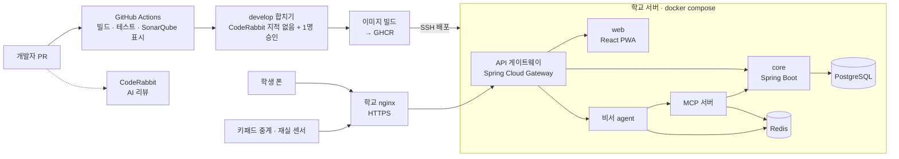
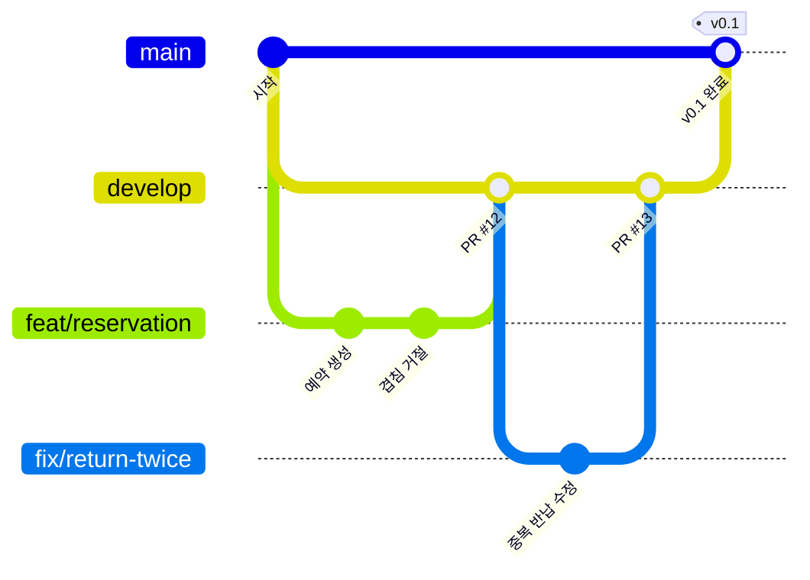

# 인프라 · CI/CD

> 담당: 재웅 · 최종 수정 2026-11-06 (지금 compose·워크플로에 맞춤) · ✅ 확정

## 1. 한눈에

## 2. 기술 스택

| 영역 | 선택 | 상태 |
|---|---|---|
| 프론트 | React · Vite · TypeScript · Tailwind · PWA | ✅ |
| 백엔드 | Java 21 (LTS) · Spring Boot 4 · Maven (3.5는 2026-06-30 무료 지원 종료라 4로) | ✅ |
| DB | PostgreSQL · Flyway | ✅ |
| Jetson | Python | ✅ |
| AI 비서 (`mspace-assistant`) | Java 21 · Spring Boot 4 · Maven (core와 같은 스택, 11/2 결정) | ✅ |
| 개발 도구 | IntelliJ IDEA (학생 라이선스 Ultimate 무료) · `.editorconfig` | ✅ |
| CI | GitHub Actions · Testcontainers · SonarQube(학교 Community 서버) · CodeRabbit | ✅ |
| 컨테이너 | Docker · docker compose | ✅ |
| 이미지 저장소 | GHCR (GitHub Container Registry) | ✅ |
| 입구 | 학교 nginx(HTTPS) 뒤에 **API 게이트웨이**(`mspace-gateway`, Spring Cloud Gateway) 한 겹. 11-04 우리 nginx 컨테이너에서 바꿈 | ✅ |
| 비서 저장소 | Redis 7 (대화 맥락 24시간, 시간표 AOF 보관, 비밀번호) | ✅ |
| 배포 서버 | 학교 실습 서버 (사비 0원 원칙. HTTPS가 안 되면 Cloudflare Tunnel 무료로 보완) | ✅ |

## 3. 브랜치 전략 — 간소화 Git Flow ✅

| 브랜치 | 역할 | 배포 |
|---|---|---|
| `main` | 확인이 끝난 버전만. 시연·발표용 | 시연 서버 |
| `develop` | 매일 기능을 합치는 곳 | 개발 서버 (자동) |
| `feat/…` `fix/…` `docs/…` `chore/…` `refactor/…` | `develop`에서 따서 1~2일 안에 합치는 작업 브랜치 | — |

**왜 이 방식인가**
- `main`을 시연용으로 지켜 둔다. 11/13 기능 동결 후 11/14~19 발표 준비 동안 `main`은 고정하고, 실수로 망가져도 시연은 안전하다.
- 정식 Git Flow의 `release`·`hotfix` 브랜치는 뺐다. 버전이 2~5일마다 나와서 따로 다듬는 기간이 거의 없고, 양쪽으로 합치는 단계만 늘어난다. 버전 기록은 **태그 + GitHub Release**로 남긴다.
- 브랜치가 3종류뿐이라 4명이 바로 따라 할 수 있다.

**흐름**
1. 평소: `develop` → `feat/…` 작업 → 15시까지 PR → 합치기 → 개발 서버 자동 배포
2. 버전 완료(v0.1, v0.2, v0.3): `develop` → `main` PR → `v0.x` 태그 + GitHub Release(바뀐 점) → 시연 서버 배포 → 버전 지도 갱신
3. 11/13 동결 후: `main` 고정. 고칠 것은 `develop`에서 고치고 확인된 것만 `main`으로

| 규칙 | 내용 |
|---|---|
| 보호 | `main`, `develop` **직접 push 금지** (브랜치 보호 설정) |
| 커밋 메시지 | `feat: 예약 생성 API 추가` (Conventional Commits: feat, fix, docs, chore, refactor, test) |
| PR | 제목은 커밋 형식, 본문에 요구사항 ID(`FR-RSV-001`)와 이슈(`Closes #5`) |
| develop에 합칠 때 | **빌드·테스트 통과 + 마지막 커밋의 CodeRabbit 리뷰 끝, 해결 안 된 지적 없음 + 팀원 1명 승인** · Squash merge 후 브랜치 삭제 · SonarQube 결과는 표시만 |
| main에 합칠 때 | develop → main 릴리스 PR. CodeRabbit이 건너뛰므로 **CI만** 봄: 빌드·테스트 + **SonarQube 팀 게이트**(새 코드 커버리지 80% 이상 · 중복 3% 이하 · 새 버그·취약점 0) · Merge commit |
| SonarQube 팀 게이트 | 학교 공용 계정은 서버 게이트를 바꿀 권한이 없어, 워크플로가 방금 올린 분석 값을 API로 읽어 판정(`.github/scripts/sonar-team-gate.sh`, assistant #88 머지 · core #78 PR 대기). 막는 것: 새 코드 커버리지 80% 미만, 중복 3% 초과, 새 버그·취약점(신뢰성·보안 등급 A 아님). 막지 않는 것: 새 이슈(코드 스멜)·핫스팟 검토는 대시보드에만. 분석 실패·5분 초과·토큰 없음·커버리지 값 누락은 실패 |
| 커버리지 공유 | 매일 스크럼에서 develop 커버리지 숫자 공유 |
| CodeRabbit | AI 리뷰. `develop` 머지 조건(지적이 남아 있으면 합치지 않음). 사람 리뷰를 대신하지 않음. main 릴리스 PR은 리뷰하지 않음 |

커밋·PR 양식, 코드·API·DB 이름 규칙은 [팀 컨벤션](../conventions.md)에 있다.

## 3-1. 저장소 나누기

| 저장소 | 담는 것 |
|---|---|
| `mspace-core`, `mspace-web`, `mspace-assistant`, `mspace-gateway` | 자기 `Dockerfile`, PR 빌드·테스트 · 이미지 올리기(amd64 · arm64) · 서버 배포 Actions |
| `infra` | 서버용 compose(게이트웨이 · web · core · mcp · agent · Redis · DB, 개발/시연 같은 파일), `.env.example`, DB 백업·복구 스크립트, 배포 README |

## 4. 배포 흐름

| 언제 | 무엇이 | 결과 |
|---|---|---|
| PR 올릴 때 | 빌드 · 테스트 · 품질 검사 | 실패하면 합치기 불가 |
| develop 합칠 때 | 이미지 빌드 → GHCR → **개발 서버**에서 `docker compose pull && up -d` (`DEPLOY_ENABLED=true`, 11-05부터 자동) | 수 분 안에 `https://dev-mspace.java21.net`에 반영 |
| main 합칠 때 (버전 완료) | 같은 이미지를 **시연 서버**에 배포 + 태그·Release | `https://mspace.java21.net`에 반영 |
| 배포 직후 | `/actuator/health` 확인 | 실패하면 Actions가 빨간불 |

## 5. 환경

| 환경 | 어디서 | 용도 |
|---|---|---|
| 로컬 | 각자 노트북, `docker compose up` | 개발 |
| 개발 서버 | 학교 실습 서버 (재웅 계정), `develop` | 매일 확인 |
| 시연 서버 | 학교 실습 서버 (재웅 계정), `main` | 버전 확인·발표 |
| 현장 | Jetson 보드 B (보드 A 사용 금지) | 센서 · 키패드 · Ollama |

**학교 서버 포트 배정 (배포용, 재웅 범위 8410~8419)**

| 포트 | 용도 |
|---|---|
| 8413 | 개발 서버 입구 (`develop`, `dev-mspace.java21.net`, compose 프로젝트 `mspace-dev`, `.env.dev`) |
| 8414 | 시연 서버 입구 (`main`, `mspace.java21.net`, compose 프로젝트 `mspace-prod`, `.env.prod`) |

- 8410·8411은 다른 프로젝트(블로그)가 쓰고 있어 11-05에 8413·8414로 옮겼다.
- 학교 nginx(도메인 → 우리 포트)의 업로드 한도는 **1MB**다. 사진은 앱이 900KB 아래 JPEG로 줄여 보내서 nginx 설정을 바꾸지 않는다(web #26). 더 큰 파일이 필요하면 강사님께 한도를 부탁한다.
- 밖으로 여는 포트는 **게이트웨이 하나**다. web·core·mcp·agent·Redis·DB는 compose 내부 네트워크로만 연결하고 포트를 열지 않는다.
- 게이트웨이도 `0.0.0.0`으로 열지 않는다(Docker 포트는 ufw를 건너뛴다). 학교 서버는 `BIND_ADDR=10.116.64.12`, 맥은 기본 `127.0.0.1`.

다른 팀원은 각자 포트 범위에서 개인 테스트 환경을 띄운다. 접속 정보(계정·비밀번호)는 공개 저장소에 올리지 않고 팀 안에서만 공유한다.

## 6. 비밀값 · 비용

- 비밀번호·키는 **저장소에 절대 올리지 않는다.** GitHub Actions Secrets에만 두고, 배포 때 서버의 `.env`로 전달.
- `.env`는 `.gitignore`에 넣고, 저장소에는 `.env.example`(값 없이 항목만)만 둔다.
- 서버 `.env`에 들어가는 값: `JWT_SECRET`(core·게이트웨이 같은 값), DB 비밀번호, `REDIS_PASSWORD`, `MSPACE_DEVICE_TOKEN`, `MAIL_*`, `GEMINI_API_KEY`. 환경(개발/시연)마다 다른 값을 쓴다.
- **사비 0원 원칙.** 유료 클라우드(AWS 등)는 쓰지 않는다. 학교 서버가 안 되는 부분은 무료 대안(Cloudflare Tunnel, Oracle Cloud 무료 등급)으로 메운다.

## 7. 운영 기본

| 항목 | 방법 |
|---|---|
| 설정 분리 | Spring 프로필 `local` / `dev` / `prod`. 값은 `.env`에서 |
| 되돌리기 | 이미지 태그를 이전 버전(`v0.1`)으로 바꾸고 `docker compose up -d` |
| DB 백업 | `scripts/backup.sh`를 cron으로 매일 실행, `backups/dev/`·`backups/prod/`에 7일 보관. 복구는 `scripts/restore.sh` |
| 시연 대비 | 학교 서버·와이파이가 죽어도 되게 노트북에서 `docker compose`로 전체 띄우기 연습 + 시연 영상 녹화 |

## 8. 결정 대기

| 항목 | 추천 | 확인할 것 |
|---|---|---|
| 학교 서버 조건 | 학교 서버로 확정 (자원은 강사님이 지원). HTTPS(학교 nginx)·Actions SSH 배포는 11-05에 됨 | 발표(11/19)까지 사용 가능한지 |

## 9. 용어 한 줄 설명

| 용어 | 뜻 |
|---|---|
| CI | PR마다 자동으로 빌드·테스트 |
| CD | 합치면 자동으로 서버에 배포 |
| 커버리지 | 테스트가 실행해 본 코드의 비율 |
| 품질 게이트 | SonarQube의 합격선. 우리는 새 코드 커버리지 80% · 중복 3% · 새 버그·취약점 0 |
| Docker 이미지 | 앱과 실행 환경을 통째로 담은 "상자" |
| GHCR | GitHub의 이미지 "창고". Actions가 올리고 서버가 받아 간다 |
| docker compose | 상자 여러 개를 한 번에 띄우는 설정 파일 |
| API 게이트웨이 | 요청을 주소에 따라 web, core, 비서로 나눠 주고 로그인 토큰을 먼저 확인하는 정문 (우리는 Spring Cloud Gateway) |
| Flyway | DB 변경을 버전 파일로 순서대로 적용하는 도구 |

> GHCR을 쓰는 이유: 빌드를 GitHub이 해서 공용 학교 서버가 느려지지 않고, 버전마다 이미지가 남아 있어 문제가 생기면 바로 이전 버전으로 되돌릴 수 있다.
