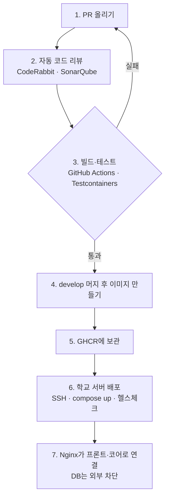

# M-SPACE 3차 팀 회의 정리

Nov 2, 2026 · @나영준

> **📢 오늘의 TMI:** 미국 중간선거가 현지 시간 11월 3일(화), 한국 시간으로는 내일입니다. 개표 결과가 나오는 4일(수) 오전에는 미국 증시가 크게 출렁일 수 있어요. 주식 하시는 분들은 변동성에 유의하세요. 회의 문서는 변동 없이 아래부터 시작합니다 🙂

## 한눈에

11/2 아침 스크럼(3차 회의)에서 네 명이 각자 발표하고, 재웅님이 배포 파이프라인을 설명했다.

- **예약 규칙:** 자정을 넘는 예약은 허용한다. 시작 시각만 7일 안이면 된다. 즉시 시작은 누른 시각부터 다음 30분 칸 + 2시간까지 (예: 14:17 → 16:30)
- **구조:** 레포 4개(백 코어, 프론트 웹, IoT, MCP 비서). 휴대폰에서는 PWA(웹을 앱처럼 홈 화면에 추가)로 쓴다
- **배포:** AWS 대신 학교 서버 + Docker Compose. 이미지는 GHCR 창고에 두고, 개발 서버와 실제 서버를 나눈다. 재웅님이 오늘 CI/CD를 만든다
- **키패드:** 예약하면 6자리 번호 → 키패드 입력 → 코어 서버가 확인 → 문 열림(지금은 LED). ESP32는 단자가 없어 부품이 올 때까지 우노 + 노트북으로 한다
- **설문:** 응답 7명 → 12명. 다음 주 월요일(11/9)까지 받고 바로 추첨
- **팀 이름:** AI-go-do
- **시범운영:** 학교에 여러 번 연락했지만 답이 없어, 시범운영은 기대하지 않고 키패드 중심으로 간다. 학교 서버 사용은 허락이 먼저다

## 정해진 것

| 항목 | 결정 | 비고 |
| --- | --- | --- |
| 자정을 넘는 예약 | 허용 | 시작 시각은 7일 안이어야 함. 2차 문서의 결정 대기 항목 종료 |
| 즉시 시작 시간 (지영) | 누른 시각부터 다음 30분 칸 + 2시간 | 14:17에 누르면 16:30까지. 14:00부터 잡으면 사용자가 17분 손해, 16:17에 끝내면 16:30까지 방이 빈다 |
| 팀 이름 | AI-go-do | 11/2 확정. GitHub 조직 이름과 같다 (NoKey에서 변경) |
| 설문 마감 | 11/9(월)까지, 그 뒤 바로 추첨 | 응답 7명 → 12명. 영준이 텔레그램에 공지 |
| 레포 구성 | 백(코어), 프론트(웹), IoT, MCP(비서) 4개 | 레포를 만들 때는 팀에 알리고, 이름은 각자 정해 공유 |
| 휴대폰 화면 | PWA | 앱스토어 등록비 없이 웹사이트를 홈 화면에 앱처럼 추가 |
| 배포 서버 | 학교 서버 + Docker Compose | AWS·쿠버네티스는 우리 규모에 너무 크고 비용이 든다 |
| 서버 두 개 | develop → 개발 서버, main → 실제 서버 | 실제 사용자는 실제 서버만 본다 |
| 키패드 흐름 | 6자리 번호 → 코어 확인 → 문 열림(지금은 LED) | 같은 입력이 두 번 와도 eventId로 한 번만 처리. 입력 장치는 나중에 도어락 등으로 교체 가능 |
| 환기(CO2) 센서 | 농도 이벤트 인터페이스 → 지금은 LED·알림으로 출력 | 나중에 출력만 갈아 끼우면 돼서 확장성 발표에 좋다 (재웅 제안) |
| 비밀값 | .env로 두고 .gitignore에 추가, 재웅이 등록 | DB 주소·비밀번호를 GitHub에 올리지 않는다 |
| DB 보안 | 지영이 공부해서 팀에 공유 | 코어 담당이라서 |
| 팀 공통 문서 | 재웅이 정리한 문서를 각자 읽고 이의를 말한다. TEAM.md는 영준이 재웅 문서와 회의 녹음을 참고해 만들고 전원 확인 후 쓴다 |  |
| 데모 초기화 버튼 | 삭제 작업 필요 없음 | 새로 만드는 구조라 v1 코드를 고칠 일이 없다 |

## 사람별 발표 요약

| 사람 | 한 것 | 오늘 할 것 |
| --- | --- | --- |
| 지영 | 예약 규칙 문서 정리, 요구사항 올림, 즉시 시작 규칙과 자투리 시간 처리 결정 | 예약 설계(테이블 설계로 추정), 설문 결과 정리, 수연과 키패드·서버 연결. 화면 공통 틀은 같이 할지 정해야 함 |
| 수연 | 7단계 계획(7단계까지는 어려울 수 있음), 부품 주문(사비), PWA 선택. ESP32는 단자가 없어 못 쓰는 것을 확인 | 키패드 회로 설계와 코드, 키패드를 누르면 LED가 바뀌는 것까지. 부품이 오기 전에는 우노 + 노트북(USB), 오면 와이파이로 |
| 재웅 | 팀 문서 정리, 배포 파이프라인 설계. 계획은 최소 기능부터 0.1 → 0.2 → 0.3으로 붙이기 | CI/CD 구축. 코어 로드맵: 기본 기능, DB 설계, 키패드, 자동 배포, 스케줄러(자동 반납·노쇼·연장·메일 알림), 현황, 환기 센서 |
| 영준 | 2차 회의 문서, 역할 재정리, 설문 개편과 추첨 이벤트, mspace-assistant 레포와 일정 | M1 이슈 #1–#3, 3차 회의 문서 공유, TEAM.md 초안, 설문 마감 공지, 시간이 되면 회로도 돕기 |

**사용 흐름 (재웅 정리):** 로그인 → 빈방 확인 → 참여자와 함께 예약 → 확정되면 6자리 번호 받기 → 키패드 입력 → 공부 → 퇴실

## 배포 파이프라인

재웅님이 설명한 흐름이다. 커밋·푸시만 하면 테스트부터 배포까지 자동으로 돈다.

| 용어 | 한 줄 설명 |
| --- | --- |
| CI / CD | CI는 합치기 전에 자동으로 빌드·테스트, CD는 통과한 코드를 자동으로 배포 |
| GitHub Actions | PR·머지 때 GitHub가 잠깐 빌려주는 컴퓨터에서 정해 둔 작업(.yml)을 돌린다 |
| Gradle | 자바 코드를 컴파일하고 테스트하고 실행 파일(jar)로 묶는 도구 |
| Docker 이미지 | 코드 + 자바 버전 + 실행 방법을 한데 묶은 복사본. Dockerfile이 만드는 법 |
| GHCR | GitHub의 이미지 창고. 학교 서버가 여기서 이미지를 받는다 |
| Docker Compose | 서버 한 대에서 여러 컨테이너(프론트, 코어, DB)를 한 번에 띄우는 도구 |
| Nginx proxy\_pass | 밖에서 온 요청을 주소에 따라 안쪽 포트(프론트, 코어)로 넘긴다 |
| 헬스체크 | 배포 뒤 서버가 제대로 떴는지 주소를 불러 확인 |

## 회의에서 나온 질문과 답

회의 중에 나온 질문을 Claude가 답으로 정리했다. 회의에서 나온 추측과 다른 부분은 **바로잡음**으로 표시했다.

**Q1. `actions/checkout@v4`의 v4는 우리 코드 버전인가?**

- 아니다. 코드를 받아 오는 **도구(checkout 액션)의 버전**이다. 우리 코드는 매번 그 PR·커밋의 최신 내용을 받는다
- 도구 버전을 고정해 두는 이유는 도구가 업데이트돼도 우리 파이프라인이 갑자기 깨지지 않게 하려는 것이다. 새 버전(v5 등)이 나오면 우리가 골라서 올린다. 평소에는 바꿀 일이 거의 없다
- `setup-java`의 21도 같은 뜻이다. 빌드에 쓸 자바 버전을 고정한 것

**Q2. GHCR은 왜 쓰나?**

- GitHub Actions가 빌려준 컴퓨터는 작업이 끝나면 사라진다. 그래서 만든 이미지를 다른 곳에 보관해야 학교 서버가 받아 갈 수 있다
- 장점: 학교 서버가 직접 빌드하지 않아 무거워지지 않는다. 이미지에 버전 태그를 붙여 두면 문제가 생겨도 이전 이미지로 바로 되돌릴 수 있다. 퍼블릭 레포는 무료다 (프라이빗은 용량 제한 확인 필요)
- DB는 GHCR에 넣지 않는다. Docker Hub의 공식 PostgreSQL 이미지를 쓰고, 데이터는 서버의 볼륨(저장 공간)에 남는다

**Q3. 개발 서버를 따로 두면 로컬과 뭐가 다른가?**

- 팀원 모두 pull 없이 같은 주소에서 최신 develop을 본다 (수연님이 찾은 장점)
- 휴대폰으로 PWA·키패드를 실제 주소에서 테스트할 수 있다. 노트북 로컬 서버는 휴대폰에서 접속하기 어렵다
- 배포 문제를 발표 직전이 아니라 개발 중에 미리 만난다. 개발 기간이 짧아 이게 가장 크다

**Q4. 테스트에 H2 대신 진짜 PostgreSQL을 쓰는 이유는?**

- H2는 설치 없이 메모리에 잠깐 뜨는 가벼운 DB다. 빠르지만 예약 겹침을 막는 `EXCLUDE` 제약과 `btree_gist`가 없어서, 우리가 가장 중요하게 테스트해야 할 동시 예약을 검사할 수 없다
- Testcontainers는 테스트하는 동안만 Docker로 진짜 PostgreSQL을 띄웠다가 끄는 자바 라이브러리다. `@Container`로 컨테이너를 정의하고 `@ServiceConnection`을 붙이면 접속 정보가 자동으로 연결된다
- **바로잡음:** H2는 기본값이 아니지만, yml을 꼭 써야 하는 것도 아니다. Spring Boot는 H2가 의존성에 있고 DB 주소가 설정돼 있지 않으면 자동으로 H2를 쓴다. 그래서 의존성에 H2를 넣지 않는 것도 하나의 안전장치다 (Spring Boot 4의 테스트 기본 동작은 확인 필요)

**Q5. Flyway는 무엇인가?**

- DB 구조의 버전 관리 도구다. `V1__테이블생성.sql`, `V2__컬럼추가.sql`처럼 번호 붙은 SQL 파일을 순서대로 적용하고, 어디까지 적용했는지 DB에 기록한다. 팀원 모두의 DB 구조가 똑같이 맞춰진다
- **바로잡음:** "V2가 터지면 V1로 되돌린다"는 아니다. 무료판은 되돌리기(undo)가 없고, 잘못된 V2를 고치는 V3를 새로 만든다(앞으로만 간다). 그래서 이미 배포한 V 파일은 절대 고치지 않는다

**Q6. DB는 밖에서 어떻게 막나?** (지영님이 공부해서 더 정리할 부분)

- DB 컨테이너는 Docker 내부 네트워크에만 두고 서버 밖으로 포트를 열지 않는다. 코어 서버만 접속한다
- 개발 중 DB를 보고 싶으면 SSH 터널로 들어간다. 같은 목적의 IP 제한(방화벽)도 함께 쓸 수 있다
- 앱 전용 DB 계정에는 필요한 권한만 주고, 비밀번호는 .env와 GitHub Secrets에만 둔다
- **바로잡음:** 브라우저에서 화면 코드를 볼 수 있어도 DB에 직접 닿지는 못한다. 위험한 것은 API 입력으로 SQL을 끼워 넣는 SQL 인젝션이고, JPA의 파라미터 바인딩을 쓰면 막힌다. 화면에 스크립트를 심는 XSS·CSRF는 따로 막는다(쿠키 SameSite 설정, Spring Security). 회의에서 나온 "샘라이트X"는 SameSite로 추정
- **바로잡음:** Spring Cloud Gateway가 있다고 저절로 안전해지지는 않는다. 게이트웨이는 요청을 나눠 보내는 입구고, 인증 검사·요청 횟수 제한을 설정해야 보안이 된다

**Q7. Docker Compose는 쿠버네티스의 미니 버전인가?**

- **바로잡음:** 아니다. Compose는 서버 한 대에서 여러 컨테이너를 묶어 띄우는 도구고, 쿠버네티스는 여러 서버에 나눠 띄우고 죽으면 다시 살리는 도구다. 작은 쿠버네티스는 k3s 같은 것이다. 서버 한 대인 우리에게는 Compose가 맞다

**Q8. Nginx `proxy_pass`는 무엇인가?**

- 밖에서 들어온 요청을 주소에 따라 안쪽 포트로 넘기는 설정이다. 예: `/api`는 코어 포트로, 나머지는 프론트 포트로
- 로드 밸런싱은 같은 서버를 여러 개 띄웠을 때(`upstream`) 나눠 보내는 것이고, 지금 우리는 나눠 보낼 서버가 하나씩이다

## Claude 의견

**1. 시범운영은 기다리지 말고 키패드 중심으로 간다**

- 학교에 여러 번 연락했는데 답이 없다(영준). 답을 기다리며 키 지급 방식에 맞춰 만들면 11/20 발표 전에 시간만 쓴다. 키패드(키 없는 입실)를 기본으로 만든다
- 시범운영은 "학교가 원하면 할 수 있는 선택지"로 남긴다. 예약 코어가 키 지급 방식도 설정값으로 켜고 끌 수 있게 두면, 나중에 답이 와도 다시 만들 필요가 없다 (지영 확인 필요)
- 11/20 발표 초대는 그대로 보낸다. 다만 메일의 "시범운영은 처음 제안대로 유지" 문장은 빼고, "학생들이 만든 예약·키 없는 입실 시연"으로 바꾼다. 답이 없던 제안에 다시 묶이지 않기 위해서다
- TEAM.md의 "두 단계" 구분은 "기본: 키패드 / 선택: 학교 시범운영"으로 고친다. AI 비서는 여전히 가짜 데이터로만 시연한다

**2. 학교 서버는 허락이 먼저다**

- 팀 프로젝트용으로 학교 서버를 쓰는 것은 시범운영 검토와 별개로 허락이 필요하다 (정보전산원 또는 학과, 확인 필요). 회의에서도 "학교 서버를 가져올 수 있나?"가 답 없이 남았다
- 안 되면 대안: 팀원 노트북 한 대를 개발 서버로 쓰고 터널(예: Cloudflare Tunnel)으로 주소를 연다. 비용은 없지만 그 노트북이 꺼지면 서버도 꺼진다
- AWS를 안 쓰면 TEAM.md의 "AWS 배포·비밀값(OIDC), 예산 알림"을 고쳐야 한다

**3. 프론트 레포가 따로 생기면서 담당이 비었다**

- 2차 회의에서는 "프론트 담당 없이 각자 기능의 화면까지"로 정했다. 그런데 웹 레포가 따로 생기면 누가 그 레포를 관리하고 PR을 합치는지 정해야 한다
- 추천: 화면 공통 틀은 하루 같이 잡고, 웹 레포 관리(리뷰·머지)는 주 단위로 돌아가며 맡는다. 화면 코드는 각자 자기 기능 부분만 올린다

**4. 즉시 시작 규칙에서 정해야 할 것**

- 14:17 → 16:30은 2시간 13분이라 "1회 최대 2시간"을 넘는다. 즉시 시작에만 있는 예외로 규칙 문서에 적어 두자
- 다음 예약이 16:00에 있으면 16:00까지만 된다. 시간 겹침 DB 제약이 막아 주지만, 사용자에게는 "16:00까지 가능"을 미리 보여주자

**5. 6자리 번호는 막 누르기에 약하다**

- 6자리는 100만 가지라 계속 눌러 보면 맞출 수 있다. 연속 5회 실패하면 잠깐 잠그고, 번호는 그 예약 시간에만 통하게 하자
- 번호는 DB에 그대로 저장하지 말고 해시로 저장하는 방법도 검토할 만하다. 다만 우리 규모에서는 잠금과 유효 시간이 더 급하다

**6. 수연님의 부품비**

- 부품을 사비로 샀다. 금액을 기록해 두고 나중에 팀이 나눠 내자

## 보류·확인할 것

| 항목 | 상태 | 누가 |
| --- | --- | --- |
| 시범운영 진행 여부 | 학교 답 없음. 키패드 중심으로 진행, 시범운영은 학교가 원할 때만 하는 선택지 | 영준 |
| 학교 서버 사용 허락 | 누구에게 어떻게 요청할지 정하기. 안 되면 노트북 + 터널 | 재웅 |
| 프론트(웹) 레포 담당 | 정해지지 않음 | 전원 |
| 화면 공통 틀 | 같이 만들지, 지영이 만들지 | 전원 |
| 레포 이름 | 코어·웹·IoT 레포 이름을 각자 정해 공유 (비서는 mspace-assistant) | 각자 |
| 즉시 시작 2시간 초과 예외 | 규칙 문서에 적기 | 지영 |
| 키패드 번호 잠금·유효 시간 | 정하기 (Claude 제안) | 지영·수연 |
| ESP32 부품 도착일·비용 분담 | 주문했지만 아직 출발 전 | 수연 |
| 설문 추첨 | 개수·금액·비용 분담, 당첨자 발송 후 전화번호 삭제 | 영준 |
| 대표자 동시 1건 규칙 | 오늘 언급 없음. 지영 규칙 문서에 들어갔는지 확인 | 지영 |
| .env 공유 방법 | 팀원에게 비밀값을 어떻게 전달할지 (채팅방에 올리지 않기) | 재웅 |
| 팀 이름 | AI-go-do로 확정 (11/2) | 영준 |

## 할 일

- [x] 영준: 3차 회의 문서를 점심 전에 공유
- [x] 영준: TEAM.md 초안 (재웅 팀 문서 + 회의 녹음 참고) → 전원 확인
- [ ] 영준: M1 이슈 #1–#3 (도구 명세, MCP 구현 방식, 확인 흐름 설계)
- [x] 영준: 설문 마감(11/9) 텔레그램 공지, 설문 설명에도 마감일 추가
- [ ] 영준: 시간이 되면 수연님 회로도 돕기
- [ ] 지영: 예약 설계(테이블), 설문 결과 정리
- [ ] 지영: DB 보안 공부 후 팀에 공유
- [ ] 지영 + 수연: 키패드 → 코어 서버 확인 → LED 연결
- [ ] 수연: 키패드 회로 설계와 코드, eventId 중복 처리
- [ ] 재웅: CI/CD 구축
- [ ] 재웅: 학교 서버 사용 허락 확인, .env 등록·공유 방식 정하기
- [ ] 전원: 재웅님 팀 문서 읽고 이의 있으면 말하기
- [ ] 전원: 각자 레포 만들고 이름 공유
- [ ] 전원: 프론트 레포 담당과 화면 공통 틀 방식 정하기
