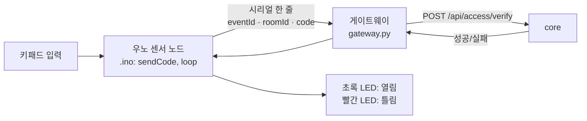
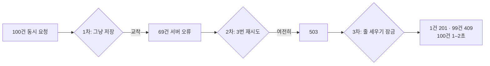

# M-SPACE 4차 팀 회의 정리

Nov 3, 2026 · @나영준 · 아침 스크럼 녹취(음성 인식) 정리

> **참석자 표기:** 녹취의 참석자 1 = 영준, 참석자 2 = 재웅. 참석자 4는 수연(키패드·게이트웨이 발표)과 지영(DB·동시 예약 발표) 발언이 섞여 있어 내용으로 나눴다(추정). 참석자 3은 발언이 거의 없다.
> 음성 인식 오타는 고쳐 적었다: 지옥님·재용 → 재웅, 마르코님·마리콘님·아베콘님 → 멘토(지도교수 또는 멘토, 추정), 울라마·올라와 → Ollama, 소나큐 → SonarQube, 디터브 → GitHub, 닥스·닥새 → docs 저장소, 엑스유저 → `X-User-Id`, 엔진엑스 → Nginx, 부츠 아이디 → `bootId`.

## 한눈에

| 주제 | 한 줄 |
| --- | --- |
| 진행 속도 | 멘토 의견: 공부보다 **일단 굴러가는 것부터 빨리**. 단, 한 번에 완성품이 아니라 자전거 → 엔진 달기처럼 단계적으로 |
| 우선순위 | **배포가 먼저.** 필수 기능(로그인, 방 목록·조회, 예약)이 학교 서버에서 실제로 도는지 확인한 뒤 MCP를 붙인다 |
| 시간대 | 비서에서 예약 시각이 9시간 어긋난 사례 → **시간대 팀 컨벤션을 영준이 docs에 추가** |
| 인증 | 지금은 임시 `X-User-Id` 헤더. 키패드도 장치별 토큰이 필요 → **JWT 인증은 재웅이 맡음** |
| 키패드 | 우노 + Jetson으로 연결 성공. 틀린 입력 뒤 LED 대기 중 못 누르는 문제 → 대기 없애기. 게이트웨이 함수 나누기 |
| 동시 예약 | 100건 동시 → 1건 성공·99건 `409`. 교착(데드락) → 재시도 → 줄 세우기 잠금으로 해결, 100건에 1–2초 |
| 스크럼 | **15분 안.** 슬라이드로 어제 한 것 / 트러블슈팅 / 왜 그렇게 정했나 / 오늘 할 것. 긴 설명은 따로 회의 |
| 화면 | 재웅 목업이 딱딱하다 → 조선대 파란색 기반으로 더 알록달록·깔끔하게. 야놀자처럼 배치도 형태 검토 |
| 리뷰 | 재웅이 브랜치 보호를 풀었음. 각자 Claude에게 PR 확인 후 괜찮으면 머지하게 |

## 정해진 것

| 항목 | 결정 | 누가 말했나 | 비고 |
| --- | --- | --- | --- |
| 진행 방식 | 공부는 뒤로, 먼저 돌아가게 만든다. 단 단계적으로 키운다 | 재웅(멘토 의견 전달) | 지금 속도는 MVP(v0.1) 수준을 크게 넘지 않았다는 확인을 받음 |
| 배포 우선 | v0.1 필수 기능 + 배포까지 먼저. 배포 뒤 화면 디자인, 그다음 MCP | 재웅 | Nginx 문제는 멘토가 오늘 해결해 줌 → 곧 배포 예정 |
| MCP 시점 | 필수 기능이 배포돼 돌면, 그때부터 MCP는 요구사항 없이도 "넣어 볼래"로 넣어도 된다 | 재웅 | 영준은 그 전까지 쉬어도 된다고 함. **아래 "충돌" 1번 참고** |
| 시간대 컨벤션 | 서울 시간 기준 규칙을 팀 컨벤션에 넣는다. 영준이 docs에 PR | 재웅 → 영준 | 이 문서와 함께 반영함 (아래 "반영한 것") |
| 인증 | `X-User-Id`는 JWT 오기 전 임시. JWT·장치 인증은 재웅이 맡음 | 재웅, 지영 | 영준: `X-User-Id`는 누구나 헤더를 바꿔 보낼 수 있어 약하다 |
| 장치 토큰 | 키패드는 여러 대, 서버는 하나라 장치마다 토큰이 필요 | 수연·지영(추정) | 아무 키패드나 열어 두면 안 된다 |
| 스크럼 시간 | 4명 합쳐 15분. 코드 설명은 짧게(회로도·흐름 정도), 길게 할 사람은 따로 불러 회의 | 재웅 | 코드 리뷰 자세한 건 지영과 실습실에서 따로 |
| 스크럼 주제 | 코드 설명보다 면접에서 쓸 기술 용어(예: HTTP/2 vs 1.1)를 설명하는 쪽이 낫다 | 영준 | 재웅도 "본인 파트를 말할 수 있으면 된다"는 취지 |
| 요구사항 수정 흐름 | 각자 Claude를 레포에 연결 → 텔레그램으로 팀에 알림 → 괜찮으면 본인이 docs에 반영 | 재웅 | 검증을 한 번 받는 효과 |
| 리뷰·머지 | 브랜치 보호를 풀어 두고, 각자 Claude가 PR을 보고 괜찮으면 머지 | 재웅 | **아래 "충돌" 2번 참고** |
| 화면 디자인 | 지금 목업은 딱딱하다. 조선대 파란색 + 더 알록달록·깔끔하게 | 영준·지영·수연 | 재웅이 다시 만든다. 영준이 방 배치도 사진을 준다 |

## 사람별 발표 요약

| 사람 | 어제 한 것 | 트러블슈팅 | 오늘 할 것 |
| --- | --- | --- | --- |
| 영준 | M1(MCP 방식 결정, 뼈대, 도구 명세, SonarQube) 끝, M2(빈방 찾기, 예약 확인, 취소·퇴실) 진행 | ① 예약 시각 9시간 당겨짐 → 서울 시간으로 ② `.gitignore`의 `out/`가 `adapter/out` 소스까지 무시 → `/out/` ③ 가짜 서버에 HTTP/2로 POST하면 끊김 → HTTP/1.1 고정 | Gemini API 키 받아 실제로 돌려 보기: 개인정보가 새는지, 확인 토큰(2분)이 제대로 만료되는지. 안 되면 공부 |
| 수연 | 맥 소프트웨어 업데이트가 오래 걸려 **Jetson + 우노**로 연결. 드라이버를 설치하니 Jetson이 우노를 인식함 | 게이트웨이 한 함수에 기능이 몰려 있다는 리뷰 → 다음 PR에서 나눔 | 틀린 입력 뒤 LED가 켜진 동안 키패드를 못 누르는 문제 → 대기 없애기(지영 리뷰). 코드 직접 돌려 보기 |
| 지영 | DB 세팅, Flyway로 로컬·서버 스키마 맞춤, Testcontainers, 방 목록·조회, 예약 생성, 동시 예약, 멱등 응답, CodeRabbit·SonarQube(커버리지 80%) | 100건 동시 예약에서 69건이 서버 오류 → 원인 교착 → 3번 재시도도 `503` → 줄 세우기 잠금으로 1건 성공·99건 `409`, 100건 1–2초 | DB 설계 발표 준비. Claude가 혼자 예약 취소 등 PR을 더 올림 |
| 재웅 | docs에 시스템 아키텍처 그림(수동), 기능 시연 흐름(로그인·JWT·DB), 프론트 목업 | 학교 서버 Nginx 문제(멘토가 해결) | 아키텍처 설명, 배포, 화면 다시 만들기 |

### 수연: 키패드 코드 구조 (회의에서 화면으로 본 것)

- `loop()`: 6자리 전에 `#`를 누르면 빨간 LED. 6자리면 서버에 물어 맞으면 초록(OK), 틀리면 빨강
- `sendCode`: 지영과 맞춘 통신 형식. `eventId`는 이벤트마다 하나, `roomId`는 방 번호
- `bootId`: 우노가 몇 번째로 켜졌는지(EEPROM에 저장, 켤 때마다 +1). **따로 보내는 필드가 아니라 `eventId` 안에 들어간다** (`eventId` = `방-bootId-순번`, 예: `1-1000002-3`). 이게 없으면 재부팅 뒤 순번이 다시 1부터 시작해 core가 **새 입력을 중복으로 보고 버린다**
- `gateway.py`: `post`(67번 줄)와 `main`(92번 줄)이 핵심(11/3 PR #20에서 역할별로 나눠 지금은 `HttpVerifier.verify`, `handle_line`, `main`). 드라이런(연습) 모드는 가짜 시리얼과 테스트 번호 `123456`을 쓴다

### 지영: 동시 예약 처리 흐름

- 영준 질문: "누가 먼저 왔는지 무엇으로 정하나?" → 답: 클릭한 시각이 아니라 **서버(DB)에 먼저 도착해 잠금을 잡은 순서**. 게임에서 내 화면에선 맞았는데 서버 기준으로 빗나가는 것과 같다

## 회의에서 나온 질문과 답

회의 중 추측이나 헷갈린 부분을 Claude가 정리했다. 회의 내용과 다른 부분은 **바로잡음**으로 표시했다.

**Q1. 왜 시각이 9시간 어긋났나? (영준 발표)**

- 정확히는 "미국 시간"이 아니라 **UTC(세계 표준시)**다. Jackson이 `OffsetDateTime`을 읽을 때 기본으로 UTC로 바꾼다(`14:00+09:00` → `05:00Z`). 같은 순간이지만 AI 모델은 숫자를 그대로 읽어 "오전 5시"라고 답할 수 있다 (TS-01)
- 오늘 실제 core와 붙였을 때는 반대 방향도 나왔다. 모델이 `2026-11-04T14:00`처럼 오프셋 없이 넣으면 도구가 거절했다. 지금은 오프셋이 없으면 서울 시간으로 본다 (TS-04)
- 서버 컨테이너(Docker)와 GitHub Actions는 기본 시간대가 UTC다. 코드가 "서버 시간대"에 기대면 노트북에선 맞고 배포 서버에선 9시간 어긋난다. 그래서 팀 규칙으로 정한다

**Q2. HTTP/2에서 1.1로 바꾸니 왜 풀렸나?**

- **바로잡음:** HTTP/2가 "조건이 많아서"라기보다, 자바 `HttpClient`가 `http://` 주소에 HTTP/1.1로 보내면서 "HTTP/2로 올려 줄래?"(h2c 업그레이드)를 같이 묻는다. 가짜 서버(WireMock)가 본문 있는 POST에서 이 업그레이드를 받다가 연결을 끊었다. 진짜 Gemini는 `https`라 영향이 없다
- HTTP/2는 연결 하나에 여러 요청을 동시에 싣는다(여러 차선). 1.1은 연결 하나에 한 번에 하나다. 이 비유는 맞다

**Q3. WireMock 테스트를 통과했으면 실제로도 되나? (영준 발표)**

- 아니다. 영준 말대로 **가짜 core로 한 시뮬레이션**이다. 실제로 오늘 core와 붙이자 오프셋 문제(TS-04)가 새로 나왔다. 그래서 배포된 core에 다시 붙여 보는 것이 남아 있다

**Q4. 확인 카드에 학번을 넣으면 외부 AI로 안 가나? (영준 발표)**

- 맞다. 카드에 적은 값은 화면 → 비서 서버 → core로 가고, 모델(Gemini)과 나눈 대화에는 들어가지 않는다 (A-5 결정)
- **바로잡음:** "하드코딩으로 적어도 DB로 간다"는 표현은 정확하지 않다. 사용자가 카드에 **입력한 값**이 core API를 거쳐 core DB에 저장된다. 코드에 값을 박는 것(하드코딩)과는 다르다
- 대화창에 직접 쓴 학번·전화번호는 모델로 보내기 전에 가린다(`PrivacyMask`). 이름은 규칙으로 가려내기 어려워 v0.3에서는 알려진 한계로 둔다(11/2 결정)

**Q5. `bootId`가 왜 필요한가? 끝난 기록은 지우면 되지 않나? (영준 질문)**

- 회의에서 가장 헷갈린 부분이다. 정리하면 이렇다
- core는 같은 신호가 두 번 와도 한 번만 처리하려고 받은 `eventId`를 기억한다. 키패드가 재부팅돼 순번을 다시 1부터 세면, core는 진짜 새 입력을 "이미 받은 1번"으로 보고 버린다. 그래서 우노가 `eventId`를 만들 때 `bootId`(켤 때마다 올라가는 번호)를 **안에 넣는다**(`방-bootId-순번`). `bootId`를 따로 보내지 않고, core는 `eventId` 하나만 기억하면 된다 (수연 바로잡음)
- **바로잡음:** 회의에서 나온 "하루 한 번만 예약" 예시는 우리 규칙과 다르다. 규칙은 **대표자 동시 1건(끝나지 않은 예약), 하루 횟수 제한 없음**이다. 그리고 예약 기록을 지우면 안 되는 이유는 `bootId`와 별개다. 노쇼·신고 판정과 통계에 기록이 필요하기 때문이다
- 받은 `eventId`를 영원히 들고 있을 필요는 없다. 일정 시간(예: 하루)이 지난 것만 지워도 된다(지영·수연 확인 필요)

**Q6. "줄 세우기 잠금"은 무엇인가? (지영 발표)**

- 같은 방·같은 시간을 노리는 요청을 한 줄로 세워 하나씩 처리하는 방식이다. PostgreSQL의 행 잠금(`SELECT … FOR UPDATE`)이나 권고 잠금(advisory lock) 중 무엇을 썼는지는 지영 확인 필요
- 최종 안전장치는 여전히 **DB 제약**(`no_room_overlap`, `one_active_per_owner`)이다. 잠금은 교착과 500을 줄이고, 겹침 자체는 제약이 막는다
- 시험 기간에 몰리면: 잠금 단위가 방 하나라면 다른 방끼리는 서로 기다리지 않는다. 잠금을 테이블 전체에 걸면 병목이 된다(확인 필요)

**Q7. 게이트웨이는 파이썬인데 백엔드는 자바다. 괜찮나? (영준 질문)**

- 괜찮다. 둘은 HTTP API로만 이야기한다(`POST /api/access/verify`). 언어가 달라도 JSON 형식만 맞으면 된다. 그래서 형식(`sendCode`, verify 요청·응답)을 문서로 고정하는 게 중요하다

**Q8. 아키텍처 그림에서 화면이 Nginx 뒤에 있나 앞에 있나? (재웅·영준)**

- 사용자의 브라우저(화면)는 바깥에 있고, Nginx가 입구다. 주소에 따라 `/`는 front 컨테이너(정적 파일), `/api`는 core로 보낸다. 그림에서 "사용자 화면"은 Nginx 앞(밖)에, "front 서버"는 Nginx 뒤(안)에 그리면 둘 다 맞다(재웅 다시 확인)
- **바로잡음:** Nginx를 "로드 밸런싱"이라고 했는데, 지금은 개발/시연 입구를 **주소로 나눠 보내는 것**(리버스 프록시)이다. 로드 밸런싱은 같은 서버를 여러 대 띄워 나눠 보낼 때다

## 충돌·확인 필요 (기존 결정·지침과 다른 것)

| # | 오늘 나온 것 | 기존 결정·지침 | Claude 의견 |
| --- | --- | --- | --- |
| 1 | **배포 먼저, MCP는 그다음.** 영준은 그동안 쉬어도 됨 | 프로젝트 마일스톤 ~11/12 비서 + MCP 연결, **11/13 기능 동결**. CLAUDE.md는 v0.3 기능 | 방향은 맞다. 다만 배포가 늦어지면 MCP가 동결 직전으로 밀린다. 영준은 쉬기보다 **로컬 core에 붙여 대조**를 계속하고, 배포되면 바로 같은 시나리오를 다시 돌리는 게 안전하다 |
| 2 | **브랜치 보호 해제**, 각자 Claude가 보고 머지 | TEAM.md·컨벤션: `main`·`develop` 직접 push 금지, **다른 팀원 1명 승인** + 빌드·테스트 통과 | "사람 승인 필수"를 빼는 건 팀 합의면 괜찮다. 하지만 **빌드 통과 필수 검사와 직접 push 금지는 남기자**. 이걸 풀면 깨진 코드가 `develop` → 개발 서버로 바로 간다. 컨벤션 문서도 실제와 맞게 고쳐야 한다(재웅) |
| 3 | "공부할 필요 없이 Claude에 맡겨라" | 프로젝트 지침: 구현은 Claude Code, 끝나면 학습 문서. 포트폴리오: 트러블슈팅 2건·결과 숫자 1개 | 충돌은 작다. 구현은 빨리 하되 **트러블슈팅 기록은 그때그때** 남겨야 발표·면접 거리가 된다. 학습 문서는 기능 동결 뒤로 미뤄도 된다 |
| 4 | 영준: "발표가 19일" | 프로젝트 지침 11/20 발표. IT Festival 2026 공고: 제출 11/16 16:00, 본선 11/19(추정) | 날짜가 섞여 있다. **11/16 제출 마감**이 가장 빠르니 이걸 기준으로 거꾸로 계획하자 (공고 원문 확인 필요) |
| 5 | Claude가 혼자 PR을 계속 올림(지영) | 각 버전 범위는 요구사항 명세 기준 | 재웅 말대로 docs 요구사항에 **버전 범위(v0.1/v0.2/v0.3)가 표시돼야** Claude가 멈춘다. 재웅 확인 |
| 6 | 장치 인증은 재웅 | 기존: JWT scope 논의 보류(11/2), core #37 재웅 | 일치. 비서는 JWT가 오면 사용자 토큰을 그대로 넘기면 된다. 장치 토큰은 사용자 토큰과 **다른 종류**로 두자(키패드가 예약을 만들 수는 없게) |

## 반영한 것 (영준 담당)

| 항목 | 내용 | 어디 |
| --- | --- | --- |
| 시간대 컨벤션 | 9장 "시간대" 추가: 기준 `Asia/Seoul`, 타입별 쓰임, 오프셋 없는 입력 처리, 서버 시간대에 기대지 않기, 테스트 방법 | 프로젝트 파일 `팀-컨벤션.md`, docs 저장소 `conventions.md` PR |
| 근거 | TS-01(응답이 UTC로 바뀜), TS-04(오프셋 없는 입력 거절) | mspace-assistant `docs/트러블슈팅.md` |

## 보류·확인할 것

| 항목 | 상태 | 누가 |
| --- | --- | --- |
| 학교 서버 배포 | Nginx 문제 해결됨(멘토), 곧 배포 | 재웅 |
| 아키텍처 그림의 화면 위치 | 다시 찾아보기로 함 | 재웅 |
| JWT·장치 토큰 | `X-User-Id` 대체. 장치 토큰은 사용자 토큰과 분리 권장 | 재웅 |
| 브랜치 보호 범위 | 승인 필수만 뺄지, 빌드 검사도 뺄지. 컨벤션 문서 갱신 | 재웅 |
| docs 요구사항 버전 표시 | Claude가 범위 밖까지 만들지 않게 | 재웅 |
| 줄 세우기 잠금 방식 | 행 잠금인지 권고 잠금인지, 잠금 범위 | 지영 |
| `eventId` 보관 기간 | 언제 지워도 되는지 | 지영·수연 |
| 키패드·core 통신 형식 문서 | `sendCode` 형식이 문서로 없음(코드에만) | 수연·지영 |
| 발표·제출 날짜 | 11/16 제출 / 11/19 본선 / 11/20 수업 발표 정리 | 영준 |
| 방 배치도 사진 | 화면 디자인 참고용 | 영준 → 재웅 |

## 할 일

- [x] 영준: 4차 회의 정리
- [x] 영준: 시간대 컨벤션 추가 (프로젝트 파일 + docs PR)
- [ ] 영준: Gemini API 키 받아 실제 실행 — 개인정보 누출, 확인 토큰 2분 만료 확인 (#9)
- [ ] 영준: 배포되면 배포된 core에 비서 붙여 시나리오 3개 다시 돌리기
- [ ] 영준: 방 배치도 사진 재웅에게 전달
- [ ] 영준: 스크럼 슬라이드에 기술 용어 설명 1개씩 (예: HTTP/2 vs 1.1, UTC vs 서울 시간)
- [ ] 재웅: v0.1 배포, 아키텍처 그림 다시 확인, 화면 다시 만들기(조선대 파란색 기반)
- [ ] 재웅: JWT·장치 인증, 브랜치 보호 범위 정리, docs 요구사항에 버전 표시
- [ ] 지영: DB 설계 발표 준비, 잠금 방식 정리
- [x] 수연: 게이트웨이 함수 나누기(다음 PR), 틀린 입력 뒤 대기 없애기, 코드 직접 돌려 보기 (11/3 mspace-device PR #20 머지, Jetson에서 키패드·LED 실제 동작 확인)
- [ ] 수연·지영: 키패드 ↔ core 통신 형식 문서로 남기기
- [ ] 전원: 스크럼 15분 지키기, 각자 Claude를 레포에 연결해 PR 확인·알림
