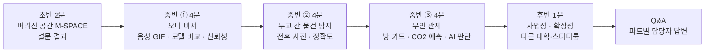

# M-SPACE 11차 회의 정리 (제출물·발표 방향·탐지 범위·시연 영상)

Nov 13, 2026 · @나영준 · 녹음 받아쓰기 두 개(오전 1차 32분, 이어진 2차 60분) 정리

> **참석자 표기:** 받아쓰기는 "참석자 1, 2…"로만 나뉘고 같은 사람이 다른 번호로 잡히기도 한다. 이름은 내용으로 확실한 곳만 적고, 나머지는 "팀"으로 적는다.
> 받아쓰기 오타는 고쳐 적었다: 수현 → 수연, 마르코님 → 멘토(마르코님), 젠슨·제이슨·잭슨 → 젯슨, VM → VLM, 캡티·캡띠 → 캡디(캡스톤디자인), 삼지 정확도 → 탐지 정확도, 공주버스 → 광주 버스(추정), 솔마루 → 학교 식당 솔마루(추정), 조대랑 → [조대랑](https://jodaerang.com)(다른 학생이 만든 학교 생활 앱), 엠스페이스 → M-SPACE.
> 회의 중 외부 학생과의 통화(조대랑 제작자 지인), 식사·잡담은 필요한 사실만 남겼다.
> 팀 의견(1–3장)과 Claude 추천 의견(7장)을 나눠 적는다. 추천은 결정이 아니다.

## 한눈에

| 주제 | 한 줄 | 상태 |
| --- | --- | --- |
| 리플렛 | 인쇄하지 않는다. **QR을 띄우고, 스크롤로 보는 PDF 책자**로 예쁘게 | 결정 |
| 기능 동결 | **11/15(일)** 제안. 그 뒤 새 기능 없이 버그만. 발표 카드 만들기 전까지는 기능 추가 가능 | 제안(확인 필요) |
| 시연 영상 | **지금 있는 기능으로** 찍는다. 직접 출연하는 인트로가 있는 **UCC 형식**. 오늘(11/13) 점심 뒤 촬영 | 결정 |
| 비서 확장 | 재웅 제안: 오디 MCP에 **날씨·버스(교내 셔틀) API** → 아침 브리핑. 식당 혼잡도는 **인터페이스만** | "해 보기로" (범위 미정) |
| 탐지 범위 | **쓰레기 경고·제재를 빼고 "물건이 있어요" 알림만** 남긴다. 지금 정확도 약 89% | 방향 합의 |
| 발표 청중 | 기업 실무자·인사 담당자 + 교수. **쉽게, 결과 중심**, 깊은 내용은 Q&A에서 | 결정 |
| 발표 흐름 | 초반 "키 때문에 버려진 공간" 서사 + 설문 → 중반 비서·사진 탐지·관제 → 후반 사업성·확장성 | 큰 틀 합의 |
| 발표자 | **영준이 한 명으로 진행**, 나머지 셋은 옆에 서 있다가 Q&A는 각자 파트 | 결정(11/13 영준 확인) |
| 시간 | 15분 기준 **2분 / 4분 / 4분 / 4분**(+마무리) | 초안 |
| 연습 | **월요일(11/16)부터 오전·오후 하루 두 번 모의 발표 + 모의 Q&A** | 결정 |
| 경쟁 사례 | [조대랑](https://jodaerang.com): 1학년이 만든 학교 생활 앱(교내 버스·식당·도서관 좌석·제휴 할인). 디자인 평이 좋음. 버스는 실시간 아님(측정한 고정 시간) | 참고 |
| 다음 대회 | AI 안경·전파 탐지기(부정행위 탐지) 아이디어는 **11/20 뒤 12월 대회 후보** | 보류 |

### 발표 흐름 (2차 회의 큰 틀)

## 1. 1차 회의 (오전)

### 1.1 제출물 분담

| 항목 | 내용 |
| --- | --- |
| 모아서 보낼 것 | 과제 설명서, 영상, 소스. **누가 모아서 보낼지 정해야 한다** (오늘 정하지 못함) |
| 발표자·시간 배분 | 2차 회의로 넘김(2.6) |
| Q&A 담당 | 각자 자기 파트를 답하면 된다 |

### 1.2 리플렛

- 20부를 여유 있게 뽑아도 1인당 1만 원 꼴이라는 계산이 나왔지만, **인쇄 대신 QR을 띄워 두고 PDF로 내려 보는 책자**로 하기로 했다
- 이미 만든 3단 리플렛 시안(프로젝트 파일 `leaflet/leaflet.html`)을 스크롤 PDF로 바꾸면 된다

### 1.3 기능 동결

- 동결 뒤에는 새 기능 없이 버그만 고친다
- 제안: **11/15(일)**. 발표 카드(슬라이드)를 만들기 전까지는 기능을 더 넣어도 된다
- 시연 영상은 **지금 있는 기능**으로 찍는다. 탐지 정확도가 가장 큰 문제라, 이걸 어떻게 푸느냐에 따라 발표 품질이 달라진다

### 1.4 비서 확장 제안 (날씨·버스·식당)

| 제안 | 내용 | 팀 반응 |
| --- | --- | --- |
| 날씨 | 아침에 "오늘 비 온다, 우산 챙겨라" | 좋음 |
| 버스 | 아침에 "몇 시 버스가 온다, 그때까지 준비해라", 수업이 18:00에 끝나면 "18:05 차가 오고 있다" | 좋음. 교내 버스까지 해 보기로 |
| 식당 혼잡도 | 솔마루(추정)가 붐비는지. 협의는 안 됐지만 POS 주문량 같은 신호로 알 수 있다는 **인터페이스만 설계**하고 모의로 30초 정도 말하기 | "이것저것 찍먹한 것처럼 보일 수 있다"는 걱정도 나옴 |
| 아침 TTS | 앱을 켜면 비서가 먼저 말해 주는 그림(멘토 마르코님 이야기) | — |

- 걸리는 점: 버스 노선이 바뀌면 데이터를 고쳐야 한다. 교내 셔틀은 실시간 위치 데이터가 없을 수 있다(조대랑도 측정한 고정 시간을 쓴다)
- 추가하면 **버전 관리·기능표도 같이** 갱신해야 한다

### 1.5 경쟁 사례: 조대랑

| 항목 | 들은 내용 |
| --- | --- |
| 누가 | 컴퓨터공학 1학년(전공 수업 과제). IT Festival은 캡스톤디자인 연계 수업만 나갈 수 있어 이번에는 안 나온다고 함 |
| 기능 | 교내 셔틀, 기숙사·학교 식당 메뉴, 중앙도서관 좌석, 학사 공지·일정, 제휴 할인, 지도 |
| 데이터 | 버스는 직접 재 본 고정 시간(실시간은 다음 주쯤 예정), 식당·도서관은 학교 사이트를 긁어 옴 |
| 팀 느낌 | 디자인이 좋다. "1학년한테 밀리는 느낌", 주제가 겹치면 저쪽이 더 좋아 보일 수 있다 |
| 우리와 다른 점(팀 대화) | 우리 기능은 어느 방에나 붙일 수 있다. 확장할 때 걸리는 건 **카메라**다 |

### 1.6 탐지 정확도 (수연 발표, 핵심 안건)

**지금 막힌 곳**

| 문제 | 내용 |
| --- | --- |
| 의자 위 물건 | 의자를 하나의 물체로 잡으면 그 위의 가방을 안 본다. 의자를 통째로 빼지 않고 한 번 더 보게 해서 **89%**까지 올림 |
| 두 가지가 같이 안 오름 | 놓치는 것을 줄이면 오판(깨끗한데 물건 있다고 함)이 늘고, 반대도 마찬가지 |
| 새 공간 | 처음 보는 방(모니터 3대 등)에서는 원래 있던 물건인지 새로 생긴 건지 모른다 → 정확도가 떨어짐 |
| 모양이 바뀐 물건 | 리모컨이 뒤집히면 다른 물건으로 본다. 줄 이어폰처럼 작은 건 원본 해상도로도 못 찾음 |
| 쓰레기 | YOLO가 학습하지 않은 종류라 하나하나 알려 줘야 한다 |
| 메모리 | 젯슨 8GB 중 약 5.7GB 사용. 더 큰 VLM을 올리려면 지금 VLM을 끄고 바꾸는 중 |

**검토한 방법**

| 방법 | 좋은 점 | 걸리는 점 |
| --- | --- | --- |
| 공간마다 처음 한 번 원래 물건 알려 주기 | 그 뒤 비용 없음, 89%를 더 올릴 수 있음 | 번거롭다. 물건을 여러 방향으로 보여 줘야 한다. 확장성 설명이 약해짐 |
| 클라우드 AI(Claude 등)로 전후 비교 | 의자가 빠져도 "뭔가 있다"를 잘 찾음 | 호출마다 비용. 한도를 걸 수 있지만 **한도에 닿으면 알림·경고가 다 멈출까 봐** 걱정 → 맨 마지막에 시험 |
| 사진만 보여 주기("혹시 두고 가셨나요?" 탭) | 정확도 부담이 없다 | 기능이 내려간다 |
| **경고·제재를 빼고 "물건이 있어요" 알림만** | 정확도를 올려야 하는 이유(남에게 잘못 경고) 자체가 사라짐. 개발도 간단해짐 | 쓰레기 버리고 간 사람을 잡는 기능이 빠진다 |

**정한 방향:** 쓰레기에 대한 제재는 뺀다. 사용자가 "두고 갔어"라고 하면 사진을 보고 확인하는 정도. 어지럽힘은 **다음 사용자가 사진을 찍어 신고**하는 기존 흐름으로 잡는다. 멘토(강사님)도 쓰레기가 아니라 **잃어버린 물건**에 무게를 뒀다.

### 1.7 카메라에 대한 다른 의견

- 다른 멘토가 "방에 카메라를 달아 인원을 세는 건 감시 같다"고 웃으며 말한 적이 있다. 카메라는 원래 강사님이 먼저 제안한 것이라 팀이 헷갈려 함
- 레이저 센서였다면 비용이 훨씬 낮았다(젯슨이 비싸다)
- 1차 회의 끝 메모: 멘토 질문 중 하나는 **"AI 판단 한 번에 비용이 얼마인가"** 였다. 지금은 무료 한도가 있고, 로컬은 한도가 없지만 장비가 무겁다

## 2. 2차 회의 (이어서)

### 2.1 사업화 비용 질문에 대한 팀 생각

- 사업화하면 더 좋은 모델을 돌릴 그래픽카드 같은 비용을 다 생각했느냐는 질문이 부담스럽다는 이야기가 나왔다. 지원금 없이 기대 효과는 크게, 비용은 작게 쓰라는 요구라 답답하다는 의견
- 과제설명서 기대 효과는 **카메라를 쓰느냐에 따라 달라진다**(비용 분석 [business/README.md](../business/README.md))

### 2.2 초반: 서사 (2분)

| 순서 | 말할 것 |
| --- | --- |
| 1 | S-Space·TDM 같은 공간은 키가 없어 늘 사람이 많다 |
| 2 | **M-SPACE만 학과실에서 키를 받아야 해서 사람이 안 온다** → IT융합대학 한가운데의 "예쁜 쓰레기 공간", "낙엽만 날린다"(과장해서 공감을 끈다) |
| 3 | 안타까워서 설문을 해 봤다 → 결과 |
| 4 | 그래서 오디를 만들었다. 만들다 보니 **무인 운영도 가능하다** |

- 설문 숫자를 어떻게 말할지: "300명 이하가 원했다", "98.9%" 같은 말이 오갔다. 실제 응답은 **15명**이다(팀원도 "100%는 의심스럽다", "몇 명 참여했냐고 묻는다"고 짚음) → 7장 추천 (a)
- "개발하는 동안 우리 말고 한 명 썼다"고 하면 **"실사용 테스트는 안 했네요?"** 질문이 나올 수 있다

### 2.3 청중과 심사 기준

| 항목 | 내용 |
| --- | --- |
| 청중 | 잡매칭 행사와 같이 열려 **기업 실무자·인사 담당자**가 온다. 교수님도 온다. 둘 다 코드 수준 기술은 모른다고 봄 |
| 지난 경험(다른 수업) | 중간 발표: "무슨 말인지 모르겠다" → 기말에 쉽게 했더니 "설명이 너무 없다, 조잡하다" |
| 결론 | **흐름은 쉽게, 결과 중심.** 깊은 건 Q&A에서. PPT에는 다 적어 둔다(심사위원은 말보다 PPT를 다시 넘겨 보며 질문한다) |
| 심사 항목 이야기 | 명확성·창의성·난이도·사업성. 우리는 명확성은 높고 **주제가 약하다**(요즘 AI 비서는 흔하다). 난이도도 높지 않다는 냉정한 평가 |
| 전달력 | "듣고 나서 무엇을 만들었는지 알았다"면 된다. Q&A가 "이 단어가 뭐죠?"나 "어떤 모델 썼죠?"면 감점 없음 |

### 2.4 중반: 세 파트

| 파트 | 담당 | 보여 줄 것 | 무게 |
| --- | --- | --- | --- |
| ① 오디 비서 | 영준 | **음성 대화 GIF**(슬라이드에서 말하면 바로 되는 모습), 기능, 환각을 막는 구조(모델은 제안만, 백엔드·DB가 다시 검증), Gemini를 고른 이유, **모델·지시문 비교 기준표와 점수 상승** | 기능은 짧게, 성능 올린 과정에 무게 |
| ② 두고 간 물건 | 수연 | 입실 전·퇴실 뒤 사진 비교, 정확도(89% 등), 젯슨 스펙은 슬라이드에 적고 20초 안에 넘김 | 숫자 한눈에. 경고를 빼면 심각 오류 이야기가 줄어 아쉽다는 의견도 |
| ③ 무인 관제 | (관제 화면 담당) | 방 카드 1~5번(인원·입실·퇴실), 그래프, 공기청정기·에어컨·난방·제습, **AI 판단 카드**("6분 뒤 CO2가 기준을 넘을 것 같아 미리 켬"), 시계열 예측 모델·균형 점수 | 넣는다(관리자 없이 돌아간다는 확장성) |

- 프론트는 물건 이름을 감추고 **"뭔가를 두고 가셨네요"**로 고정한다(YOLO가 이름을 붙여 보내도 화면에서 하드코딩)
- 시스템 흐름도와 각자 핵심 로직은 넣는 게 좋다는 의견
- MCP 개념도 조금은 설명해도 된다

### 2.5 관제 값이 가짜라는 고민

- 관제 화면의 2~5번 방 값은 **10/21부터 실습실에서 잰 실제 센서 기록**을 바탕으로 돌리는 시뮬레이션이다. 아침 8시 20분에 비어 있다가 사람이 오는 흐름까지 그대로 나와 신기했다는 이야기
- 1번 방은 실제로 시험 중
- 걱정: Q&A에서 "실제 센서를 달았냐"고 물으면 답하기 어렵다. "학교가 설치를 허락하지 않아 실습실 센서로 준비했다"고 말하자는 안, 오늘 하드웨어를 갖고 가서 사진이라도 찍자는 안이 나옴. "진실 반 거짓 반"이라는 말도 나왔다 → 7장 추천 (b)

### 2.6 발표자와 시간

| 안 | 좋은 점 | 걸리는 점 |
| --- | --- | --- |
| 파트마다 담당자가 발표 | 자기 것을 잘 안다. 목소리가 바뀌어 환기 | 3~4분마다 바뀌면 정신없다 |
| **한 명이 전체 진행** | 흐름이 매끄럽다 | 남의 파트 파이프라인을 다 이해해야 한다 |

- 정리: **한 명이 진행**하고, 나머지 셋은 **옆에 서 있다가** Q&A에서 마이크를 넘겨받아 답한다. 발표자는 각 파트 담당에게 궁금한 걸 다 물어 이해한다
- 대본은 만들되 **보지 않는다**(흐름을 외우고 슬라이드를 보며 말함). 대본은 파트 담당이 흐름 확인용으로 받아 본다
- 시간: 15분 기준 **2 / 4 / 4 / 4**(+마무리). 5분씩 하면 15분을 넘고 재미없다는 의견
- 연습: 월요일부터 **오전·오후 한 번씩**, 발표자가 준비해 오면 나머지가 심사위원처럼 질문까지 끝까지 모의

### 2.7 후반: 사업성·확장성

- 마무리는 GitHub README를 보여 주며 "이 파트는 이렇게 개발했습니다, 감사합니다" 안과, **사업성·기대 효과로 끝내는 안**이 나왔고 기대 효과 쪽으로 기움
- "예약 시스템 자동화"라고 하면 ERP 자동화처럼 들려 다른 이야기가 된다 → **"만들다 보니 어디든 무인으로 쓸 수 있다"**
- 예시 말: "전국 대학 중 스터디룸이 있는 곳에 이런 시스템이 없다면 팔 수 있다"(숫자는 확인한 것만, 7장)

### 2.8 시연 영상

| 항목 | 정한 것 |
| --- | --- |
| 형식 | TTS로 MCP만 보여 주는 화면 녹화가 아니라 **UCC처럼 직접 출연하는 인트로** |
| 콩트 아이디어 | 누군가 "어디로 가야 하지?" 헤매면 다른 팀원이 폰을 보여 주며 "너만 안 쓰고 있어" |
| 화면 | 예약하는 모습이 나오면 캠·선이 지저분할 수 있지만 서류 평가 기준상 괜찮다(주제 완성도) |
| 쓰임 | 발표 PPT 인트로에서 틀어도 된다 |
| 촬영 | **오늘 점심 뒤 바로**. 1시까지 반납할 것이 있음 |
| 대본 | [시연 영상 대본](#부록-시연-영상-대본-요약) (부록) |

### 2.9 다음 대회 아이디어 (보류)

- 시험 부정행위: AI 안경·초소형 이어폰. 전파 탐지기는 비싸서 교육부가 안 들였다 → 젯슨 + 카메라로 비슷한 비용에 만들 수 있지 않을까, **AI 렌즈까지 미리 막는다**
- 지금 갈아엎자는 말도 나왔지만, **11/20 뒤 12월 대회**로 미루자는 쪽. 재료비·식비 지원 프로그램을 쓸 수 있다(11/30까지 Claude 사용 가능, 젯슨은 반납)

## 3. 결정 사항

| # | 결정 | 근거 |
| --- | --- | --- |
| 1 | 리플렛은 QR + 스크롤 PDF, 인쇄 안 함 | 1.2 |
| 2 | 시연 영상은 지금 기능으로, 직접 출연 UCC 형식, 11/13 오후 촬영 | 1.3, 2.8 |
| 3 | 탐지: 쓰레기 경고·제재 빼고 "물건이 있어요" 알림만. 화면은 물건 이름 없이 | 1.6, 2.4 |
| 4 | 발표는 쉽게·결과 중심, 깊은 건 Q&A. PPT에는 다 적는다 | 2.3 |
| 5 | 발표 흐름: 서사·설문 → 비서 → 사진 탐지 → 관제 → 사업성 | 2.2–2.7 |
| 6 | 발표자는 **영준** 한 명, 4명 모두 무대, Q&A는 파트 담당 (11/13 영준 확인) | 2.6 |
| 9 | 두고 간 물건은 **알림만**: "N시간 안 안 가져가면 경고" 규칙을 없앰 (11/13 영준, 요구사항 v0.4.40) | 1.6 |
| 7 | 월요일(11/16)부터 하루 두 번 모의 발표·모의 Q&A | 2.6 |
| 8 | AI 안경·전파 탐지기는 11/20 뒤로 | 2.9 |

## 4. 아직 정하지 않은 것

| 항목 | 지금 상태 | 정할 사람 |
| --- | --- | --- |
| 제출물(과제 설명서·영상·소스) 모아서 보낼 사람 | 안 정함. 마감 **11/16(월) 16:00** | 팀 |
| 기능 동결 날짜 | 11/15(일) 제안. TEAM.md는 11/13 | 팀 |
| 날씨·버스 도구 범위 | "해 보기로"만 함. 데이터 출처·API 키 | 영준 |
| 탐지 정확도를 발표에서 어떻게 말할지 | 89%, 조건(방·물건 수·시도 수) 정리 필요 | 수연 |
| 관제 시뮬레이션을 어떻게 밝힐지 | 7장 추천 (b) | 관제 담당 |
| 마무리 방식 | README 보여 주기 vs 사업성 | 발표자 |

## 5. 담당과 할 일

| 할 일 | 담당 | 기한 |
| --- | --- | --- |
| 시연 영상 촬영·편집 | 전원(편집은 정할 것) | 11/13 촬영, 11/15 편집 |
| 리플렛을 스크롤 PDF로 + QR | 정할 것(시안은 영준) | 11/18 |
| 발표 슬라이드 초안 + 흐름 대본 | 영준(발표자) | 11/16 오전 |
| 비서 파트: 음성 GIF, 기준표·점수 상승 슬라이드, 젯슨 7B 측정 결과 채우기 | 영준 | 11/16 |
| 날씨·버스 도구(범위 정한 뒤) | 영준 | 동결 전 |
| 탐지: 경고 빼기, 프론트 문구 "뭔가를 두고 가셨네요", 정확도 표 | 수연(+프론트) | 동결 전 |
| 관제 파트 슬라이드, 시뮬레이션 표기 | 관제 담당 | 11/16 |
| 모의 Q&A 질문 목록(파트별) | 각자 | 11/16부터 |
| 요구사항 변경(경고 빼기): docs v0.4.40, core 이용 수칙 문구, 화면 예시 알림 문구 | 영준 PR → 지영·재웅 리뷰 | 동결 전 |
| 제출물 취합·발송 | 정할 것 | 11/16 16:00 |

## 6. 팀 의견 모음 (회의에서 나온 그대로)

| 주제 | 팀 의견 |
| --- | --- |
| 서사 | 과장해서라도 "버려진 공간"으로 공감을 끈다 |
| 설문 숫자 | 크게 말하고 싶다는 의견과 "몇 명 참여했냐고 묻는다, 100%는 의심스럽다"는 의견이 함께 |
| 비서 | 음성이 강점. 심사위원은 음성을 좋아한다. 기능보다 **성능을 올린 과정**(여러 모델, 기준표)에 무게 |
| 탐지 | 경고를 빼면 위험이 없어진다. 다만 심각 오류를 줄인 노력이 덜 보여 아쉽다 |
| 관제 | 예약 시스템이면 관리자가 볼 화면은 꼭 있어야 한다. 시계열 모델 성능을 올린 노력은 없어서 말할 게 적다 |
| 관제 값 | 가짜라고 말하기 어렵다. 실습실 실측 기록이 바탕이라 실제처럼 움직인다 |
| 발표 | 짧게 짧게, Q&A를 많이 준비. 직접 해 봐야 안다(월요일) |
| 비서 확장 | 날씨·버스를 넣으면 "진짜 AI 비서". 반대로 이것저것 찍먹처럼 보일 수 있다 |
| 주제 | 명확하지만 주제가 약하고 난이도가 높지 않다. 창의성은 비서·분실물로 보탤 수 있다 |

## 7. Claude 추천 의견

> 회의 내용과 이 저장소 문서(설문 집계, 비용 분석, 요구사항, 평가 기록)를 보고 정리한 추천이다. 결정은 팀이 한다.

### 7.1 정직하게 말하기 (가장 먼저)

| # | 추천 | 이유 |
| --- | --- | --- |
| (a) | 설문은 **"15명 중 14명이 '비었는지 가 봐야 안다'(93%)", "15명 모두 지금 방식 대신 쓰고 싶다"**로 말한다. 표본이 작다는 한계를 **먼저** 말한다. "300명 이하", "98.9%"는 쓰지 않는다 | 심사위원이 응답 수를 한 번만 물어도 무너진다. 인사 담당자는 숫자를 부풀리는 것을 신뢰 문제로 본다. 작아도 **100%와 93%는 그대로 강한 숫자**다 |
| (b) | 관제 화면 아래에 **"1번 방: 실제 센서 · 2~5번 방: 10/21부터 실습실에서 잰 실제 센서 기록으로 만든 시뮬레이션"**을 적는다 | 먼저 밝히면 Q&A 위험이 0이 된다. "실측 기록으로 시뮬레이션을 만들었다"는 것 자체가 설명할 거리다. 숨겼다가 들키면 나머지 숫자(98.5점 등)까지 의심받는다 |
| (c) | 학교와의 관계는 **"교학팀에 대여를 문의해 답을 받았다(평일 하루 최대 8시간)"**만 말한다. "2만 번 요청했는데 안 해 줬다"처럼 말하지 않는다 | 사실과 다르고, 학교를 탓하는 말은 "활용 방안" 점수에 불리하다 |
| (d) | "실사용 테스트 했나요?" → **"팀원 시험과 설문 응답자 데모(쉬웠나 평균 4.6/5)까지다. 실사용 시범운영은 학교 승인 뒤"** | 없는 걸 있다고 하지 않되, 있는 숫자를 쓴다 |

### 7.2 발표 구성

| 항목 | 추천 | 이유 |
| --- | --- | --- |
| 시간 | **2 / 4 / 3.5 / 3.5 / 1(사업성) = 14분**, 1분 여유 | 본선은 시간을 넘기면 끊길 수 있다(공고 확인 필요). 마무리 사업성이 빠지면 "활용방안·기대효과" 배점을 놓친다 |
| 파트마다 숫자 하나 | 비서 **v4d 98.5점**(43문항, 동료 키 재측정도 98.5), 시간표 사진 **시각 맞힘 65.4 → 100**(합성 1장, "1장"이라고 밝힘), 탐지 **89%**(조건과 함께), 관제는 **"관리자 클릭 0번"** | 인사 담당자는 "얼마나 올렸나" 하나를 기억한다. 젯슨 7B는 측정이 끝나면 넣고, 낮게 나와도 "그래서 Gemini를 골랐다"의 근거로 쓴다 |
| 비서 파트 | GIF 20초 → "모델은 제안만, 실행은 학생 버튼 + 서버 검증" 그림 1장 → 기준표(판마다 한 가지 바꿔 점수) 1장 | 기능은 흔하다는 팀 판단이 맞다. 차별점은 **믿을 수 있게 만든 과정**이다 |
| 탐지 파트 | 경고를 빼도 **심각 오류 표는 남긴다**: "남의 물건을 쓰레기로 잘못 경고하는 일을 0으로 만들려고 경고 자체를 뺐다"는 결정으로 이야기 | 빼는 결정도 수치에서 나온 판단이라 좋은 이야기다. 팀이 아쉬워한 부분이 오히려 강점이 된다 |
| 발표자 | 한 명 진행에 찬성. 다만 **파트 넘어갈 때 담당자를 한 번 소개**("이 부분은 수연이 만들었습니다")하고, 모의 발표 첫날 두 방식을 한 번씩 들어 보고 정한다 | 회의 결론과 같고, 기여가 분명해야 하는 포트폴리오 원칙(TEAM.md 7장)도 지킨다 |
| PPT | 슬라이드마다 숫자·출처를 작게 적는다 | 심사위원이 PPT를 넘겨 보며 질문한다(2.3) |

### 7.3 기능 동결과 비서 확장

| 항목 | 추천 | 이유 |
| --- | --- | --- |
| 동결 | **11/15(일) 23:59**로 정하고 TEAM.md를 고친다 | 제출 마감이 11/16 16:00이라 그 전에 영상·서류가 고정돼야 한다 |
| 날씨 | 넣는다면 **읽기 도구 하나**("오늘 비 와?"), 아침 브리핑에 한 줄. 공공 날씨 API 키가 필요하다(CLAUDE.md 8장: 외부 API 키는 먼저 물어봄) | 쓰기·확인 카드가 없어 안전 규칙과 안 부딪히고, 기존 브리핑에 붙이면 하루 안에 끝난다(추정) |
| 교내 셔틀 | **실시간처럼 보이게 하지 않는다.** 시간표 고정값으로 "다음 셔틀은 18:05(시간표 기준)"라고 밝힌다 | 조대랑도 실시간이 아니다. "지금 오고 있다"고 말하면 7.1과 같은 위험 |
| 식당 혼잡도 | 만들지 않고 **확장 슬라이드 한 줄**("POS 주문량 포트를 두면 붙일 수 있다") | 협의도 데이터도 없다. 동결 이틀 전 새 기능은 버그 위험이 크다 |
| 우선순위 | 그래도 먼저는 **대화로 예약하는 기본 흐름 안정과 시연 영상** | 10차 회의 우선순위(CLAUDE.md 3.1). 날씨·버스는 빠져도 발표가 무너지지 않는다 |

### 7.4 탐지 요구사항 정리

- 10차 회의의 **"2시간 안에 안 가져가면 경고"**와 이번 **"경고 빼기"**가 부딪힌다. 요구사항 명세(FR-DEV-105 등)와 core 경고 판단기(WarningReviewer)에서 "물건 → 경고" 길을 끄고 **알림만** 남기는 변경을 동결 전에 PR로 낸다
- 경고 기능 자체(신고·노쇼·경고 철회 재검토)는 그대로 둔다. 어지럽힘은 **다음 사용자 신고 + 사진**으로
- 정확도는 **조건을 같이** 적는다: 몇 번 방, 물건 몇 종, 몇 번 시도, 놓침·오판 각각 몇 건

### 7.5 Q&A 미리 준비할 질문

| 질문 | 답의 뼈대 | 담당 |
| --- | --- | --- |
| AI 판단 한 번에 비용이 얼마인가? | 지금 Gemini 무료 한도. 유료 단가 × 한 번 판단 토큰 수(측정값)로 1회 비용, 로컬(젯슨)은 전기료만. **단가는 공고 전 확인해 숫자로** | 영준·수연 |
| 설문 몇 명? | 15명(AI 문항은 9명). 한계를 먼저 인정 | 발표자 |
| 센서 진짜인가? | 7.1 (b) | 관제 담당 |
| 조대랑 같은 앱과 뭐가 다른가? | 조대랑은 정보를 **읽어 보여 주는** 앱, 오디는 **예약·입실·퇴실을 실제로 처리**(동시 예약 DB 제약, 확인 카드)하고 사람 없이 운영 | 발표자 |
| 카메라는 감시 아닌가? | 사람이 없는 퇴실 뒤 사진만, 사람 기준 사진은 남기지 않음(10차), 카메라는 선택 기능 | 수연 |
| AI가 잘못 예약하면? | 모델은 제안만, 실행은 학생 버튼, 확인 토큰 1회용 + 멱등 키 | 영준 |
| 실사용 테스트? | 7.1 (d) | 발표자 |

### 7.6 그 밖에

- **서류 영상 형식 확인:** 2026 공고의 제출 영상은 **"5분 이내 PPT 기반 영상"**이다. 오늘 찍는 UCC(약 3분)는 그 안에 넣는 시연 장면으로 쓰고, 앞뒤에 PPT 설명을 붙이는 것을 추천. 구성: [서류 제출 영상 구성](../presentation/2026-11-13-서류영상-구성.md)(4분 40초, 9장면)
- 조대랑을 "베끼는" 것(학교 사이트 긁기)은 A-4 결정(학사시스템 긁기 안 함)과 어긋난다. 참고는 디자인까지만
- AI 안경 아이디어는 **11/20 뒤**가 맞다. 지금 바꾸면 이미 있는 숫자(98.5점, 89%)를 다 버리게 된다

## 부록: 시연 영상 대본 (요약)

UCC형 약 2분 55초. 전체 대본(화면·대사·자막 표)은 프로젝트 파일 `demo-video/2026-11-13-시연영상-대본.md`.

| # | 시간 | 장면 | 자막 |
| --- | --- | --- | --- |
| 1 | 0:00–0:15 | 복도 → 불 꺼진 M-SPACE | IT융합대학 한가운데, 늘 비어 있는 방 |
| 2 | 0:15–0:35 | (콩트) 방 찾아 헤매는 학생, 학과실 "부재" | 학과실 → 명부 → 학생증 → 열쇠 |
| 3 | 0:35–0:45 | 설문 슬라이드 | 15명 중 14명 "비었는지 가 봐야 안다" |
| 4 | 0:45–1:15 | "오디한테 말해 봐" → 음성 예약 → 확인 카드 → [확인] | 예약은 학생이 [확인]을 눌러야만 실행 |
| 5 | 1:15–1:35 | 문 앞 QR 입실 | 열쇠·학생증 없이 QR로 |
| 6 | 1:35–1:55 | 끝나기 10분 전 알림 → [연장하기] | 가장 원한 기능: 연장(15명 중 11명) |
| 7 | 1:55–2:15 | 퇴실 → 의자 위 가방 → "방에 물건이 있어요" | 입실 전·퇴실 뒤 사진 비교 |
| 8 | 2:15–2:40 | 관리자 관제 화면, AI 판단 카드 | 1번 방 실제 센서 · 2~5번 방 실측 기록 기반 시뮬레이션 |
| 9 | 2:40–2:55 | 넷이 함께 "키 없이, 말 한마디로. 오디!" | 오디 · AI-go-do |
