

  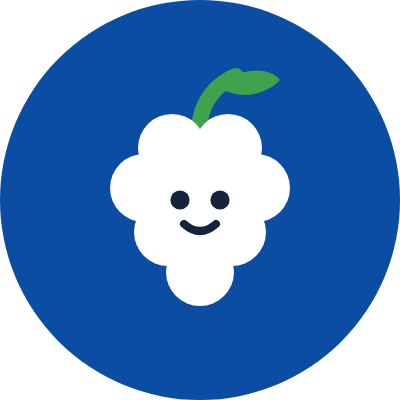
  <h1>오디 · M-space</h1>
  
<strong>말 한마디로 빈 방을 잡고, 예약만으로 문이 열리는 무인 스터디룸 서비스입니다.</strong>

  
조선대학교 IT융합대학 M-space(회의·스터디 방 5개)를 교학팀 없이 운영해요. 
  AI 비서 <b>오디</b>가 시간표를 보고 빈 방을 찾아 주고, 문 앞 QR 카메라와 방 센서·카메라가 나머지를 챙겨요.

  
📅 <b>개발 기간</b> : 2026.10.29 ~ 2026.11.19 &nbsp;·&nbsp; 🏆 <b>2026 IT 페스티벌 출품</b>

## 📖 도메인

| 환경 | 주소 | 배포 |
|---|---|---|
| 시연 | <a href="https://mspace.java21.net">https://mspace.java21.net</a> | `main` 머지 |
| 개발 | <a href="https://dev-mspace.java21.net">https://dev-mspace.java21.net</a> | `develop` 머지 시 자동 |

## 📋 API 명세서

- <a href="https://github.com/AI-go-do/docs/blob/main/api/README.md">API 명세</a> : core·비서 API 주소, 요청·응답 예시, 오류 코드
- <a href="https://github.com/AI-go-do/docs/blob/main/requirements/requirements.md">요구사항 명세</a> : 기능 ID(FR-…)와 수용 기준
- <a href="https://github.com/AI-go-do/mspace-assistant/blob/develop/docs/도구-명세.md">MCP 도구 명세</a> : 오디가 부르는 도구 12개의 입력·출력

## 👥 팀원

<table align="center">
  <tbody>
    <tr>
      <td align="center">
        <a href="https://github.com/rnrn428">
          
           <b>재웅</b>
        </a>
         <b>인프라·CI/CD, 웹 화면, 게이트웨이, 스크럼</b>
      </td>
      <td align="center">
        <a href="https://github.com/yeong0128">
          
           <b>지영</b>
        </a>
         <b>예약 코어, 동시 예약, 신고·경고</b>
      </td>
      <td align="center">
        <a href="https://github.com/happyzerojun">
          
           <b>영준</b>
        </a>
         <b>AI 비서 오디, MCP 서버</b>
      </td>
      <td align="center">
        <a href="https://github.com/suyeon040610">
          
           <b>수연</b>
        </a>
         <b>QR 입실, 센서, Jetson·방 카메라</b>
      </td>
    </tr>
  </tbody>
</table>

---

## 💻 Tech Stacks

| 구분 | 기술 스택 (Tech Stack) |
| :--- | :--- |
| **Frontend** |       |
| **Backend** |            |
| **AI** |      |
| **Database** |    |
| **IoT** |       |
| **Infrastructure** |          |
| **Collaboration** |      |

---

## ✨ 주요 기능

> 아래 화면은 `develop` 코드를 그대로 띄우고 **가짜 학생·가짜 예약**으로 찍었어요. 실제 학생 정보는 없어요.

### 1. 말로 예약하기, 오디

"수업 끝나고 4명이서 2시간 쓸 방 잡아 줘" 한마디면 오디가 내 시간표에서 마지막 수업 끝을 찾고, 그 뒤 빈 방을 골라 확인 카드를 띄워요. 학생은 친구를 누르고 **[확인] 한 번**만 누르면 돼요.

- 도구를 이어 부르는 일은 모델이 아니라 **에이전트 반복**이 해요 (`my_schedule` → `find_available_rooms` → `create_reservation`, 한 번에 최대 8번)
- 예약·취소·퇴실·연장 같은 쓰기는 **바로 실행하지 않아요.** 확인 토큰(한 번만, 2분)을 받고, 같은 확인을 두 번 보내도 `Idempotency-Key`로 예약은 한 건만 생겨요
- 권한 검사는 core가 하고, 오디는 **학생 본인 토큰**으로만 불러요. 학번·전화번호는 모델(Gemini)로 보내지 않아요

<table>
  <tr>
    <td align="center">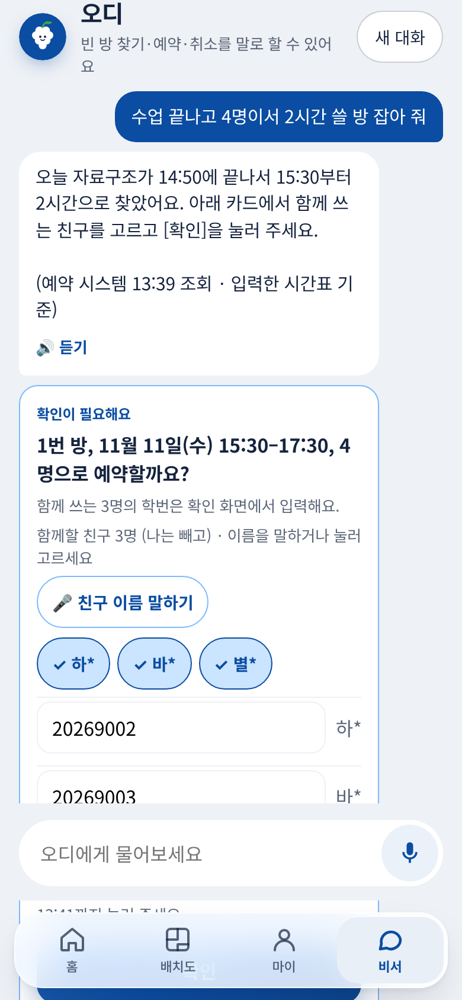 시간표를 보고 15:30부터 찾음</td>
    <td align="center">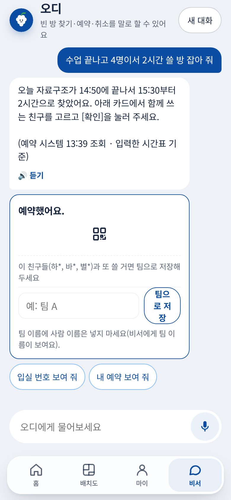 [확인] 한 번으로 예약</td>
    <td align="center">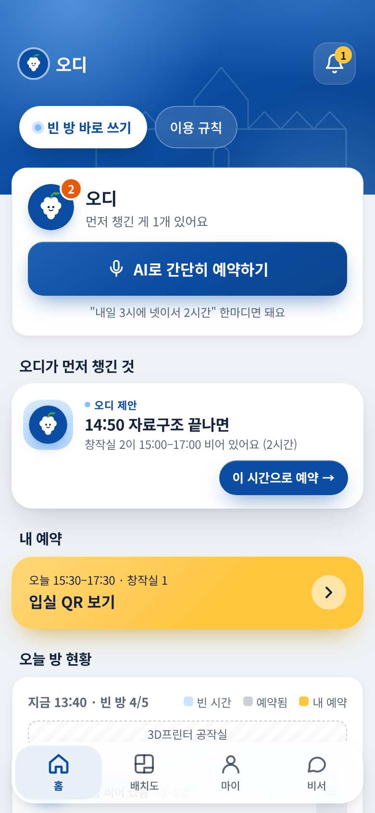 홈: 오디가 먼저 챙긴 것</td>
    <td align="center">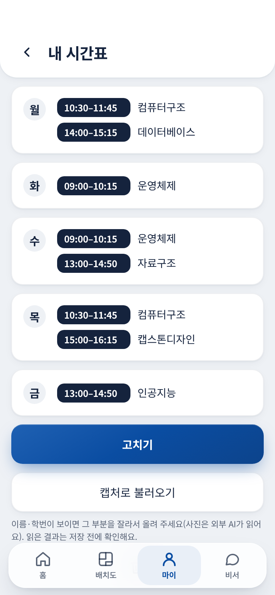 내 시간표 (캡처로 불러오기)</td>
  </tr>
</table>

### 2. 빈 방 바로 쓰기 · 미리 예약

- 30분 칸, 한 번에 최대 2시간, 오늘부터 7일 안. 지금 비어 있는 방은 누른 시각부터 바로 써요
- 같은 방·같은 시간 겹침과 "한 사람 한 건"은 코드가 아니라 **DB 제약**으로 막아요 (`no_room_overlap` EXCLUDE 제약, `one_active_per_owner`). 100팀이 동시에 같은 칸을 눌러도 1건만 저장돼요 (`ConcurrentReservationTest`)

<table>
  <tr>
    <td align="center">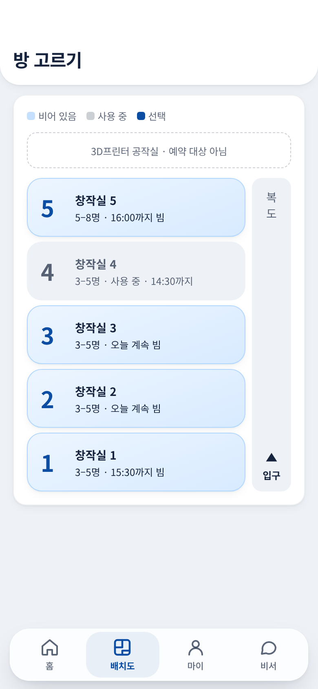 배치도: 방별 지금 상태</td>
    <td align="center">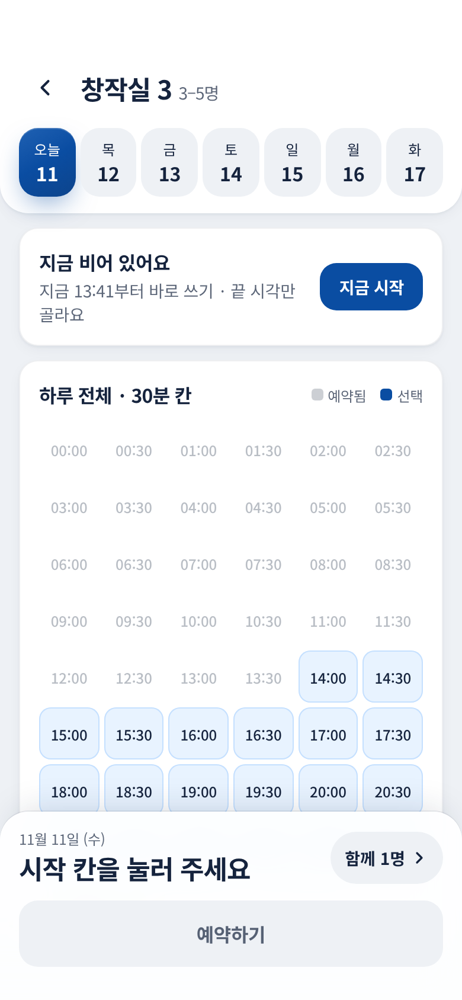 7일 · 30분 칸 고르기</td>
    <td align="center">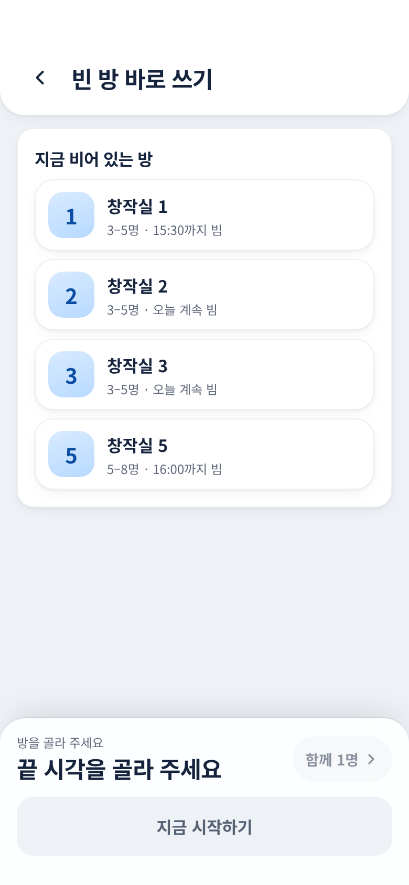 빈 방 바로 쓰기</td>
    <td align="center">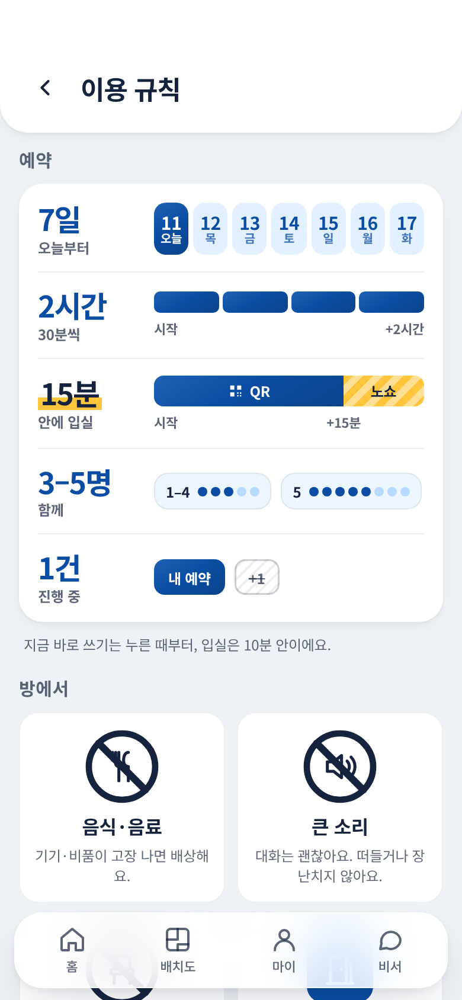 이용 규칙을 그림으로</td>
  </tr>
</table>

### 3. 예약만으로 문이 열려요 (QR 입실)

- 대표자 폰의 입실 QR을 **문 앞 카메라(Jetson)** 에 비추면 core가 확인하고 문을 열어요. 열쇠·학생증을 맡기지 않아요
- 시작 15분 안에 들어오지 않으면 노쇼로 방이 풀리고, 끝나는 시각이 되면 자동 퇴실돼요
- 방이 10분 비면(PIR·조도) 알림, 15분이면 자리 비움으로 퇴실해요. "아직 있어요"는 예약당 한 번

<table>
  <tr>
    <td align="center">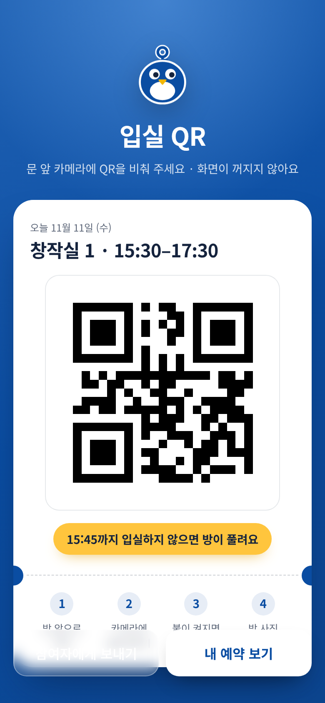 입실 QR</td>
    <td align="center">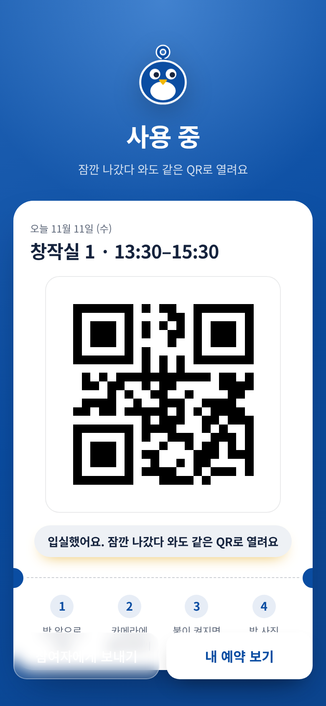 사용 중: 잠깐 나갔다 와도 같은 QR</td>
    <td align="center">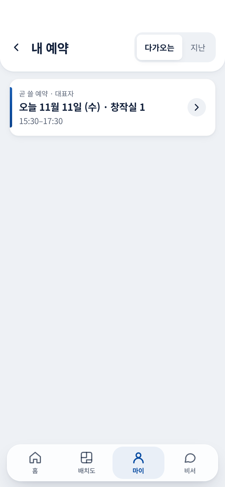 내 예약</td>
  </tr>
</table>

### 4. 두고 간 물건 · 경고도 AI가

- 퇴실 뒤 **방 카메라(YOLOv8)** 가 빈 방을 입실 전과 비교해 두고 간 물건을 찾고, 알림을 보내요. **[찾으러 갈게요]** 를 누르면 10분짜리 QR이 나와요 (3시간 안)
- 신고 판정·경고·철회 재검토는 관리자가 아니라 AI가 해요. 경고를 받으면 7일 안에 철회를 요청할 수 있고, core의 `WarningReviewer`(Gemini)가 근거 기록을 다시 비교해요
- 사람이 찍힌 사진은 남기지 않아요. 빈 방·물건 사진만 30일 보관해요

<table>
  <tr>
    <td align="center">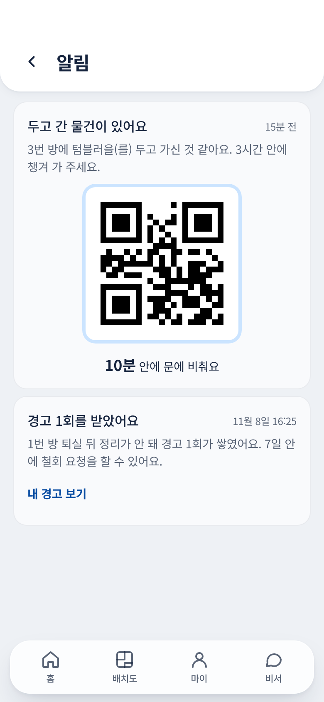 두고 간 물건 → 찾으러 갈게요 QR</td>
  </tr>
</table>

### 5. 관리자는 보기만 (관제 화면)

방 5개의 재실·CO2·온도·습도·조도를 한 화면에서 보고, 오디가 무엇을 판단하고 처리했는지 기록으로 남겨요. CO2가 환기 기준(1000ppm)에 다가가면 방 사용자에게 먼저 알려요.

  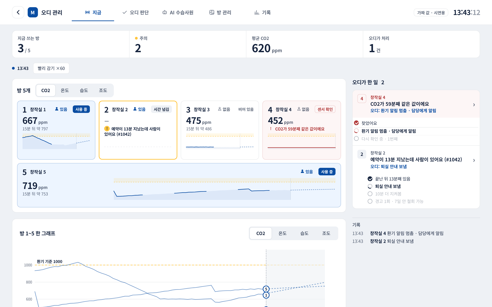

  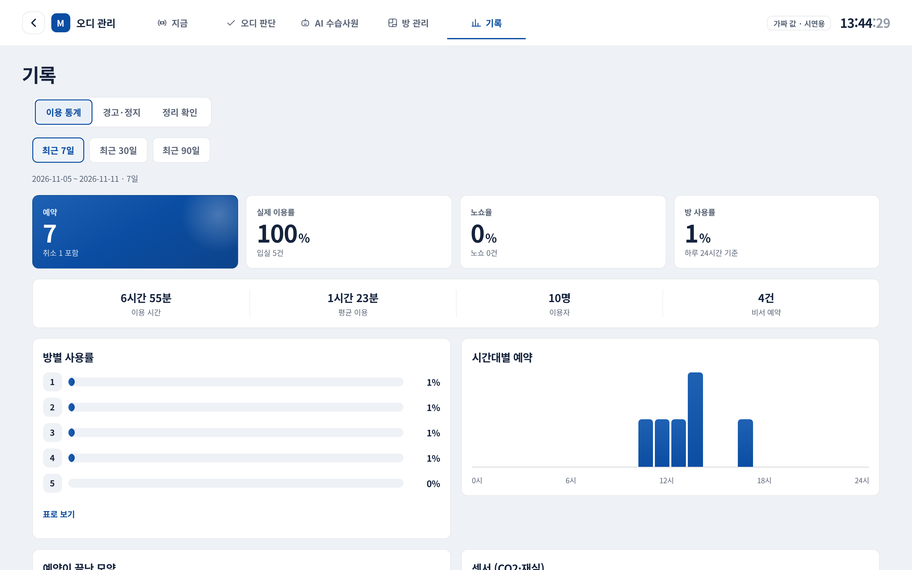

---

## 🏗 System Architecture

  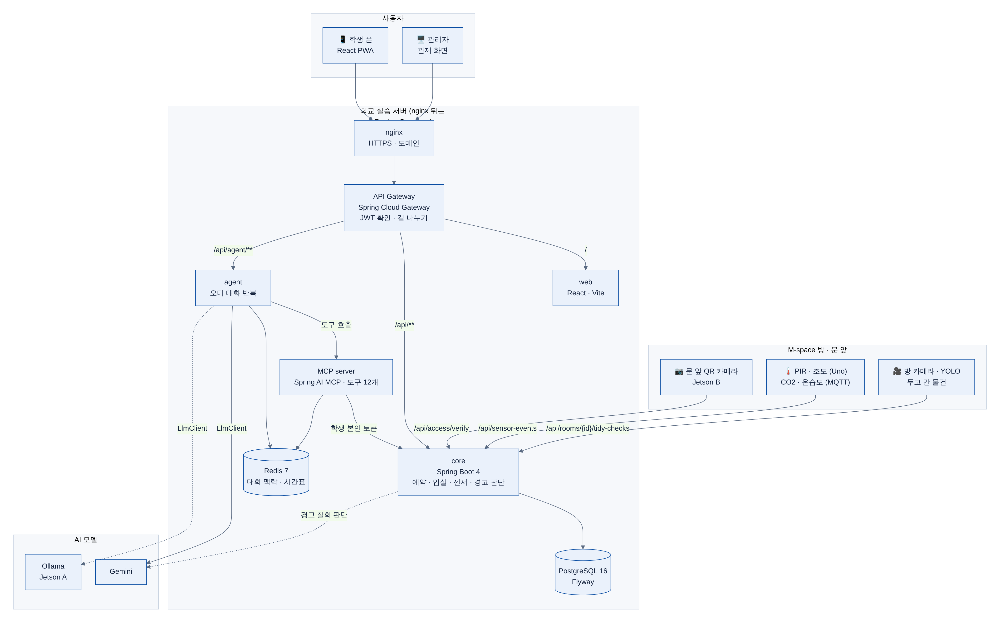

<blockquote>
  밖에서 들어오는 문은 <b>API 게이트웨이 하나</b>예요. DB에는 <b>core만</b> 닿고, 비서·QR 카메라·센서는 모두 core API를 불러요.
</blockquote>

<b>1. 들어오는 길과 보안</b>

<ul>
  <li><b>nginx (학교 서버)</b>: 도메인 → 우리 포트, HTTPS. 개발 8413, 시연 8414</li>
  <li><b>API Gateway (Spring Cloud Gateway)</b>: JWT를 먼저 확인하고 <code>/api/agent/**</code> → agent, <code>/api/**</code> → core, <code>/</code> → web으로 나눠요. 화면과 API가 같은 주소라 CORS가 필요 없어요</li>
  <li>core는 토큰과 장치 토큰을 한 번 더 확인해요. MCP·Redis·PostgreSQL은 밖으로 포트를 열지 않아요</li>
</ul>

<b>2. 서비스</b>

<table>
  <tr><th>저장소</th><th>서비스</th><th>하는 일</th></tr>
  <tr><td><a href="https://github.com/AI-go-do/mspace-web">mspace-web</a></td><td>web</td><td>학생 화면(PWA)과 관리자 관제 화면</td></tr>
  <tr><td><a href="https://github.com/AI-go-do/mspace-gateway">mspace-gateway</a></td><td>gateway</td><td>단일 입구, JWT 확인, 길 나누기</td></tr>
  <tr><td><a href="https://github.com/AI-go-do/mspace-core">mspace-core</a></td><td>core</td><td>예약 규칙, 입실 확인, 노쇼·자동 퇴실, 센서, 정리 확인, 신고·경고·AI 판단. 포트와 어댑터 구조의 모듈러 모놀리스</td></tr>
  <tr><td><a href="https://github.com/AI-go-do/mspace-assistant">mspace-assistant</a></td><td>agent · mcp-server</td><td>오디 대화 반복(<code>LlmClient</code> 뒤 Gemini·Ollama), core API를 MCP 도구 12개로 감쌈, 시간표 저장</td></tr>
  <tr><td><a href="https://github.com/AI-go-do/mspace-device">mspace-device</a></td><td>Jetson · Uno · ESP32</td><td>문 앞 QR 카메라, PIR·조도, 교육장 MQTT CO2·온습도, 방 카메라 정리 확인</td></tr>
  <tr><td><a href="https://github.com/AI-go-do/infra">infra</a></td><td>compose</td><td>서비스 전체 compose, 배포·되돌리기·관리 Actions</td></tr>
  <tr><td><a href="https://github.com/AI-go-do/docs">docs</a></td><td>문서</td><td>요구사항, API 명세, 아키텍처, 회의록, 컨벤션</td></tr>
</table>

<b>3. 바깥 장치는 포트 뒤에</b>

<table>
  <tr><th>포트</th><th>지금 (시연)</th><th>나중 (도입)</th></tr>
  <tr><td><code>LlmClient</code></td><td>Gemini</td><td>Ollama (Jetson A, 데이터가 학교 밖으로 안 나감)</td></tr>
  <tr><td><code>AccessDevice</code></td><td>문 앞 카메라 QR</td><td>실제 도어락</td></tr>
  <tr><td><code>PresenceDetector</code></td><td>PIR · 조도 · CO2 규칙</td><td>카메라 인원 세기</td></tr>
  <tr><td><code>WarningReviewer</code></td><td>Gemini (키가 없으면 규칙 판단기)</td><td>Jetson 로컬 모델</td></tr>
  <tr><td><code>NotificationChannel</code></td><td>앱 알림함 · 메일</td><td>푸시 · 메신저</td></tr>
</table>

---

## 🚀 CI/CD

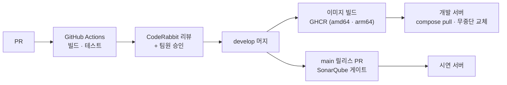

| 단계 | 내용 |
|---|---|
| **브랜치** | 간소화 Git Flow: `feat/*` → `develop`(매일 합침) → `main`(버전이 끝났을 때만). `main`·`develop` 직접 push 금지 |
| **PR 검사** | 빌드·테스트 통과 + 마지막 커밋의 CodeRabbit 리뷰 지적이 모두 해결 + 팀원 1명 승인 → Squash merge |
| **품질 게이트** | `main` 릴리스 PR은 SonarQube(학교 서버)에서 **새 코드 커버리지 80% 이상 · 중복 3% 이하 · 새 버그·취약점 0** 을 통과해야 초록 |
| **이미지** | 각 저장소 `deploy.yml`이 GHCR에 `develop`·`main`·`sha-xxxxxxx` 태그로 올려요. 외부 액션은 커밋 SHA로 고정 |
| **배포** | Actions → SSH → 학교 서버 `docker compose pull && up -d` → `/actuator/health` 확인. 이미지·설정이 그대로면 건너뛰어요 |
| **되돌리기** | `.env`의 이미지 태그를 이전 `sha-xxxxxxx`로 바꾸고 다시 켜요 (infra `rollout.yml`) |
| **비밀값** | 저장소에는 `.env.example`만. 값은 GitHub Secrets와 서버 `.env`에만 둬요 |

---

## 🗂 ERD

> core의 Flyway 마이그레이션 V1–V29를 PostgreSQL 16에 그대로 적용해 뽑은 표 29개예요. 영역 3개로 나눴어요.

<b>회원 · 방 · 예약</b> (users, rooms, reservation, 친구, 빈방 릴레이, 기간 막기)

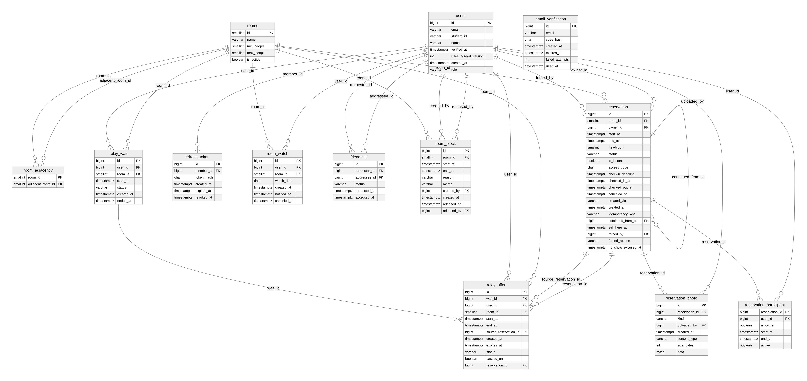

<b>입실 · 센서 · 정리 확인</b> (access_event, sensor_event, room_presence, tidy_check, retrieve_pass)

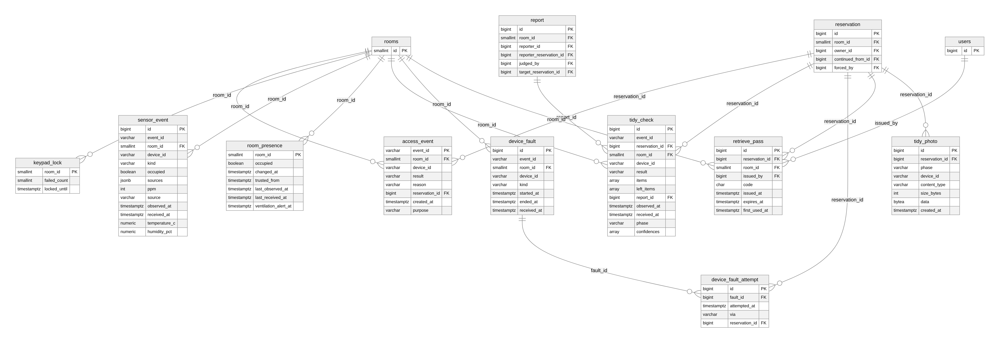

<b>신고 · 경고 · 알림</b> (report, user_warning, warning_appeal, notification)

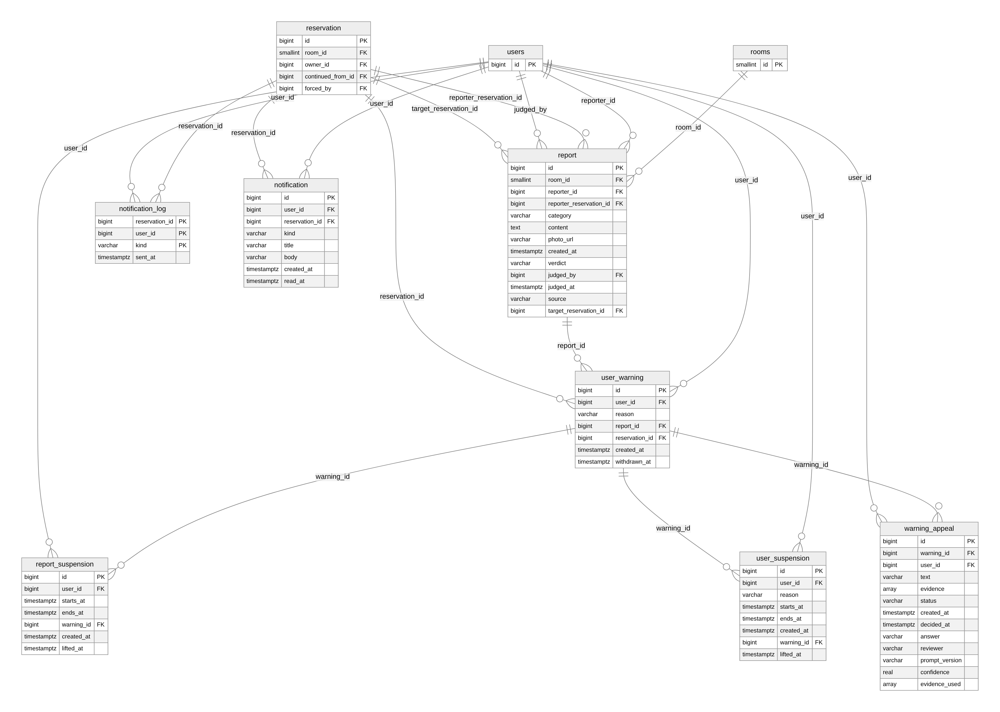

- 겹침 금지: `no_room_overlap` = `EXCLUDE USING gist (room_id WITH =, tstzrange(start_at, end_at) WITH &&)` (예약·사용 중일 때만)
- 한 사람 한 건: `one_active_per_owner` 부분 유니크 인덱스, 참여자는 `reservation_participant`의 지연 제약 트리거로 확인
- 시간은 모두 `timestamptz`, 날짜 계산은 `Asia/Seoul`

---

## ✅ 테스트

> 2026-11-10 각 저장소 `develop` CI 결과예요.

| 저장소 | 테스트 | 커버리지 | 도구 |
|---|---:|---|---|
| mspace-core | 422 | 새 코드 91.7% (SonarQube) | JUnit 5 · Testcontainers(PostgreSQL) · JaCoCo |
| mspace-assistant | 334 | SonarQube 게이트 통과 | JUnit 5 · WireMock(가짜 core) |
| mspace-gateway | 27 | 새 코드 100% (SonarQube) | JUnit 5 · Spring Security Test |
| mspace-device | 331 | 94% (pytest-cov) | pytest |
| mspace-web | 543 | — | Vitest |
| **합계** | **1,657** | | |

- 수용 기준 1개 = 테스트 1개 이상, `@DisplayName`은 한국어, given/when/then
- DB는 H2를 쓰지 않고 Testcontainers로 실제 PostgreSQL에서 돌려요 (EXCLUDE 제약까지 같은 조건)
- 오디는 같은 질문 세트로 모델·지시문 점수를 따로 재요 (`mspace-assistant/scripts/eval`)

---

  조선대학교 IT융합대학 · AI-go-do 팀

