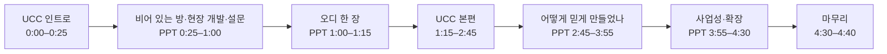

# 서류 제출 영상 구성 (5분 이내, PPT 기반 + UCC)

11/13 · 11차 회의 뒤 정리 · 발표자(내레이션) 영준

## 먼저 볼 것

| 항목 | 내용 |
| --- | --- |
| 공고 조건 | **5분 이내, PPT 기반 영상.** 파일명 `C-대표학번-성명` (학번·이름은 제출 직전에만 넣고 저장소에는 쓰지 않음) |
| 마감 | **11/16(월) 16:00** 학부 이메일로 과제설명서·신청서와 함께 |
| 만드는 법 | PPT 슬라이드를 넘기며 영준이 내레이션을 녹음하고(PowerPoint·Keynote 슬라이드 녹화), 오늘 찍은 UCC 클립을 슬라이드 안에 넣는다 |
| 목표 길이 | **4분 40초.** 5분을 넘기면 안 되니 20초를 남긴다 |
| 원칙 | 쉽게, 결과 중심(11차 결정 4). 숫자는 확인한 것만, 조건과 함께 |

## 흐름

## 장면별 구성

| # | 시간 | 화면 | 내레이션 핵심 (영준) | 심사에서 노리는 것 |
| --- | --- | --- | --- | --- |
| 1 | 0:00–0:25 | **UCC 장면 1–2**: 불 꺼진 M-SPACE, 방 찾아 헤매는 학생, 학과실 "부재" | (UCC 소리 그대로) | 주제가 한눈에 보임 |
| 2 | 0:25–1:00 | PPT: **빈 방 사진 콜라주**(1·2·3·5번 방, "11/13 평일 낮" 작게, [현장 사진](assets/2026-11-13-m-space/README.md)) → 지금 방식 4단계(학과실 → 명부 → 학생증 → 열쇠) → 설문 두 줄 | "IT융합대학 한가운데, 학교가 예산을 들여 만든 방 다섯 개입니다. 그런데 평일 낮에도 이렇게 비어 있습니다. **저희는 3주 동안 이 방에서 직접 개발하며 지켜봤습니다.** 열쇠를 받으려면 학과실에 가야 하고, 비었는지는 직접 와 봐야 압니다. 학생 **15명**에게 물었더니 **14명**이 '비었는지 가 봐야 안다', **15명 모두** 지금 방식 대신 쓰고 싶다고 했습니다." | 주제 명확성·창의성(30점). 현장에서 만든 팀이라는 신뢰. 예산 금액·이용자 수는 말하지 않음(확인한 숫자 없음) |
| 3 | 1:00–1:15 | PPT: 오디 한 장. 세 칸 "말로 예약 · QR로 입실 · 사람 없이 관리" + 단순한 구조도(학생 폰 → 오디 비서 → 예약 코어 ← QR·센서·카메라) | "그래서 오디를 만들었습니다. 말 한마디로 예약하고, 열쇠 없이 QR로 들어가고, 관리하는 사람 없이 돌아갑니다." | 무엇을 만들었는지 15초 안에 |
| 4 | 1:15–2:45 | **UCC 장면 4–8** (90초로 줄인 판): 음성 예약 → 확인 카드 → QR 입실 → 연장 알림 → 퇴실 뒤 "물건이 있어요" → 관제 화면 | (UCC 소리 + 자막 그대로) | 실제로 돌아가는 모습(완성도) |
| 5 | 2:45–3:15 | PPT: 오디 비서. 음성 GIF 작게 + "모델은 제안만, 실행은 학생 [확인]" 그림 + 점수 표(지시문 판마다 한 가지만 바꿔 잼) | "AI가 잘못 예약하지 않게, AI는 제안만 하고 실행은 학생이 확인 버튼을 눌러야 합니다. 같은 질문 43개로 판마다 점수를 쟀고 **98.5점**인 판을 골랐습니다." (젯슨 로컬 모델 결과가 나오면 한 줄: "로컬 모델은 N점이라 시연은 Gemini") | 기술 난이도를 결과 숫자로 |
| 6 | 3:15–3:35 | PPT: 두고 간 물건. 입실 전·퇴실 뒤 사진 나란히 + 정확도 | "**사람이 모두 나간 뒤에만** 방을 찍어, 들어오기 전 빈 방과 비교합니다. 물건이 남았으면 **벌하지 않고 알림만** 보냅니다. 정확도는 **89.7%**입니다(조건은 수연이 정리)." 화면에 시간 줄 그림: 입실 직전 📷 → 사용 중 저장 없음 → 퇴실 뒤 📷 | 한계를 설계로 푼 판단. **사람 있을 때 안 찍는다**를 먼저 보여 감시 오해를 막음(멘토 11/13) |
| 7 | 3:35–3:55 | PPT: 무인 관제. 방 카드 + AI 판단 카드 + 화면 아래 표기 | "CO2가 오를 것을 미리 보고 AI가 환기를 켭니다. **1번 방은 실제 센서, 나머지 방은 10/21부터 잰 실제 센서 기록으로 돌린 시뮬레이션**입니다." | 확장성. 정직 표기로 Q&A 위험 제거 |
| 8 | 3:55–4:30 | PPT: 사업성·확장. "학교에는 무료 운영 도구 / 다른 대학·무인 스터디룸에는 키트·구독" + 교학팀 대여 문의 답(평일 하루 최대 8시간) + **장비 비용 표**(5실 약 290만 원 중 잠금장치 150만 원 · 방 카메라 약 5만 원 · 판단은 서버 GPU 한 장, 젯슨을 빼면 약 220만 원, [비용 분석 4.4](../business/README.md)) | "학교에 대여를 문의해 평일 하루 최대 8시간 쓸 수 있다는 답을 받았습니다. 오디는 그 시간을 넘어 사람 없이 방을 엽니다. 방마다 붙는 건 5만 원 안팎의 카메라와 센서이고, 판단은 서버 한 곳에서 모아 합니다." 추정 금액은 화면에 "추정"으로 표시, 실구매가가 나오면 바꿈 | 활용방안·기대효과 배점. 멘토 11/13: 장비 비용을 숫자로 |
| 9 | 4:30–4:40 | UCC 장면 9: 넷이 "키 없이, 말 한마디로. 오디!" + 팀 이름·역할 | (UCC 소리) | 기억에 남는 끝 |

## UCC를 90초로 줄이는 법 (장면 4)

| UCC 장면 | 원래 | 서류 영상에서 |
| --- | --- | --- |
| 3 설문 | 10초 | 빼고 PPT 2번 슬라이드로 대신 |
| 4 음성 예약 | 30초 | 25초. 말 → 카드 → [확인]만 |
| 5 QR 입실 | 20초 | 15초 |
| 6 연장 알림 | 20초 | 10초. 알림 화면 + [연장하기] 누름만 |
| 7 퇴실·물건 알림 | 20초 | 20초 그대로(문구 "물건이 있어요", 경고 없음) |
| 8 관제 | 25초 | 20초. 시뮬레이션 표기 자막은 꼭 남김 |

## 제출 전 확인

| 확인 | 기준 |
| --- | --- |
| 길이 | 5:00 미만(목표 4:40) |
| 현장 사진 | 찍은 날(11/13 평일 낮)이 보임. 예산 금액·"3주 동안 1명" 같은 확인 안 된 숫자 없음 |
| 숫자 | 설문 15명, 비서 98.5점(43문항), 탐지 약 89%(조건 함께), 관제 시뮬레이션 표기. "300명", "98.9%" 같은 말 없음 |
| 개인정보 | 실제 학번·이름·입실 번호·QR이 화면에 없음(테스트 계정 99999001~, 편집에서 가림) |
| 경고 문구 | 두고 간 물건 장면에 "경고" 문구가 안 보임(요구사항 v0.4.40) |
| 소리 | 내레이션과 UCC 소리 크기 맞춤, 자막 있음 |
| 파일명 | `C-대표학번-성명` |

배점 참고(11차 회의 보드): 주제 명확성·창의성 30 · 난이도 20 · 활용성·기대효과 20 · 완성도 10 · 내용 전달력 10 · Q&A 10. 서류 심사 배점은 공고 원문과 대조 필요.

근거: [11차 회의](../meetings/2026-11-13-11차-회의.md), 설문 집계(15명), 비서 평가 기록(v4d 98.5), [비용 분석](../business/README.md), IT Festival 2026 공고(제출 조건).
