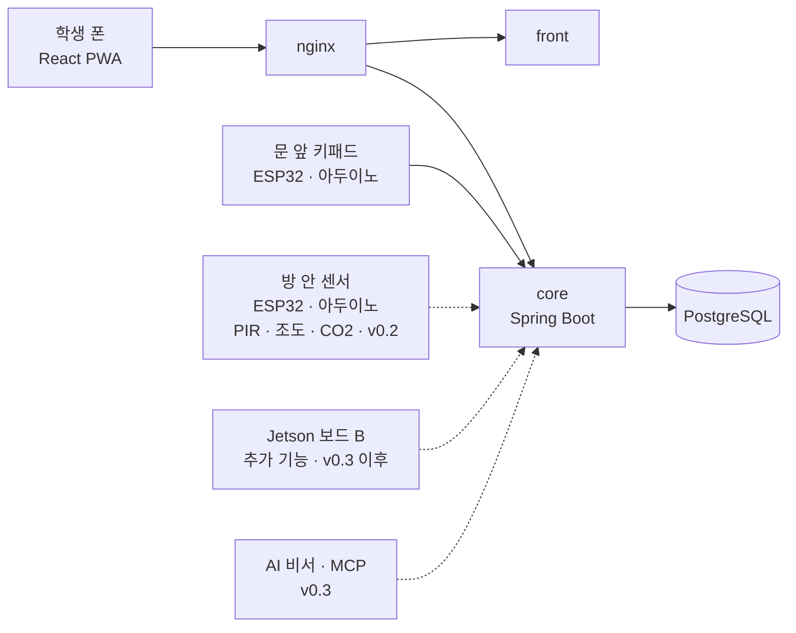
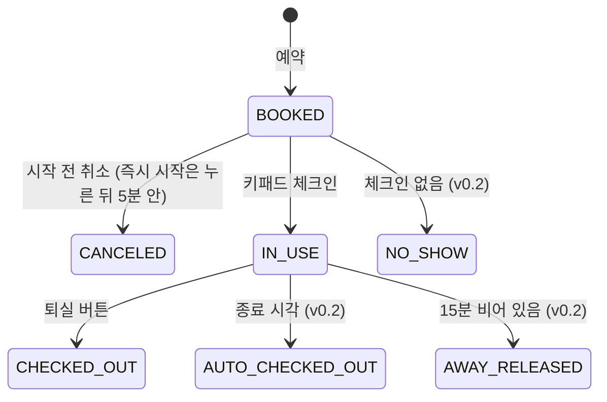

# M-space 예약 시스템 요구사항 명세 (v0.4.25)

| 항목 | 내용 |
|---|---|
| 버전 | v0.4.25 |
| 작성일 | 2026-10-30 · 최종 수정 2026-11-08 |
| 상태 | 초안. 팀 확인 후 확정 |
| 근거 | M-SPACE 예약 규칙 v2(10/30), 1–8차 팀 회의(10/29–11/6), 학생 설문 |
| 관련 문서 | [PWA 화면 시안](https://claude.ai/artifact/53VnMrNdg3qqS7nzVAnxQD), `schema-v2.sql`, [인프라 · CI/CD](../infra/infra-cicd.md), [팀 컨벤션](../conventions.md), 버전 지도 |

**목차**
1. 왜 만드나
2. 어떻게 만드나
3. 버전별 범위
4. 용어와 예약 상태
5. 사용자
6. 작성 규칙
7. v0.1 요구사항 (상세)
8. v0.2 · v0.3 요구사항 (목록)
9. 미결 사항
10. 변경 이력

---

## 1. 왜 만드나

IT융합대학 M-space는 학생들이 회의와 스터디를 하는 방이다. 지금은 이렇게 쓴다.

> 교학팀에서 명부 작성 → 학생증 맡김 → 열쇠 받음 → 사용 → 열쇠 반납

이 방식은 **사람(교학팀)이 있어야만** 돌아간다. 그래서 세 가지 문제가 생긴다.

| 문제 | 실제로 겪는 일 |
|---|---|
| 관리가 끊긴다 | 교학팀은 18시에 퇴근한다. 시험 기간에는 24시간 열어 두지만 관리하는 사람이 없다 |
| 비었는지 모른다 | 방이 비었는지 직접 가 봐야 안다. 설문에서 가장 큰 불편 |
| 반납·신분증이 번거롭다 | 학과실이 닫히면 열쇠를 반납할 수 없다. 매번 학번을 적고, 학생증을 맡기는 게 불안하다 |

학생 설문(2026-10, 응답 약 6명, 추가 수집 중)에서 **열쇠 없이 예약만으로 이용하는 데 약 83%가 찬성**했다.

**그래서 우리가 만드는 것**: 사람이 없어도 "누가, 언제, 어느 방을 쓰는지"를 시스템이 기록하고 지키며, **예약만으로 문을 여는** M-space 예약·출입 시스템.

---

## 2. 어떻게 만드나

### 2.1 원칙

| 원칙 | 뜻 | 이렇게 한다 |
|---|---|---|
| 사람 대신 규칙이 지킨다 | 관리자가 없어도 규칙이 깨지지 않아야 한다 | 겹침 금지·1인 1건(대표자·참여자)·2시간 같은 규칙은 **DB 제약**으로 막는다. 동시 요청 100건에서 중복 0건 |
| 작게 만들고 바로 배포한다 | 다 만든 뒤 배포하지 않는다 | 첫날 빈 화면을 배포하고, 기능 하나를 붙일 때마다 폰으로 확인한다 |
| 갈아 끼울 수 있게 만든다 | 학교가 도입하면 실제 장비로 바꿀 수 있어야 한다 | 메일 인증 ↔ 학교 DB, 키패드 ↔ 실제 도어락, Gemini ↔ Ollama를 **인터페이스(포트) 뒤**에 둔다 |
| 사진·영상 남기지 않기 | 개인정보를 남기지 않는다 | 재실은 PIR·조도·CO2 센서로 판단한다(레이더 센서는 8차 회의에서 환불하기로 함). 방 카메라는 퇴실 뒤 정리 확인(FR-DEV-105)에만 쓰고, 장치 안에서 사람 수·물건 이름만 뽑고 화면은 바로 버린다. 사진·영상은 저장·전송하지 않는다(11/6 지영, Q-17) |
| AI는 붙이기 쉽게 | 나중에 비서가 예약을 대신 해 줄 수 있어야 한다 | 모든 기능을 API로 열고 자동 문서(OpenAPI)를 만든다. 비서는 이 API를 MCP 도구로 쓴다 |

### 2.2 구성



- 서버는 학교 실습 서버 한 곳에서 `docker compose`로 띄운다. 비용 0원.
- 점선은 나중 버전에 붙는 부분이다.

### 2.3 일정

| 기간 | 할 일 |
|---|---|
| 11/2 – 11/5 | v0.1 예약 한 바퀴 |
| 11/6 – 11/10 | v0.2 사람 없이 돌아감 |
| 11/11 – 11/13 | v0.3 운영·AI. 11/13 기능 동결 |
| 11/14 – 11/15 | 시연 영상 촬영 · 과제설명서 |
| **11/16 (월) 16:00** | 1차 제출 마감: 5분 발표 영상 + 과제설명서 |
| **11/19 (목)** | 본선 발표 (IT 페스티벌 당일) |

- 대회 날짜는 [아키텍처](../architecture/README.md)의 공고문 기준 일정과 맞췄다(4차 회의 "11/16 제출 / 11/19 본선"). 11/20 수업 발표가 따로 있는지는 확인 필요

---

## 3. 버전별 범위

| 버전 | 한 줄 | 들어가는 것 |
|---|---|---|
| **v0.1** | 예약 한 바퀴 | 배포 파이프라인, 학교 메일 로그인, 방 목록, 예약(겹침·1인 1건·2시간·30분·7일), 참여자·방별 인원, 내 예약, 시작 전 취소, 6자리 번호 → 키패드 체크인, 퇴실 |
| **v0.2** | 사람 없이 돌아감 | 자동 퇴실, 노쇼, 즉시 시작, 연장하기(1회), 알림 2종, 방 현황 화면, 재실·환기 센서(ESP32·아두이노) |
| **v0.3** | 운영 · AI | 신고, 사진 체크인·아웃, 허위 신고 판정(관리자), AI 비서(MCP) |

**하지 않는 것**
- 카메라 사진·영상 저장·전송, 얼굴 인식. 방 카메라는 정리 확인(FR-DEV-105)에 글자만 보낸다(11/6 지영). 카메라 인원 세기로 재실을 판단할지는 Q-17
- 키박스
- 학교 학사 DB 직접 연동 (인터페이스만)
- 학과 공지·휴강 수집 (8차 회의: 범위는 M-SPACE 안. 학생이 직접 넣는 내 시간표 FR-AGT-102a~는 유지)
- 실제 도어락 (어댑터 설계만)

**입실 방식 (8차 회의, 11/6)**: 시험용 방 **1실**에서 키패드 → NFC → QR 차례로 시도한다. 시연은 QR 입실(+ 카메라 인원 세기는 Q-17 결정에 따름)이고, 키패드는 "1차 시도"로 발표 슬라이드에 남긴다. 방식별 API 모양은 Q-16.

---

### 3.1 이용 수칙

예약할 때 동의를 받고, 위반은 신고(FR-RPT-101)와 관리자 판정(FR-RPT-103)으로 처리한다. 비서가 답하는 이용 규칙(Q-10 ③)에도 이 표가 들어간다.

| 구분 | 수칙 | 어기면 |
|---|---|---|
| 소음 | 회의·대화는 괜찮다. 옆 방에 들릴 만큼 떠들거나 장난치지 않는다 | 신고가 사실로 판정되면 경고. 심하거나 반복되면 이용 정지(퇴출) |
| 음식 | **음식물 반입 금지.** 먹을 것과 마실 것(음료 포함) 모두 가져올 수 없다 | 신고가 사실로 판정되면 경고. 기기·비품이 고장 나면 **배상을 요구**한다 |
| 정리 | 퇴실 전에 쓰레기를 버리고 자리를 정리한다 | 다음 사람이 어질러짐을 신고하고 사실로 판정되면 경고·이용 제한 등 불리하게 처리 |
| 노쇼 | 시작 15분 안에 키패드로 입실한다(즉시 시작은 10분) | 예약이 자동으로 풀린다(FR-RSV-102). **30일 안에 2번이면 14일 이용 정지**(대표자·참여자 모두, FR-RSV-106) |
| 자리 비움 | 짐만 두고 자리를 맡아 두지 않는다. 사용 중에 오래 비우지 않는다 | 센서가 10분 비어 있음을 보면 "5분 안에 돌아와 주세요" 알림, 15분이면 자동 퇴실(FR-DEV-103). **30일 안에 3번이면 노쇼 1번**으로 센다 |
| 증빙 | 체크인·퇴실 때 방 사진을 찍어 두기를 권한다(선택) | 사진이 없으면 분쟁 때 내가 정리했다는 증빙이 없어 불리할 수 있다 |
| 문 | 나갈 때 문이 닫혔는지 확인한다. 문을 괴어 두거나 번호를 예약자 밖 사람에게 알려 주지 않는다 | 무단 사용이 확인되면 그 예약 대표자에게 경고 |
| 소지품 | 퇴실 전에 챙긴다. 잠깐 나갈 때도 귀중품은 들고 나간다 | 예약이 끝나 문이 잠기면 다시 예약해야 들어갈 수 있다(3.2) |

**제재 단계** (경고·정지는 11/6 지영 확정. 심한 소음·고의 파손 즉시 정지와 배상은 제안, 교학팀 확인 필요)

| 단계 | 조건 | 조치 |
|---|---|---|
| 경고 (**확정**, 11/6 지영) | 신고가 사실로 판정 1회 | 그 방 **직전 이용 예약의 대표자**에게 알림으로 경고, 기록에 남김(FR-RPT-104) |
| 이용 정지 (**확정**, 11/6 지영) | 30일 안에 경고 3회 | 3번째 경고 때부터 14일 동안 예약·연장 불가. 정지가 걸리면 그 전 경고는 다시 세지 않음 |
| 즉시 정지 (제안) | 심한 소음·고의 파손 | 14일 이용 정지 (아직 만들지 않음) |
| 신고 정지 (**확정**, 11/6 지영) | 30일 안에 허위 신고 판정 3회 | 14일 동안 신고 불가(예약은 됨). 위반 경고와 따로 셈(FR-RPT-103) |
| 노쇼 정지 (**확정**, 11/4 지영) | 30일 안에 노쇼 2회(대표자 기록. 자리 비움 3번 = 노쇼 1번) | 2번째 노쇼가 처리된 때부터 14일 동안 대표자·참여자 모두 예약 불가. 정지가 끝나면 횟수는 처음부터(FR-RSV-106) |
| 배상 | 기기·비품 고장 | 관리자가 수리비를 따로 청구(시스템 밖에서 처리, 기록만 남김) |

### 3.2 이어 쓰기 · 퇴실 · 문 잠김 (11/3 회의)

키패드 입실에서 "안에 있는데 새 번호를 어떻게 넣나", "퇴실해야 문이 잠기나", "갇히지 않나"를 정리한 것이다. 문 하드웨어에 대한 내용은 **가정**이고 IoT 담당 확인이 필요하다(Q-14).

**전제 (가정, 확인 필요)**

| 항목 | 가정 | 근거 |
|---|---|---|
| 잠금 | 문은 닫히면 저절로 잠긴다(자동 잠금 도어락). 바깥에서는 번호로만 연다 | 일반 디지털 도어락 동작. 시연은 키패드 모형 |
| 안쪽 열기 | 안에서는 번호 없이 손잡이·버튼으로 **언제나** 열린다. 서버·와이파이·전원이 죽어도 열린다 | 갇힘 방지(피난). 장치 요구사항으로 고정한다(NFR-ACC-001) |
| 퇴실과 잠금 | 퇴실은 문을 잠그지 않는다. 퇴실은 **번호를 끄는 것**이다. 잠그는 것은 문이 닫힐 때 도어락이 한다 | FR-ACC-001: 서버는 "열어도 된다"만 답한다 |

**시나리오별 정리**

| # | 상황 | 생기는 문제 | 정한 동작 |
|---|---|---|---|
| S-1 | 13:00–14:00 사용 중, 13:50에 14:00–15:00을 이어 잡으려 함 | 대표자 동시 1건이라 지금 예약이 끝나기 전에는 새 예약이 거절된다(`OWNER_HAS_ACTIVE_RESERVATION`) | 사용 중 카드의 **"연장하기"**(FR-RSV-105, Q-12). 퇴실과 새 예약을 한 번에 처리해, 새 예약이 실패하면 지금 예약이 그대로 남는다. 그 전까지는 먼저 퇴실하고 새로 잡는다(FR-RSV-104). 이 경우 그 사이 다른 팀이 먼저 잡을 수 있다 |
| S-2 | 이어 잡은 새 예약의 번호를 받았지만 방 **안**에 있음 | 키패드는 바깥에 있다. 체크인을 안 하면 새 예약이 15분 뒤 노쇼로 풀려, 사람이 안에 있는데 다른 팀이 예약할 수 있다 | "연장하기"로 잡은 예약은 처음부터 사용 중이라 키패드가 필요 없다. 따로 잡은 새 예약은 바깥 키패드에 새 번호를 넣고, 잊으면 노쇼 5분 전 알림(FR-NTF-104)이 간다 |
| S-3 | 안에 가만히 있는데 문이 닫혀 잠김 | 갇힘 걱정 | 안쪽은 언제나 열린다(전제). 잠김은 바깥에서 들어오는 것만 막는다 |
| S-4 | 일찍 나가며 퇴실을 안 누름(사진도 귀찮아서 건너뜀) | 종료 시각까지 방이 묶이고 번호도 살아 있다 | 종료 시각에 자동 퇴실(FR-RSV-101). 센서가 10분 비어 있음을 보면 "5분 안에 돌아와 주세요" 알림, 15분이면 자리 비움으로 자동 퇴실(FR-DEV-103). 사진은 선택이고 안 찍으면 증빙이 없을 뿐이다 |
| S-5 | 잠깐 나갔다 오니 예약이 끝나 문이 잠김. 소지품이 안에 있음 | 끝난 예약의 번호는 무효라 못 들어간다 | **다음 예약이 없으면** 지금 바로 다시 예약해 새 번호로 들어간다. 단 연장까지 쓴 직후 30분 안이면 연속 사용 제한(FR-RSV-105)에 걸린다. 다음 팀이 쓰고 있으면 노크해서 부탁한다. 둘 다 안 되면 교학팀 |
| S-6 | 퇴실 후 번호를 다시 누름 | 끝난 예약 번호로 문이 열리면 무단 사용 | 퇴실·자동 퇴실·취소·노쇼가 되는 순간 번호는 무효(FR-ACC-001) |

**이어 쓰기 방식 비교 (Q-12, 11/3 회의)**

| | A. 키패드 다시 입력 | B. 서버가 기억했다가 노쇼 면제 | C. "연장하기" 한 번에 (결정) |
|---|---|---|---|
| 방법 | 퇴실 → 새 예약 → 나가서 새 번호 입력. 노쇼 5분 전 알림 | 퇴실 → 새 예약. 같은 방·같은 대표자가 방금 쓰던 방이면 체크인 없이 노쇼 안 됨 | 사용 중 카드 버튼 하나. core가 한 트랜잭션에서 지금 예약 퇴실 + 새 예약을 바로 사용 중으로 만든다 |
| 사용자 불편 | 큼. 휴대폰을 못 보면 안에 있는데 노쇼 | 작음 | 가장 작음 |
| 사이에 남이 잡음 | 생김 (호출 2번) | 생김 (호출 2번) | 안 생김. 새 예약이 실패하면 퇴실도 롤백 |
| 악용 | 없음(키패드가 현장 확인) | 나간 뒤 원격으로 다시 잡아도 노쇼가 안 됨 → 빈 방이 묶임 | 사용 중(`IN_USE`)일 때만, 종료 10분 전–종료 전에만 버튼이 켜진다. 비어 있으면 센서 확인 알림 → 자동 퇴실(FR-DEV-103) |
| 동시성 | 기존 제약으로 충분 | "기억" 기간·조건을 노쇼 스케줄러가 읽어야 함 | 퇴실은 조건부 UPDATE(한 번만), 새 구간은 `no_room_overlap`이 결정. 두 번 눌러도 한 번만 |
| core 변경 | 알림 1종 | 노쇼 판정 조건 + 기억 저장 | API 1개 + 컬럼 1개(`continued_from_id`). 즉시 시작(Q-01 CHECK)에 기댄다 |

- **연장은 1회만(11/3 영준 결정).** 횟수 1은 설정값(`max-extensions`)이다. 연속 사용은 최대 "원래 예약 + 연장 1회"다.
- **우회 막기**: 퇴실한 뒤 직접 새 예약을 잡아 연장 제한을 피하지 못하게, 같은 대표자의 직전 예약이 끝난 뒤 30분(설정값 `chain-gap-minutes`) 안에 시작하는 새 예약은 **이어진 사용**으로 본다. 이어진 사용에 이미 연장이 있으면 새 예약도 연장도 `409`로 막는다. 30분이 지나면 새로 잡을 수 있다(하루 횟수 제한은 그대로 없음).
- ~~막지 못하는 것: 참여자가 대표자가 되어 새로 잡는 경우.~~ **11/5 지영 결정으로 막는다**: 대표자든 참여자든 끝나지 않은 예약은 1건만(FR-RSV-003). 참여자로 들어간 예약이 끝나기 전에는 대표자로도 참여자로도 새 예약에 들어갈 수 없다.
- C가 core에 들어가기 전(또는 v0.2에서 빠지면)에는 A로 운영한다. A여도 FR-NTF-104는 넣는다.

**S-5에서 남는 빈틈 (Q-13)**: "지금 바로 다시 예약"은 v0.2 즉시 시작이 있어야 된다(v0.1은 다음 30분 칸부터). 또 방 최소 인원(3명)과 대표자 동시 1건 때문에, 혼자 소지품만 찾으려는 사람이나 다른 예약이 잡혀 있는 사람은 바로 못 잡는다.

---

## 4. 용어와 예약 상태

| 용어 | 뜻 |
|---|---|
| 방 | 창작실 1–5(현장 배치도 표기). 문서의 "N번 방"은 "창작실 N"과 같다. 방마다 최소·최대 인원이 있다. 옆의 3D프린터 공작실은 예약 대상이 아니다 |
| 예약 | 대표자가 한 방을 시작–종료 시각 동안 쓰겠다는 기록. 참여자 목록을 가진다 |
| 대표자 | 예약을 만든 사람. 참여자 목록에도 들어간다 |
| 참여자 | 예약에 함께 들어간 회원(대표자 포함). 대표자든 참여자든 끝나지 않은 예약은 동시에 1건만(11/5) |
| 끝나지 않은 예약 | 상태가 `BOOKED`(예약됨) 또는 `IN_USE`(사용 중)인 예약 |
| 체크인 | 키패드에 번호를 입력해 입실한 것 |
| 퇴실 | 사용을 마친 것. 버튼(즉시) 또는 종료 시각(자동). 퇴실하면 방이 바로 빈다 |
| 취소 | 시작 전에 대표자가 예약을 없애는 것. 즉시 시작은 누른 뒤 5분 안, 입실 전까지(11/6) |
| 노쇼 | 정한 시간 안에 체크인하지 않은 것. 방이 풀린다 |
| 자리 비움 | 체크인한 뒤 재실 센서가 15분 동안 아무도 없다고 본 것. 자동 퇴실되고 방이 풀린다. 노쇼(한 번도 안 옴)와 다르게 센다 |
| 미리 예약 | 미래 시각을 잡는 예약 |
| 즉시 시작 | 지금 빈 방을 누른 시각부터 쓰는 예약 (v0.2) |
| 시간 구간 | `[시작, 종료)`. 10:00–11:00 뒤의 11:00–12:00은 겹치지 않는다 |



- `BOOKED`·`IN_USE`를 벗어나는 순간 겹침·대표자 제약에서 빠지므로 방과 대표자가 바로 풀린다.
- 상태 이름은 제안이다. `schema-v2.sql`에 다른 이름이 있으면 그쪽을 따른다.

---

## 5. 사용자

| 사용자 | 설명 | 버전 |
|---|---|---|
| 학생 | 학교 메일 인증을 마친 회원. 대표자 또는 참여자 | v0.1 |
| 문 앞 장치 | 키패드 번호를 core에 확인 요청 | v0.1 |
| 관리자 | 신고 기록을 보고 판정 | v0.3 |
| AI 비서 | 사용자 대신 core API 호출 | v0.3 |

---

## 6. 작성 규칙

| 항목 | 규칙 |
|---|---|
| ID | `<FR\|NFR>-<영역>-<번호>`. 번호는 영역별 001부터. v0.2 이후 기능은 101부터 |
| 영역 | `AUTH` 로그인 · `ROOM` 방 · `RSV` 예약 · `ACC` 출입 · `NTF` 알림 · `RPT` 신고 · `DEV` 센서 · `AGT` 비서 · `WEB` 화면 · `INF` 인프라 · `COM` 공통 |
| 우선순위 | **필수**(없으면 시연 불가) / **권장** / **선택** |
| 상태 | `초안` → `확정` → `구현 중` → `완료` / `폐기` |
| 한 건의 모양 | 설명 / 규칙(한 줄에 하나) / 수용 기준(`조건 / 행동 / 결과`) / 관련 |

- 확정된 뒤에는 지운 번호를 다시 쓰지 않는다(상태만 `폐기`).

---

## 7. v0.1 요구사항 (상세)

### 7.1 붙이는 순서

붙일 때마다 개발 서버에 배포하고 폰으로 확인한다.

| 순서 | 붙이는 것 | 폰으로 확인할 것 | 요구사항 |
|---|---|---|---|
| 0 | 배포 파이프라인 + 빈 화면 | 주소 접속, `/actuator/health`, develop 합치면 자동 반영 | NFR-INF-001–003 |
| 1 | 학교 메일 로그인 | 메일 번호 입력 → 내 이름·학번 표시 | FR-AUTH-001 |
| 2 | 방 목록 + 예약 생성 | 예약 성공, 겹침·2시간 초과·8일 뒤 거절 | FR-ROOM-001, FR-RSV-001–003 |
| 3 | 참여자 + 인원 확인 | 학번 검색(홍*동), 인원 미달 거절 | FR-RSV-004, FR-RSV-005 |
| 4 | 내 예약 + 취소 | 참여자 폰에도 보임, 취소 후 다른 팀이 예약 | FR-RSV-006, FR-RSV-007 |
| 5 | 6자리 번호 + 키패드 체크인 | 번호 입력 → 열림, 상태 사용 중 | FR-ACC-001 |
| 6 | 퇴실 | 방이 바로 비고 새 예약 가능 | FR-RSV-008 |

- 키패드가 늦어지면 5번은 웹 "입실" 버튼으로 먼저 시연한다. 키패드는 같은 API를 부르는 어댑터로 나중에 붙인다.

### 7.2 기능 요구사항 목록

| ID | 이름 | 우선순위 | API |
|---|---|---|---|
| FR-AUTH-001 | 학교 메일 인증 가입·로그인 | 필수 | `POST /api/auth/email-codes`, `POST /api/auth/login` |
| FR-AUTH-002 | 자동 로그인 · 로그아웃 | 필수 | `POST /api/auth/refresh`, `POST /api/auth/logout` |
| FR-ROOM-001 | 방 목록 조회 | 필수 | `GET /api/rooms` |
| FR-RSV-001 | 예약 생성 | 필수 | `POST /api/reservations` |
| FR-RSV-002 | 같은 방 시간 겹침 거절 | 필수 | `POST /api/reservations` |
| FR-RSV-003 | 회원당 끝나지 않은 예약 1건 (대표자·참여자 모두) | 필수 | `POST /api/reservations` |
| FR-RSV-004 | 참여자 추가 (친구 중에서, 11/6) | 필수 | `GET /api/friends`, `POST /api/friends/requests` |
| FR-RSV-005 | 방별 인원, 참여자 같은 시간 두 방 금지 | 필수 | `POST /api/reservations` |
| FR-RSV-006 | 내 예약 조회 (대표자·참여자) | 필수 | `GET /api/reservations/me` |
| FR-RSV-007 | 시작 전 취소 | 필수 | `POST /api/reservations/{id}/cancel` |
| FR-RSV-008 | 퇴실 | 필수 | `POST /api/reservations/{id}/checkout` |
| FR-ACC-001 | 6자리 번호 → 키패드 체크인 | 필수 | `POST /api/access/verify` |
| FR-WEB-001 | 예약 화면 | 필수 | — |
| FR-WEB-002 | 내 예약 화면 | 필수 | — |
| FR-WEB-003 | 이용 규칙 화면 | 필수 | `GET /api/rules` |
| FR-WEB-004 | 홈 (배치도 + 오늘 방 현황) | 필수 | `GET /api/rooms`, 방별 오늘 예약 시간 |
| FR-WEB-005 | 예약 완료 · 입실 번호 화면 | 필수 | `GET /api/reservations/me` |
| FR-WEB-006 | 예약이 안 될 때 안내 | 필수 | 서버 오류 `code` |

---

### FR-AUTH-001 학교 메일 인증 가입·로그인

- **설명**: 학생은 학교 메일로 받은 인증 번호로 가입·로그인한다. 인증을 마친 회원만 예약하거나 참여자로 추가될 수 있다.
- **규칙**
  - `@chosun.ac.kr` 주소만 받는다.
  - 인증 번호는 6자리, 10분 유효. 5번 틀리면 다시 받아야 한다. 같은 주소로 1분에 1번만 보낸다.
  - 처음 인증하면 이름과 학번을 받아 회원을 만든다. 학번은 회원마다 하나.
  - 로그인하면 JWT(액세스 토큰, 1시간)를 준다. 토큰에 권한 범위(scope)를 둔다. 개인정보는 넣지 않는다.
  - 본인 확인은 `IdentityVerifier` 뒤에 둔다. v0.1은 학교 메일 어댑터 하나. 학교 DB 연동은 인터페이스만.
  - 메일은 `NotificationChannel`(메일) 어댑터로 보낸다. 로컬·테스트에서는 로그에 번호를 찍는다.
- **수용 기준**
  - [ ] 조건: 가입 이력 없음 / 행동: `a@chosun.ac.kr`로 번호 요청 → 번호·이름·학번 입력 / 결과: 회원 1명 생성, 토큰 발급
  - [ ] 조건: 이미 가입 / 행동: 같은 주소로 다시 인증 / 결과: 같은 회원으로 로그인
  - [ ] 조건: — / 행동: `a@gmail.com`으로 요청 / 결과: `400` "학교 메일만 사용할 수 있습니다"
  - [ ] 조건: 번호 발급 후 11분 / 행동: 그 번호 입력 / 결과: `400` (만료)
  - [ ] 조건: 다른 회원이 학번 `20231234` 사용 중 / 행동: 같은 학번으로 가입 / 결과: `409`
- **관련**: FR-RSV-004, NFR-COM-003, FR-AUTH-002

### FR-AUTH-002 자동 로그인 · 로그아웃

- **설명**: 학생이 앱을 열 때마다 메일 인증을 다시 하지 않도록, 한 번 로그인하면 쓰는 동안 로그인이 유지된다.
- **규칙**
  - 로그인하면 액세스 토큰(1시간)과 refresh 토큰(14일)을 함께 준다.
  - 액세스 토큰이 끝나면 화면이 refresh 토큰으로 새 한 쌍을 받는다. 학생은 아무것도 하지 않는다.
  - refresh 토큰은 한 번 쓰면 새것으로 바뀐다(회전). 기한은 마지막으로 쓴 때부터 14일.
  - refresh 토큰은 DB에 해시로만 저장한다. 로그아웃하면 바로 끊는다.
  - 이미 쓴 refresh 토큰이 다시 오면 도난으로 보고 그 회원의 refresh 토큰을 모두 끊는다.
  - 기간(1시간·14일)은 설정값으로 둔다(`JWT_TTL`, `JWT_REFRESH_TTL`).
  - **같은 폰(브라우저)에서 마지막으로 쓴 지 14일이 안 됐으면 로그인 없이 바로 통과한다.** 다시 로그인하는 때는 처음 설치, 로그아웃, 다른 폰·브라우저, 브라우저 데이터 삭제, 14일 동안 안 씀뿐이다.
  - 앱을 열면 로그인 화면이 아니라 로딩 화면을 먼저 보여 준다. 그동안 ① 토큰이 있나 ② 액세스 토큰이 살아 있나(살아 있으면 바로 메인) ③ refresh로 새로 받기(성공하면 메인)를 확인하고, 실패했을 때만 로그인 화면을 보여 준다.
  - 화면: 마지막 학교 메일을 기억해 채우고, 번호칸에 `autocomplete="one-time-code"`. refresh는 동시에 한 번만 부른다.
  - 로그인이 끊겨도 예약·입실 번호는 그대로다. 다시 로그인하면 같은 회원으로 보인다.
  - **보안 체크 (운영 전 필수)**
    - 서버에는 `JWT_SECRET`(32바이트 이상)을 반드시 넣는다. 비우면 재시작할 때마다 토큰이 무효가 된다(로컬 전용).
    - 운영에서는 `MSPACE_DEV_HEADER=false`. 비서도 `X-User-Id`를 넘기지 않고 `Authorization`만 넘긴다.
    - nginx에서 `/api/auth/` 요청 횟수를 제한한다(인증번호·refresh 막 찌르기 방지).
    - 토큰은 HTTPS로만 오간다(학교 nginx HTTPS). 로그에 토큰·인증번호 원문을 남기지 않는다. 운영에서는 `MAIL_ENABLED=true`(false면 인증번호가 서버 로그에 찍힘).
    - 화면은 토큰을 다른 사이트 스크립트가 읽지 못하게 한다(외부 스크립트 최소화). 필요하면 refresh 토큰만 `HttpOnly` 쿠키로 옮긴다.
  - 게이트웨이(nginx)는 `/api/agent/`로 넘기기 전에 `auth_request`로 core `GET /api/auth/check`를 불러 토큰을 확인한다. 가짜 토큰으로 비서가 Gemini 무료 한도를 쓰지 않게 하기 위해서다. core는 토큰이 맞으면 `204`, 아니면 `401`.
- **수용 기준**
  - [ ] 조건: 가짜 토큰 / 행동: `POST /api/agent/chat` / 결과: 게이트웨이에서 `401`, 비서 서버까지 가지 않음
  - [ ] 조건: 로그인 후 2시간 / 행동: refresh 토큰으로 요청 / 결과: `200`, 새 액세스·refresh 토큰. 받은 refresh 토큰은 다시 쓰면 `401`
  - [ ] 조건: 13일마다 refresh / 행동: 3번 반복 / 결과: 계속 `200` (기한이 이어짐)
  - [ ] 조건: 14일 동안 안 씀 / 행동: refresh / 결과: `401` `REFRESH_TOKEN_INVALID` → 로그인 화면
  - [ ] 조건: 이미 바꾼 옛 refresh 토큰 / 행동: refresh / 결과: `401`, 그 회원의 새 refresh 토큰도 `401`
  - [ ] 조건: 로그아웃 / 행동: 같은 refresh 토큰으로 refresh / 결과: `401`
  - [ ] 조건: 어제 쓴 학생, 액세스 토큰 끝남 / 행동: 앱 열기 / 결과: 로그인 화면 없이 로딩 → 메인
- **관련**: FR-AUTH-001, NFR-COM-003

### FR-ROOM-001 방 목록 조회

- **설명**: 학생은 예약할 수 있는 방과 방별 인원을 본다.
- **규칙**
  - 방은 이름, 최소 인원, 최대 인원, 사용 가능 여부를 가진다.
  - 1–4번 방은 3–5명, 5번 방은 5–8명.
  - 사용 불가(수리 중 등) 방은 목록에 나오지 않는다.
  - 방 데이터는 Flyway 초기 데이터로 넣는다. 인원 숫자는 코드가 아니라 방 테이블에 둔다.
  - 옆 방 신고(v0.3)를 위해 이웃 방 정보를 둘 자리를 만든다.
- **수용 기준**
  - [ ] 조건: 방 5개 중 1개 사용 불가 / 행동: 목록 조회 / 결과: 4개, 각각 최소·최대 인원 포함
  - [ ] 조건: 로그인 안 함 / 행동: 목록 조회 / 결과: `401`
- **관련**: FR-RSV-005, FR-WEB-001

### FR-RSV-001 예약 생성

- **설명**: 대표자는 방, 시작·종료 시각, 참여자를 골라 미리 예약한다.
- **규칙**
  - 시각은 30분 단위(정각·30분)만 받는다.
  - 1회 최대 2시간. 종료는 시작보다 뒤.
  - **시작 시각**이 오늘(서울 시간)부터 7일 안이어야 한다. 자정을 넘겨도 된다(7일째 23:00–01:00 가능).
  - 시작은 지금보다 뒤.
  - 상태 `BOOKED`로 만들고 6자리 번호를 함께 발급한다(FR-ACC-001).
  - 예약과 참여자는 한 트랜잭션에서 저장한다.
  - 7일·2시간·30분은 정책 설정값으로 둔다(시범운영 후 3일·14일로 조정 가능하게).
  - 2시간·30분은 DB `valid_length` CHECK로, 7일은 서버에서 확인한다(요청 시각 기준이라 CHECK로 못 막음).
- **수용 기준**
  - [ ] 조건: 1번 방 오늘 14:00–16:00 비어 있음, 참여자 3명 / 행동: 예약 / 결과: `201`, 상태 `BOOKED`, 번호 발급
  - [ ] 조건: — / 행동: 14:10 시작 / 결과: `400` (30분 단위 아님)
  - [ ] 조건: — / 행동: 2시간 30분 예약 / 결과: `400` (2시간 초과)
  - [ ] 조건: 7일째 23:00 / 행동: 23:00–01:00 예약 / 결과: `201` (자정 넘김 허용)
  - [ ] 조건: — / 행동: 8일째 00:00 시작 / 결과: `400` (범위 밖)
  - [ ] 조건: — / 행동: 지난 시각 / 결과: `400`
- **관련**: FR-RSV-002, FR-RSV-003, FR-RSV-005, FR-ACC-001

### FR-RSV-002 같은 방 시간 겹침 거절

- **설명**: 같은 방에서 시간이 겹치는 예약은 받지 않는다. 동시에 눌러도 한 팀만 성공한다.
- **규칙**
  - `[시작, 종료)` 반열린 구간. 끝 = 다음 시작이면 겹치지 않는다.
  - 끝나지 않은 예약(`BOOKED`, `IN_USE`)끼리만 판단한다.
  - DB 제약 `no_room_overlap`(btree_gist `EXCLUDE`)으로 막는다.
  - 제약 위반은 `500`이 아니라 `409` "이미 예약된 시간입니다"로 응답한다.
- **수용 기준**
  - [ ] 조건: 1번 방 14:00–16:00 예약됨 / 행동: 15:00–17:00 / 결과: `409`
  - [ ] 조건: 같음 / 행동: 16:00–17:00 / 결과: `201`
  - [ ] 조건: 같음 / 행동: 2번 방 14:00–16:00 / 결과: `201`
  - [ ] 조건: 14:00–16:00이 퇴실·취소·노쇼됨 / 행동: 같은 시간 / 결과: `201`
  - [ ] 조건: 비어 있음 / 행동: 서로 다른 100팀이 같은 방·시간을 동시에 요청 / 결과: 1건 `201`, 99건 `409`, DB 중복 0건
- **관련**: NFR-COM-002

### FR-RSV-003 회원당 끝나지 않은 예약 1건 (대표자·참여자 모두)

- **설명**: 미래 예약을 쌓아 방을 독점하지 못하게, 한 회원은 대표자든 참여자든 끝나지 않은 예약(`BOOKED`·`IN_USE`)에 동시에 1건만 들어간다. 하루 횟수 한도는 없다. (11/5 지영 결정: 원래는 대표자만 1건이었으나, 참여자로 예약이 있는데 대표자로 또 잡히는 것을 막는다)
- **규칙**
  - DB 부분 유니크 인덱스 두 개로 막는다: 대표자는 `one_active_per_owner`(예약 표), 참여자(대표자 포함)는 `one_active_per_member`(참여자 표, `active`인 줄만).
  - 내가 대표자로 걸리면 `409 OWNER_HAS_ACTIVE_RESERVATION`, 넣으려는 참여자 중 누가 걸리면 `409 PARTICIPANT_HAS_ACTIVE_RESERVATION`(누구인지는 알려 주지 않는다).
  - 퇴실·취소·노쇼가 되는 순간 다음 예약을 할 수 있다. 연장하기(FR-RSV-105)는 지금 예약을 먼저 퇴실하고 새 예약을 넣으므로 그대로 된다.
  - 이 때문에 이미 다른 예약이 있는 친구는 참여자로 넣을 수 없다.
- **수용 기준**
  - [ ] 조건: 내 예약 내일 14:00 `BOOKED` / 행동: 모레 예약 / 결과: `409` "끝나지 않은 예약이 이미 있습니다"
  - [ ] 조건: 끝나지 않은 예약 없음 / 행동: 같은 대표자가 다른 방·시간으로 100건 동시 요청 / 결과: 1건만 `201`
  - [ ] 조건: 내 예약을 퇴실 / 행동: 새 예약 / 결과: `201`
  - [ ] 조건: 내가 참여자인 예약 오늘 15:00–17:00 `BOOKED` / 행동: 내가 대표자로 19:00–21:00 예약 / 결과: `409 OWNER_HAS_ACTIVE_RESERVATION`
  - [ ] 조건: 회원 A가 다른 예약에 참여자로 `BOOKED` / 행동: A를 참여자로 넣어 시간이 안 겹치는 예약 / 결과: `409 PARTICIPANT_HAS_ACTIVE_RESERVATION`
  - [ ] 조건: 끝나지 않은 예약 없는 회원 A / 행동: A를 넣은 서로 다른 팀 100건이 다른 방·시간으로 동시 요청 / 결과: 1건만 `201`
- **관련**: FR-RSV-005, FR-RSV-007, FR-RSV-008

### FR-RSV-004 참여자 추가 (친구 중에서)

- **설명**: 대표자는 **서로 수락한 친구** 중에서 참여자를 고른다(11/6 지영 결정). 모르는 학번을 넣어 그 사람을 동의 없이 예약에 묶지 못하게 한다.
- **규칙**
  - 친구: 학번으로 친구 요청 → 받은 사람이 수락하면 친구. 한 번 수락하면 삭제할 때까지 친구 창에 계속 남는다. 거절·요청 취소·친구 삭제 가능(삭제하면 양쪽에서 빠진다).
  - 예약 참여자는 대표자와 친구인 회원만. 한 명이라도 아니면 예약이 거절된다(`403 PARTICIPANT_NOT_FRIEND`, 누가 아닌지는 알려 주지 않음).
  - 친구를 삭제해도 이미 잡은 예약의 참여자는 그대로다.
  - 학교 메일 인증을 마친 회원만 검색·친구 요청·추가된다(DB 외래 키로 한 번 더 막음).
  - 검색 결과에는 이름 일부만 보인다(예: 홍*동).
  - 중복은 학번으로 판단한다. 같은 사람을 두 번 넣을 수 없다.
  - 대표자도 참여자 목록에 들어간다.
- **수용 기준**
  - [ ] 조건: 학번 `20231234` 회원 "홍길동" / 행동: 검색 / 결과: "홍*동" 1건
  - [ ] 조건: 가입 안 한 학번 / 행동: 검색 / 결과: 빈 결과, 추가 불가
  - [ ] 조건: — / 행동: 같은 학번을 두 번 넣고 예약 / 결과: `400`
  - [ ] 조건: 친구가 아닌(요청만 보낸 것 포함) 학번 / 행동: 참여자로 넣고 예약 / 결과: `403 PARTICIPANT_NOT_FRIEND`
  - [ ] 조건: A가 B에게 요청 / 행동: B가 수락 / 결과: 둘 다 친구 목록에 보이고, A가 B를 참여자로 넣어 예약 가능
  - [ ] 조건: 친구 / 행동: 한쪽이 삭제 / 결과: 양쪽 목록에서 빠짐, 이미 잡은 예약은 그대로
- **관련**: FR-AUTH-001, FR-RSV-005

### FR-RSV-005 방별 인원, 참여자 같은 시간 두 방 금지

- **설명**: 방마다 정한 인원 안에서만 예약하고, 한 사람이 같은 시간에 두 방에 들어갈 수 없다. 최소 인원이 있어 혼자 여러 번 잇는 "대리 연속 예약"도 줄어든다.
- **규칙**
  - 참여자 수(대표자 포함)가 방의 최소–최대 인원 안이어야 한다. 서버가 같은 트랜잭션에서 확인한다.
  - 참여자 테이블에 회원 id + 시간 범위를 복사해 `EXCLUDE` 제약으로 같은 시간 두 방을 막는다. 끝나지 않은 예약만.
  - 끝나지 않은 예약 1건 규칙(FR-RSV-003)이 대표자·참여자 모두에 걸리므로, 같은 시간 두 방 금지는 그 안에 포함된다. `no_person_overlap` 제약은 그대로 둔다.
- **수용 기준**
  - [ ] 조건: 1번 방(3–5명) / 행동: 2명으로 예약 / 결과: `400` "이 방은 3명 이상 5명 이하입니다"
  - [ ] 조건: 5번 방(5–8명) / 행동: 9명 / 결과: `400`
  - [ ] 조건: 회원 A가 1번 방 14:00–16:00 참여 / 행동: A를 넣어 2번 방 15:00–16:00 예약 / 결과: `409`
  - [ ] 조건: 같음 / 행동: A를 넣어 2번 방 16:00–17:00 / 결과: `409` (11/5부터 FR-RSV-003. A의 14:00–16:00 예약이 끝난 뒤에는 `201`)
- **관련**: FR-ROOM-001, FR-RSV-004

### FR-RSV-006 내 예약 조회 (대표자·참여자)

- **설명**: 대표자와 참여자 모두 자기 화면에서 예약 내용을 본다.
- **규칙**
  - 내가 대표자이거나 참여자인 예약만 보여 준다. 대표자 여부를 표시한다.
  - 항목: 방, 시작, 종료, 상태, 참여자(이름 일부), 6자리 번호(**대표자에게만**).
  - 정렬: 끝나지 않은 예약이 위, 그 안에서 시작이 가까운 순.
- **수용 기준**
  - [ ] 조건: X가 대표자인 예약 1건, 참여자인 예약 1건 / 행동: X로 조회 / 결과: 2건, 번호는 대표자 예약에만 보임
  - [ ] 조건: 예약 없음 / 행동: 조회 / 결과: `200`, 빈 목록
- **관련**: FR-WEB-002

### FR-RSV-007 시작 전 취소

- **설명**: 대표자는 시작 전에 예약을 취소할 수 있다. 시작 후에는 취소할 수 없다. 단 **즉시 시작(FR-RSV-103)은 누른 뒤 5분 안이고 아직 입실 전이면 취소할 수 있다**(11/6 팀 결정 "3–5분"). 즉시 시작은 누른 시각이 시작이라 예외가 없으면 잘못 눌렀을 때 노쇼(FR-RSV-106 벌칙)밖에 없기 때문이다.
- **규칙**
  - 대표자만, `BOOKED`이고 지금이 시작 전일 때만. 상태 `CANCELED`.
  - 즉시 시작은 `BOOKED`이고 지금이 **누른 시각 + 5분 전**일 때도 취소된다. 입실 마감(누른 뒤 10분)을 넘지 않는다. 길게 열면 방을 잡아 두고 안 쓰다 취소하는 데 쓰여서 짧게 둔다. 분은 설정값(`mspace.reservation.instant-cancel.minutes`, 3–5 사이로 조정, 0이면 끔).
  - 조건부 UPDATE(`WHERE status = 'BOOKED' AND (start_at > now() OR (즉시 시작 AND now() < start_at + 5분))`)로 한 번만 처리한다.
  - 내 예약 응답에 `cancelableUntil`(이 시각 전까지 취소 가능)을 주고, 화면은 이 값으로 취소 버튼을 보인다.
- **수용 기준**
  - [ ] 조건: 내 예약 내일 14:00 / 행동: 취소 / 결과: `200`, 같은 시간 다른 팀 예약 `201`, 나도 새 예약 `201`
  - [ ] 조건: 시작 시각이 지남 / 행동: 취소 / 결과: `409` "시작한 예약은 취소할 수 없습니다"
  - [ ] 조건: 참여자 / 행동: 취소 / 결과: `403`
  - [ ] 조건: 즉시 시작 3분 전, 입실 전 / 행동: 대표자 취소 / 결과: `200`, 노쇼로 세지 않음, 바로 새 예약 가능
  - [ ] 조건: 즉시 시작 6분 전, 입실 전 / 행동: 취소 / 결과: `409`
- **관련**: FR-RSV-003, FR-RSV-103, FR-RSV-106, FR-WEB-002

### FR-RSV-008 퇴실

- **설명**: 퇴실 버튼을 누르면 즉시 퇴실하고 방이 바로 빈다. 관리자 승인은 없다.
- **규칙**
  - 체크인한(`IN_USE`) 예약만, 대표자만 퇴실할 수 있다. 체크인하지 않으면 퇴실 버튼이 없다(v0.2부터 노쇼로 처리).
  - 종료 전이면 "조기 퇴실할까요?"를 한 번 확인한다.
  - 상태 `CHECKED_OUT`, 퇴실 시각 기록. 조건부 UPDATE로 두 번 눌러도 한 번만 처리한다.
  - 퇴실은 도메인 이벤트(`ReservationCheckedOut`)로 낸다. 알림·센서·비서가 구독한다.
- **수용 기준**
  - [ ] 조건: 14:00–16:00 `IN_USE`, 지금 15:00 / 행동: 퇴실 / 결과: `200`, `CHECKED_OUT`, 15:30–16:00을 다른 팀이 예약 가능
  - [ ] 조건: 같음 / 행동: 대표자가 새 예약 / 결과: `201`
  - [ ] 조건: `BOOKED` (체크인 안 함) / 행동: 퇴실 / 결과: `409`
  - [ ] 조건: `IN_USE` / 행동: 퇴실 요청 2개 동시 / 결과: 하나만 `200`
- **관련**: FR-RSV-003, FR-ACC-001, FR-WEB-002

### FR-ACC-001 6자리 번호 → 키패드 체크인

- **설명**: 예약하면 6자리 번호가 나오고, 문 앞 키패드에 입력하면 열리며 체크인된다.
- **규칙**
  - 번호는 대표자만 받는다.
  - 번호는 시작 10분 전부터 종료 전까지만 유효하다. 단 아직 입실하지 않았으면 입실 마감(미리 예약은 시작 + 15분, 즉시 시작은 누른 뒤 10분)까지만 열린다. 마감이 지나면 노쇼 정리 전이라도 키패드가 거절한다(11/3 지영). 이미 입실한 사람은 종료 전까지 다시 열 수 있다. 같은 방의 끝나지 않은 예약끼리 번호가 겹치지 않는다.
  - 장치는 `POST /api/access/verify {eventId, roomId, deviceId, code}`만 부른다(`AccessDevice` 어댑터). 장치 토큰(`Authorization: Bearer`)은 사람 토큰과 따로 두고, 장치마다 따로 준다(4차 회의).
  - 같은 `eventId`가 두 번 오면 처음 판정을 그대로 돌려주고 다시 처리하지 않는다(3차 회의). `eventId`는 `방-bootId-순번`(예: `1-1000002-3`)이고, `bootId`는 장치가 켜질 때마다 1씩 올려 재부팅 뒤 순번이 겹치지 않게 한다(4차 회의).
  - 거절도 `200 {"result":"DENIED","reason":...}`로 답한다. 장치는 `result`만 보고 LED를 켠다. `401`은 장치 토큰 문제, `400`은 형식 문제다.
  - 맞으면 처음 한 번은 `BOOKED` → `IN_USE`(체크인), 이후에는 문만 연다.
  - `CHECKED_OUT`·`AUTO_CHECKED_OUT`·`AWAY_RELEASED`·`CANCELED`·`NO_SHOW`가 되는 순간 그 번호는 무효다. 종료 시각 전이라도 퇴실했으면 열리지 않는다.
  - 서버는 "열어도 된다"만 답하고, 잠금은 문이 닫힐 때 도어락이 한다. 퇴실 API는 문을 잠그지 않는다(3.2).
  - 5번 연속 틀리면 그 방 키패드를 1분 잠근다.
  - 실제 도어락은 같은 API를 부르는 다른 어댑터로 설명만 한다. NFC·QR은 8차 회의(11/6)로 시험용 방 1실에서 키패드 다음 차례로 시도한다(API 모양은 Q-16).
- **수용 기준**
  - [ ] 조건: 내 예약 14:00 시작, 지금 13:55 / 행동: 키패드에 번호 입력 / 결과: 열림, 상태 `IN_USE`
  - [ ] 조건: 지금 13:40 / 행동: 입력 / 결과: 거절 (아직 이름)
  - [ ] 조건: 다른 방 번호 / 행동: 입력 / 결과: 거절
  - [ ] 조건: 키패드 연결 전 / 행동: 웹 "입실" 버튼 / 결과: 같은 결과 (대체 시연)
  - [ ] 조건: 14:00–16:00 예약을 15:00에 퇴실 / 행동: 15:10에 같은 번호 입력 / 결과: 거절
- **관련**: FR-RSV-001, FR-RSV-008, NFR-ACC-001

### NFR-ACC-001 안쪽에서는 언제나 열린다

- **설명**: 방 안에 있는 사람은 시스템 상태와 상관없이 문을 열고 나갈 수 있어야 한다. 갇힘을 막는다.
- **규칙**
  - 키패드·도어락 어댑터는 바깥 열림만 서버 판단을 따른다. 안쪽 열림은 서버·와이파이·전원과 무관하다.
  - 시연 모형도 "안쪽 버튼 = 언제나 열림"을 보여 준다.
- **수용 기준**
  - [ ] 조건: core를 끈 상태, 문 잠김 / 행동: 안쪽 버튼(손잡이) / 결과: 열림
- **관련**: FR-ACC-001, Q-14

### FR-WEB-001 예약 화면

- **설명**: 폰 브라우저에서 방·시간·참여자를 골라 예약한다.
- **규칙**
  - 흐름: 홈 배치도에서 방 누르기(FR-WEB-004) → 날짜 칩 7개(오늘부터 7일) → 시간 → 함께 쓸 사람 → (처음·수칙 변경 때만) 이용 수칙 동의 → 예약 → 입실 번호 화면(FR-WEB-005).
  - 시간은 하루 48칸(30분 칸, 6열 격자)을 **한 화면에** 보여 준다. 가로로 밀어 넘기지 않는다. 이미 예약된 칸·지난 칸은 고를 수 없게 흐리게 표시한다. 시작 칸과 끝 칸을 눌러 고르고, 최대 2시간(4칸)을 넘기면 고를 수 없다.
  - 함께 쓸 사람: **내 친구 안에서만** 학번·이름으로 골라 한 명씩 추가·삭제한다(FR-RSV-004, web #35). 친구가 아닌 학번을 치면 "친구가 아니라 넣을 수 없어요"와 그 자리 친구 요청 버튼을 보여 준다. 친구 화면은 마이 탭 아래 `/me/friends`. 지금 인원과 방의 인원 범위(예: 3–5명)를 함께 보여 준다. 같은 시간에 다른 방에 들어간 사람은 추가할 수 없다고 바로 알려 준다.
  - 서버 오류 메시지(`409` 등)를 그대로 보여 준다.
  - 예약(미리 예약·지금 바로 쓰기)이 성공하면 화면에 폭죽을 2.6초 띄우고 입실 번호 화면으로 간다(11/6 스크럼, web #31). 휴대폰 "동작 줄이기"를 켠 사람에게는 띄우지 않는다.
  - **처음 예약할 때와 수칙이 바뀌었을 때만** 이용 수칙(3.1) 동의 화면을 띄운다. 동의하면 다음부터는 묻지 않는다(회원에 동의한 수칙 버전을 저장).
  - 동의 화면은 노쇼 15분(강조), 소음, 음식물 반입 금지, 정리, 사진(선택)과 제재(30일 안 경고 3회 → 14일 정지)를 한 화면에 보여 주고, "동의합니다"를 체크해야 "동의하고 예약하기" 버튼이 켜진다.
- **수용 기준**
  - [ ] 폰(가로 360px)에서 가로 스크롤 없이 예약을 끝낸다.
  - [ ] 동의한 적 없는 회원은 동의 전까지 예약할 수 없다. 동의한 회원은 다시 묻지 않는다.
  - [ ] 인원 미달·겹침이면 이유가 화면에 보인다.
- **관련**: FR-ROOM-001, FR-RSV-001, FR-RSV-004, FR-RSV-005

### FR-WEB-002 내 예약 화면

- **설명**: 내 예약을 보고 취소·퇴실한다.
- **규칙**
  - 대표자 예약: 6자리 번호, 취소(시작 전)·퇴실(체크인 후) 버튼.
  - 참여자 예약: 보기만.
  - 사용 중인 예약은 맨 위 **사용 중 카드**로: 방, 끝나는 시각, 남은 시간(1초마다 줄어듦), 대표자 버튼 **퇴실하기 · 연장하기 · 아직 있어요**(FR-DEV-103). 참여자에게는 "퇴실·연장은 대표자가 해요"(web #29). 키패드·QR로 입실하면 입실 번호 화면이 "문이 열렸어요" 뒤 마이 탭으로 넘어오고 사용 중 카드가 맨 위에 있다(web #27·#49·#50).
  - 다가오는 예약은 누르면 상세 화면으로 간다. 상세에서 취소 → 확인 창 → "취소됐어요" 상태.
  - 퇴실 화면: 정리 체크 목록(쓰레기·자리·창문) → 퇴실 사진(선택, 건너뛰면 "증빙이 없어 불리할 수 있어요" 안내) → "퇴실하기" → 완료.
  - v0.3: 입실·퇴실 사진 칸(찍은 시각 표시, 예약 상세는 사용 중일 때·퇴실 화면은 정리 체크 아래. 앱이 900KB 아래 JPEG로 줄여 보냄, FR-RPT-102), "방에 문제가 있나요?" 버튼 4개 → 신고 화면(FR-RPT-101).
  - v0.2부터 사용 중 카드에 **"연장하기"** 버튼을 둔다(FR-RSV-105). 사용 중이고, 종료 10분 전부터이고, 다음 칸이 비어 있을 때만 보인다. 누르면 30분 단위로 최대 2시간을 고른다. 연장은 새 예약 1건으로 기록되고 **1회만** 된다. 연장한 예약에서는 버튼이 보이지 않는다.
  - 버튼은 "취소할까요?" / "조기 퇴실할까요?" 확인을 거친다. 처리 후 목록을 새로고침한다.
- **수용 기준**
  - [ ] 퇴실 → 상태가 "퇴실"로 바뀌고 버튼이 사라진다.
  - [ ] 빠르게 두 번 눌러도 오류 화면이 없다.
- **관련**: FR-RSV-006, FR-RSV-007, FR-RSV-008

### FR-WEB-003 이용 규칙 화면

- **설명**: 이용 수칙을 앱 한 곳에 모아 두고 언제든 본다.
- **규칙**
  - 메뉴에 "이용 규칙"을 둔다. 예약 규칙(7일·2시간·노쇼 등)과 이용 수칙(3.1)을 함께 보여 준다.
  - 필요한 순간에는 한 줄만 다시 보여 준다: 퇴실 버튼에서 "자리 정리하셨나요?", 체크인 직후 "음식물은 반입 금지예요".
  - 이용 규칙 화면 위쪽에 내 경고 횟수(예: "내 경고 0회")를 보여 준다.
  - 수칙 내용은 화면에 박지 않고 서버(`GET /api/rules`)에서 받는다. 비서의 규칙 답변도 같은 내용을 쓴다.
- **수용 기준**
  - [ ] 로그인 전에도 이용 규칙 화면을 볼 수 있다.
  - [ ] 퇴실 확인 창에 정리 안내 한 줄이 보인다.
- **관련**: FR-WEB-001, FR-WEB-002, FR-RPT-104

### FR-WEB-004 홈 (배치도 + 오늘 방 현황)

- **설명**: 앱을 열면 실제 배치도 모양으로 방 5개와 오늘 하루 예약 상황을 한눈에 보고, 방을 누르면 바로 시간 고르기로 간다.
- **규칙**
  - 현장 배치도 순서대로 창작실 5 → 1을 세로로 놓고, 위에 3D프린터 공작실(예약 불가, 점선), 오른쪽에 복도·입구를 그린다.
  - 방마다 한 줄: 큰 방 번호, 오늘 0–24시 막대(다른 사람 예약 · 내 예약 색 구분, 지금 시각 세로선), "지금 비어 있음/사용 중"과 인원(3–5명 등).
  - 방 5개와 하루 전체 시간이 **한 화면에** 보인다. 가로로 밀어 넘기지 않는다.
  - 위쪽에 "지금 비어 있는 방 N개 중 M개", 알림 종(안 읽은 알림 점), "지금 바로 쓰기"(v0.2 FR-RSV-103)·"이용 규칙" 바로가기.
  - 방 줄을 누르면: 그 방이 **지금 비어 있고 지금 시작해 쓸 칸이 있으면 그 방이 골라진 지금 바로 쓰기**(FR-WEB-102), 아니면 그 방의 시간 고르기(FR-WEB-001)로 간다(11/6 스크럼 "즉시 시작을 기본값", web #32). 지금 바로 쓰기 화면 아래에 "나중에 쓸 거예요 · 시간 골라 예약하기" 줄을 둔다.
  - 오늘 내 예약이 있으면 아래 카드로 보여 주고, 누르면 입실 번호 화면으로 간다.
  - v0.1의 "비어 있음"은 예약 기준이다. 센서로 실제 재실을 보여 주는 것은 FR-DEV-102(v0.2).
  - 아래 탭: 홈 · 배치도 · **마이** · 비서. 마이(`/me`)는 내 정보(수칙 동의), 사용 중/다가오는 예약 1장, 내 예약 목록(`/me/reservations`)·내 시간표·친구·이용 규칙·(관리자)·로그아웃을 한 곳에 모은다(11/6 재웅, web #50). 처음엔 탭 이름이 "내 예약"이었다.
- **수용 기준**
  - [ ] 폰(가로 360px)에서 방 5개와 0–24시가 스크롤 없이 보인다.
  - [ ] 빈 방 줄을 누르면 그 방이 골라진 지금 바로 쓰기가, 사용 중인 방 줄을 누르면 그 방의 시간 고르기 화면이 열린다.
  - [ ] 내 예약 구간은 다른 예약과 다른 색으로 보인다.
- **관련**: FR-ROOM-001, FR-WEB-001, FR-DEV-102

### FR-WEB-005 예약 완료 · 입실 번호 화면

- **설명**: 예약이 끝나면 입실에 필요한 것을 한 화면에서 본다.
- **규칙**
  - 방, 시간, 6자리 번호(크게), "시작 15분 뒤(예: 19:15)까지 입실하지 않으면 방이 풀려요" 안내.
  - **입실 QR**(web #28): 예약 응답의 `qrText`(`MSPACE:<방>:<번호>`)를 QR로 크게(화면 폭 60% 이상, 흰 바탕) 띄우고 번호는 그 밑에 둔다. 예약됨(`BOOKED`)일 때만 보이고, `qrText`가 없으면(참여자 등) 번호·안내만. 노쇼가 되면 "입실 시간이 지나 예약이 풀렸어요".
  - 입실 순서 4단계: ① 방 앞 키패드 ② 번호 6자리 입력 ③ 문 열림 → 입실 ④ 방 사진 한 장 찍기(v0.3, 선택).
  - 번호는 대표자에게만 보인다(FR-RSV-006).
- **수용 기준**
  - [ ] 예약 직후 이 화면이 열리고, 내 예약에서도 다시 볼 수 있다.
- **관련**: FR-ACC-001, FR-RSV-102

### FR-WEB-006 예약이 안 될 때 안내

- **설명**: 예약이 거절되면 이유와 다음에 할 일을 아래 시트로 보여 준다.
- **규칙**
  - 서버 오류 `code`마다 제목·설명·다음 행동 버튼을 정한다.

| 경우 | 관련 | 다음 행동 |
|---|---|---|
| 그 시간에 이미 예약이 있음 | FR-RSV-002 | 다른 시간 고르기 |
| 끝나지 않은 내 예약이 있음 | FR-RSV-003 | 내 예약 보기 |
| 인원이 방 범위 밖 / 함께 쓸 사람이 같은 시간 다른 방에 있음 | FR-RSV-005 | 함께 쓸 사람 고치기 |
| 2시간 초과 | FR-RSV-001 | 시간 다시 고르기 |
| 7일 뒤 날짜 | FR-RSV-001 | 날짜 다시 고르기 |
| 이용 정지 중(정지 끝나는 날짜 표시) | FR-RPT-104, FR-RSV-106 | 이용 규칙 보기 |

- **수용 기준**
  - [ ] 위 6가지 경우 모두 `500` 화면이 아니라 이유가 보인다.
- **관련**: FR-WEB-001

---

### 7.3 비기능 요구사항

| ID | 이름 | 내용 | 확인 방법 | 우선순위 |
|---|---|---|---|---|
| NFR-COM-001 | 응답 시간 | v0.1 API는 학교 와이파이에서 1초 안 | 시연 폰으로 10회씩 | 필수 |
| NFR-COM-002 | 동시성 | 동시 요청 100건에서 중복 예약 0건. 실패는 `409` | DB 단계 확인 완료(10/30). Spring API로 재실행 + 제약 없는 "조회 후 저장" 버전과 전후 비교 | 필수 |
| NFR-COM-003 | 개인정보 | 저장하는 개인정보는 학교 메일·이름·학번뿐. 다른 사람 이름은 일부만 표시 | ERD 검토 | 필수 |
| NFR-COM-004 | 시간 기준 | 날짜 계산은 `Asia/Seoul`, DB는 `timestamptz` | 코드 리뷰 | 필수 |
| NFR-COM-005 | 오류 형식 | `{ "code": "...", "message": "..." }` | API 테스트 | 필수 |
| NFR-COM-006 | 갈아 끼우기 | 본인 확인·출입·알림·재실·LLM을 인터페이스 뒤에 둔다 (아래 표) | 코드 리뷰 | 권장 |
| NFR-COM-007 | 테스트 | v0.1 수용 기준을 자동 테스트로 (Testcontainers) | `./mvnw test` | 필수 |
| NFR-COM-008 | AI 확장성 | 비서가 붙어도 core를 고치지 않는다 (아래 5가지) | 코드 리뷰, OpenAPI | 필수 |
| NFR-INF-001 | 비밀값 | 비밀번호·키는 저장소에 올리지 않는다. Actions Secrets → 서버 `.env` | 저장소 검색 | 필수 |
| NFR-INF-002 | 로컬 실행 | `docker compose up` 한 번으로 core·DB를 띄운다 | 팀원 노트북 | 필수 |
| NFR-INF-003 | 자동 배포 | develop → 개발 서버, main → 시연 서버. 테스트 실패 시 배포 안 함 | 합친 뒤 10분 안 반영 | 필수 |

**NFR-COM-006 인터페이스 목록**

| 인터페이스 | 지금 (시연) | 나중 (도입) |
|---|---|---|
| `IdentityVerifier` | 학교 메일 인증 | 학교 학사 DB |
| `AccessDevice` | 키패드 모형 → NFC · QR (1실에서 차례로, 8차 회의) | 실제 도어락 |
| `NotificationChannel` | 메일 | 텔레그램 · 푸시 |
| `PresenceDetector` | PIR·조도·CO2 규칙 (레이더는 8차 회의에서 환불) | 카메라 인원 세기(Q-17), 다른 센서 |
| `LlmClient` | Gemini | Ollama (Jetson) |

**NFR-COM-008 AI 확장성 5가지**
1. 기능은 core API로만 연다. OpenAPI 자동 문서가 MCP 도구의 근거가 된다. 비서는 DB에 직접 접근하지 않는다.
2. 기록에 `created_via`(WEB / AGENT / DEVICE)를 남긴다. 비서는 예약 만들기 요청에 `X-Created-Via: AGENT`를 붙이고, 없으면 WEB이다(권한이 아니라 건수 구분용, 권한은 4번). WEB/AGENT 건수는 관리자만 `GET /api/reservations/stats`로 본다(11/3, 영준 요청·지영 결정). 쓰는 사람은 관리자, 쓰임은 비서 작업 숫자(발표용)다. 관리자 화면(FR-WEB-101)에 붙일지는 아직 정하지 않았다. 수용 기준: 관리자가 아니면 `403 ADMIN_ONLY`, 로그인 안 하면 `401`.
3. 상태 변경은 도메인 이벤트로 낸다.
4. JWT scope로 비서 권한을 제한한다. **v0.3은 아직 안 함**: 비서는 학생 본인 토큰을 그대로 넘기고, 쓰기는 확인 카드 [확인]으로만 실행해 막는다. scope 제한은 v0.3 이후(11/5 재웅).
5. LLM은 `LlmClient` 뒤에 둔다.

### 7.4 데이터

| 테이블 | 주요 컬럼 | 제약 |
|---|---|---|
| `users` | id, email, name, student_id, verified_at, rules_agreed_version, role | email·student_id 유일, role은 USER/ADMIN |
| `email_verification` | email, code_hash, expires_at, attempts | |
| `rooms` | id, name, min_people, max_people, is_active | |
| `reservation` | id, owner_id, room_id, start_at, end_at, status, access_code, checked_in_at, checked_out_at, created_via | `no_room_overlap`, `one_active_per_owner`, `valid_length` |
| `reservation_participant` | reservation_id, user_id, start_at, end_at, active | 같은 시간 두 방 `EXCLUDE` |

- 전체 DDL은 `schema-v2.sql`이 기준이다. 다르면 그쪽을 따르고 이 표를 고친다.

### 7.5 v0.1 완료 기준

- [ ] 팀원 폰으로 메일 인증 → 참여자 3명과 예약 → 번호 확인 → 키패드 입력(열림) → 퇴실까지 한 번에 된다.
- [ ] 두 폰으로 같은 시간을 눌렀을 때 한 팀만 성공한다.
- [ ] 끝나지 않은 예약이 있는 대표자는 두 번째 예약이 막힌다.
- [ ] 퇴실·취소한 시간대를 다른 팀이 바로 예약할 수 있다.

### 7.6 화면 디자인 기준

시안: [PWA 화면 시안](https://claude.ai/artifact/53VnMrNdg3qqS7nzVAnxQD) (화면 18장, 화면끼리 눌러서 이동)

| 항목 | 기준 |
|---|---|
| 기본 색 4개 | 파랑 `#0A4DA2`(버튼·선택, 조선대 파랑) · 남색 `#15233D`(글씨, 보조 글씨는 70%) · 회색 `#EEF1F5`(바탕) · 흰색 |
| 보조 색 2개 | 하늘 `#7DBBFF`(빈 방·조건 맞음) · 노랑 `#FFC53D`(내 예약·마감 안내·안 읽은 알림). 초록·빨강은 쓰지 않는다 |
| 글꼴 | Noto Sans KR 하나 |
| 누르는 곳 | 44px 이상 |
| 한눈에 | 방 5개, 하루 시간(48칸)은 한 화면에. 가로 슬라이드 금지 |
| 마스코트 | "스페이시"(둥근 파랑 새, 노란 부리 `#F2B705`, 열쇠고리 볏). 학교 마스코트를 쓰지 않는다(저작권). 로그인·입실 번호·비서 3곳에만 |

---

## 8. v0.2 · v0.3 요구사항 (목록)

해당 버전을 시작할 때 7장처럼 상세히 쓴다.

**v0.2 사람 없이 돌아감**

| ID | 이름 | 내용 (규칙 v2) |
|---|---|---|
| FR-RSV-101 | 자동 퇴실 | 종료 시각에 `IN_USE` → `AUTO_CHECKED_OUT`. 스케줄러 + 조건부 UPDATE |
| FR-RSV-102 | 노쇼 | 미리 예약은 시작 + 15분, 즉시 시작은 누른 뒤 10분 안에 체크인 없으면 `NO_SHOW`, 방 해제 |
| FR-RSV-103 | 즉시 시작 | 지금 빈 방을 누른 시각부터. 끝은 30분 칸으로 올림(2:17 → 최대 4:30). 10분 안에 키패드. 새 예약 1건 |
| FR-RSV-104 | 연장 | 사용 중 카드의 "연장하기"(FR-RSV-105)로 한다. 연장은 새 예약 1건이고 **1회만** 된다. 끝난 뒤 따로 다시 예약하면 새 번호로 키패드 체크인을 해야 하고, 30분 안이면 이어진 사용으로 보아 연장 제한이 그대로 적용된다(3.2) |
| FR-RSV-105 | 연장하기 (11/3 넣기로 확정, core 구현 예정) | `POST /api/reservations/{id}/continue {endAt}` + `Idempotency-Key`. 대표자, `IN_USE`, 종료 10분 전–종료 전, 다음 칸이 비어 있을 때만. `endAt`은 지금 종료 + 30분 단위, 최대 2시간. 한 트랜잭션: 지금 예약 퇴실(조건부 UPDATE) → 지금 시각부터 `endAt`까지 새 예약을 `IN_USE`로 INSERT(`continued_from_id`, 참여자 이어받음). 그 사이 남이 다음 칸을 잡았으면 `409 RESERVATION_TIME_TAKEN`, 전부 롤백되어 지금 예약은 그대로다. 새 번호는 카드에 보여 주되 다시 들어올 때만 쓰고, 예전 번호는 바로 무효. **1회만**: 연장으로 만든 예약(`continued_from_id` 있음)이나 이어진 사용(직전 예약 종료 후 30분 안 같은 대표자)에 이미 연장이 있으면 `409 RESERVATION_EXTENSION_LIMIT`(11/3 지영 확정). 일반 예약 생성(`POST /api/reservations`)도 같은 검사를 한다. 횟수·간격은 설정값. 대표자 동시 1건 제약이 있어 같은 대표자의 동시 요청은 하나만 통과한다. 직전 예약 조회용으로 `(owner_id, end_at)` 인덱스 확인 필요. 3.2 비교표 C |
| FR-RSV-106 | 노쇼 벌칙 (core, 11/4 지영 결정) | 30일 안에 대표자 노쇼 2번이면 2번째 노쇼가 처리된 때부터 14일 이용 정지. 정지 중에는 대표자로 예약하면 `403 USER_SUSPENDED`(끝나는 날짜 안내), 참여자로 넣으면 `403 PARTICIPANT_SUSPENDED`(누구인지 알려 주지 않음). 미리 예약·즉시 시작 모두. 정지 전에 잡아 둔 예약은 그대로 둔다. 정지가 끝나면 횟수는 처음부터 센다. 노쇼 처리(FR-RSV-102)와 같은 트랜잭션에서 정지를 건다. 같은 사람 정지 기간 겹침은 DB 제약(`user_suspension`의 EXCLUDE)이 막아 정리가 동시에 돌아도 한 번만. 횟수·기간은 설정값. 자리 비움 3번 = 노쇼 1번(FR-DEV-103)은 자리 비움 구현 때 같이 센다 |
| FR-NTF-101 | 시작 안내 | 시작 10분 전, 대표자·참여자 전원. "15분 안에 체크인 안 하면 노쇼". 즉시 시작은 안 보냄 |
| FR-NTF-102 | 퇴실 안내 | 종료 10분 전, 전원. 다음 칸이 비어 있으면 "연장할 수 있어요" |
| FR-NTF-104 | 노쇼 직전 안내 | 체크인 안 한 예약에 노쇼 5분 전(미리 예약은 시작 + 10분, 즉시 시작은 + 5분) 대표자에게 "5분 안에 키패드에 번호를 넣지 않으면 방이 풀려요". 방 안에서 따로 새 예약을 잡은 경우도 포함 |
| NFR-NTF-101 | 알림 중복 없음 | 예약·사람·종류별 한 번만. `notification_log` PK(예약, 사람, 종류) |
| FR-DEV-101 | 재실 센서 값 수집 | PIR·조도·CO2(레이더는 8차 회의에서 환불) → ESP32(아두이노) → core(와이파이 HTTP). 학습 없이 규칙으로 판단, 틀리면 "있음" 쪽으로 |
| FR-DEV-102 | 방 현황 화면 | 지금 비었는지, 다음 예약 시각. 설문 1위 불편 |
| FR-DEV-103 | 자리 비움 자동 퇴실 | 체크인 판정은 키패드가 기준. 사용 중(`IN_USE`)인데 재실 센서가 **10분** 연속 비어 있음 → 대표자에게 "자리에 안 계시네요. 5분 안에 돌아와 주세요" 알림. **15분**에도 비어 있음 → 자동 퇴실, 상태 `AWAY_RELEASED`, 방 해제. 돌아왔는지는 버튼이 아니라 센서로 판단한다(PIR·레이더 중 하나라도 있음이면 있음, 헷갈리면 있음). 벌칙: **30일 안 자리 비움 3번 = 노쇼 1번**(노쇼 제재를 따른다). 횟수는 따로 저장하지 않고 `AWAY_RELEASED` 기록을 센다. "아직 있어요" 버튼(예약당 1번, 센서 오판 대비): 누르면 시계를 누른 시각부터 다시 재고, **누른 뒤에는 10분 비면 알림 없이 바로 자동 퇴실**(11/5 지영). 실제 서비스에도 둔다(11/5 지영 결정, 11/3 회의의 "시연·테스트만"을 바꿈, Q-08). `POST /api/reservations/{id}/still-here` |
| FR-DEV-104 | 환기 알림 | CO2가 1000ppm을 넘으면 사용 중인 예약자에게 "환기해 주세요" 알림. 같은 방에 30분에 한 번만 |
| FR-DEV-105 | 퇴실 뒤 정리 확인 (방 카메라, 11/6 지영·수연) | 예약이 실제로 끝났을 때(직접 퇴실·시간 종료·자리 비움 퇴실)만 젯슨 카메라가 사람이 0명인 방의 물건 목록을 보고 `CLEAN`·`NEEDS_CLEANING`과 두고 간 귀중품(`BAG`·`PHONE`·`EARBUDS`·`LAPTOP`)을 core에 보낸다. 젯슨은 `GET /api/rooms/{roomId}/current`의 `lastEnded`로 끝남을 안다. 예약당 결과 1개. **사진은 저장하지 않는다**(사람 수·물건 이름만 뽑고 화면은 버림). `NEEDS_CLEANING`이면 core가 어질러짐 신고를 **자동으로** 만들고(신고자 없음) 관리자가 판정한다. 사실 판정이면 그 예약 대표자 경고(FR-RPT-104). 카메라 결과만으로 바로 벌칙을 주지 않는다(11/6 지영). 귀중품을 두고 가면 대표자·참여자에게 알림 |
| FR-NTF-103 | 앱 알림함 | 홈 종 아이콘 → 알림 목록(시작·퇴실 안내, 환기, 빈 방 확인, 신고 결과). 안 읽은 알림은 점 표시. 자리 비움 알림(FR-DEV-103)에는 "퇴실할게요"(퇴실 화면) 버튼. "아직 있어요" 버튼(예약당 1번, FR-DEV-103)도 둔다 |
| FR-WEB-102 | 지금 바로 쓰기 화면 | 지금 빈 방만 보여 주고, 끝 시각은 30분 칸 칩으로 고른다(다음 예약 전·2시간 안까지만). "10분 안(예: 15:42까지) 입실" 안내 → 입실 번호 화면 |

**v0.3 운영 · AI**

| ID | 이름 | 내용 (규칙 v2) |
|---|---|---|
| FR-RPT-101 | 신고 | 비품 고장·창문 열림·어질러짐·소음. 그 방 예약자 + 옆 방 예약자만. 소음은 "정말 소란인가요?" 체크 필수. **어질러짐은 더 좁게(11/8 지영): 자기 방만, 입실 뒤 5분 안에만, 그 예약에 입실 사진이 있어야** 받는다(자기가 어지르고 앞 팀 탓으로 하는 신고를 막으려고). 연장으로 생긴 예약은 같은 팀이 계속 쓴 방이라 어질러짐 신고를 받지 않는다. 5분은 설정값. 화면: "이 방 / 옆 방" 고르기 → 종류 4개 → 사진·메모(선택) → "허위 신고로 판정되면 경고가 남아요" 안내 후 보내기 → 결과는 알림함으로 |
| FR-RPT-102 | 사진 체크인·아웃 | 선택. 안 찍으면 "신고 시 증빙이 없어 불리할 수 있음". 단, **어질러짐 신고를 하려면 입실 사진이 있어야 한다**(FR-RPT-101, 11/8 지영). 입실 자체는 사진 없이 된다. 사람 없이 방만 찍게 안내. **규칙(11/5 지영 "추천대로")**: 예약의 대표자·참여자 누구나 입실 1장·퇴실 1장(먼저 올린 사진, 두 번째는 `409`). 입실 사진은 사용 중(`IN_USE`)일 때, 퇴실 사진은 사용 중이거나 퇴실 후 30분 안. JPEG·PNG만(파일 앞부분으로 확인), 1장 최대 2MB. 앱이 **900KB 아래 JPEG로 줄여** 보낸다(web #26). 학교 nginx 업로드 한도는 처음 1MB였고 11/6 재웅이 100MB로 올렸다. 줄여 보내기는 학교 와이파이 속도 때문에 그대로 둔다. 보는 사람은 그 예약의 대표자·참여자와 관리자(신고 판정 FR-RPT-103·관리자 화면 FR-WEB-101). 올린 지 30일 지나면 지운다. 저장은 core DB(PostgreSQL `bytea`, 11/5 지영 결정: 새 서버·라이브러리·배포 설정 없이 바로 되고 예약과 한 트랜잭션. 커지면 파일·저장 서버로 바꿀 수 있게 저장 포트로 감쌈). 숫자(2MB·30분·30일)는 설정값 |
| FR-RPT-103 | 허위 신고 판정 | 관리자가 사실 / 확인 불가(벌칙 없음) / 허위로 판정. 소음은 판정 대상 아님. 기준: 비품 고장 = 가 보니 정상 작동, 창문 열림 = 가 보니 닫혀 있음, 어질러짐 = 앞 사람 퇴실 사진과 신고자 체크인 사진이 모두 깨끗함. 벌칙(**확정**, 11/6 지영): 허위면 신고자에게 경고 1회, 30일 안 3회면 14일 신고 정지(`403 REPORT_SUSPENDED`). 판정 결과는 신고자에게 알림(`REPORT_RESULT`). `POST /api/reports/{id}/judge` (core #70) |
| FR-RPT-104 | 수칙 위반 제재 | 판정이 "사실"이면 위반자에게 경고 기록과 알림(`WARNING`). **위반자 = 그 방 직전 이용 예약의 대표자**(11/6 지영): 같은 방, 신고자 예약 제외, 신고 전에 입실한 예약 중 가장 최근. 찾지 못하면 경고 없음. 30일 안 3회면 14일 이용 정지(예약·연장 불가, `403 USER_SUSPENDED`). 숫자는 설정값. 관리자는 사용 중인 예약을 강제 퇴실시킬 수 있다(퇴출, `POST /api/reservations/{id}/force-checkout`, 사유 200자까지, 대표자·참여자에게 알림, 경고·정지는 따로 걸지 않음). (core #70, #73) |
| FR-WEB-101 | 관리자 화면 | 탭 3개(신고 · 경고·정지 · 배상). API: 증거 사진 `GET /api/reports/{id}/evidence`, 경고·정지 목록 `GET /api/penalties`, 이용 통계 `GET /api/stats/usage`(core #74·#75·#76 머지), 화면은 web #37·#38 머지(11/6). 지금 화면 탭은 신고 · 강제 퇴실 · 경고·정지 · 이용 통계이고 배상 탭은 아직 없다. 신고마다 증거 사진 두 장(앞 사람 퇴실 사진 · 신고자 입실 사진)을 나란히 놓고 사실 / 확인 불가 / 허위를 고르면 누구에게 무엇이 남는지 미리 보여 준다. 소음 신고는 "판정 대상 아님" |
| FR-AGT-101 | 비서로 예약 조회·생성·취소·퇴실 | 비서 이름 **스페이시**(마스코트와 같음). MCP 도구. **v0.3 채널은 앱 비서 탭만**(확인 카드·입실 번호 카드가 화면에 필요해서). 텔레그램은 나중, 카드를 어떻게 보여 줄지 정한 뒤(11/5 재웅). Gemini 기본, Ollama 교체 가능. 쓰기(예약 생성·취소·퇴실)는 비서가 확인안만 만들고, 학생이 화면 **확인 카드의 [확인]**을 눌러야 실행한다. 확인은 본인만, 1번만 쓸 수 있고 짧게 만료된다. 참여자 학번은 대화가 아니라 확인 카드에서 받고, FR-RSV-004와 같이 학번 검색 → 이름 일부(홍*동) 확인 뒤에 넣는다. **입실 번호는 대표자 화면 카드로만** 보여 주고 LLM 입력·출력에 넣지 않는다. 외부 LLM에 보내기 전 학번·전화번호를 가린다. 대화 한 번에 도구 호출은 최대 8번(넘으면 멈추고 알림). 권한 검사는 core가 하고 비서는 학생 본인 토큰으로만 부른다. API: [api/README](../api/README.md) |
| FR-AGT-102a | 시간표 직접 입력 (선택 · 1단계) | **초안, 회의 결정 대기.** 로그인한 학생이 요일·시작·끝·과목명을 넣으면 저장되고 본인만 볼 수 있다. 한 학기 동안 쓴다(한 번 넣는 데 5분 안쪽). 강의실·교수명은 받지 않는다. 학생이 직접 지울 수 있다. 화면: 내 정보 → 내 시간표(월–금 주간 표, 칸을 눌러 입력). 저장 위치는 Q-15 |
| FR-AGT-102b | 오늘·내일 스케줄 묻기 (선택 · 1단계) | **초안.** "오늘 스케줄 어때?" → 오늘 요일의 수업을 시간 순서로 답하고 오늘 내 예약도 같이 알려 준다(`my_schedule` + `my_reservations`). 시간표가 없으면 "시간표를 먼저 넣어 주세요" + [시간표 넣기] 버튼(`NO_SCHEDULE`). 그날 수업이 없으면 빈 목록. 답에 "입력한 시간표 기준"을 밝힌다(휴강·보강은 반영 못 함) |
| FR-AGT-102c | 수업 끝 기준 빈방 찾기 (선택 · 1단계) | **초안.** "수업 끝나고"를 말하면 마지막 수업 끝 + 여유(기본 30분, 설정값)를 **다음 30분 칸으로 올린 시각**(16:50 → 17:30, 14:50 → 15:30)부터 빈방을 찾는다. 시각 계산은 모델이 아니라 `my_schedule`이 `searchFromAt`으로 돌려준다. 예약은 확인 카드를 눌러야 생기고, 카드에 "오늘 수업(16:50 끝) 뒤 30분" 같은 근거 한 줄을 적는다. 이미 끝나지 않은 예약이 있으면(대표자 1건) 새로 찾지 않고 그 예약을 알려 준다 |
| FR-AGT-102d | 없으면 다음 날 (선택 · 시간 되면) | **초안.** 오늘 맞는 방이 없으면 다음 수업 있는 날(시작 시각 7일 안)로 한 번 더 찾아 하나만 골라 확인 카드를 띄우고, 어느 날로 잡혔는지 카드에 적는다. "예약해"라고 말해도 확인 카드까지만 간다 |
| FR-AGT-103 | 아침 브리핑 (발표 뒤) | 앱을 열면 오늘 수업·오늘 예약을 홈 카드 한 장으로 보여 주고, [듣기]를 누르면 브라우저 음성 합성(`speechSynthesis`)으로 읽어 준다. 자동 재생은 하지 않는다(브라우저 제약 + 개인정보). 문장은 모델이 아니라 코드 틀로 만든다. 발표에서는 "다음 단계" 그림으로만 |
| FR-AGT-104 | 학교 시간표 가져오기 (나중) | 학사 시스템·에브리타임 등에서 자동으로 가져온다. 학교 허락이 필요해 어댑터 자리만 남긴다. 비밀번호를 받아 긁는 방식은 하지 않는다 |

- **FR-AGT-102 나누기(11/5 재웅 "시간표 비서 기능 기획서" 초안):** 예전 FR-AGT-102("시간표 1회 등록, 본인 비서만 조회")를 102a–d로 나눴다. 102a–c가 1단계(11/12까지), 102d는 시간 되면. 회의에서 v0.3에 넣지 않기로 하면 1단계도 발표 뒤로 미룬다("학사 정보는 가장 먼저 뺀다")
- **비서 도구:** `my_schedule(date?)` → `{ classes: [{ name, startAt, endAt }], lastClassEndAt, searchFromAt }`. 날짜를 생략하면 오늘(Asia/Seoul). 빈방 찾기·예약은 이미 있는 도구를 에이전트 반복이 이어 부른다(최대 8번)
- **시간표 개인정보:** 모델(Gemini)로는 그날·다음 날 수업의 과목명 + 시작·끝만 보낸다. 주간 시간표 전체를 한 번에 보내지 않는다. 본인 토큰으로만 읽고(도구 입력에 사용자 id 없음), 로그에는 과목명·시각을 남기지 않는다. 시연은 테스트 계정(99999001–)의 가짜 시간표만

- **Jetson 보드 B**는 필수 기능(v0.1–v0.2)이 다 된 뒤에 붙인다. 무엇을 맡길지는 Q-10.

---

## 9. 미결 사항

**이번에 결정된 것**: 30분 단위 · 시작 전 취소 · 연장하기 1회(사용 중 카드 버튼, FR-RSV-105) · 체크인 = 키패드 · 신고 = 그 방 + 옆 방 · 1인 동시 1건(대표자·참여자, 11/5).

| ID | 질문 | 기본안 |
|---|---|---|
| Q-01 | 즉시 시작(2:17–4:30, 2시간 13분)이 `valid_length` CHECK에 걸린다 | CHECK 조건을 바꾼다 (아래 SQL) |
| Q-02 | 알림을 어디로 보내나? | v0.2는 학교 메일. 폰 푸시는 아이폰 제약이 커서 나중. 텔레그램은 v0.3 |
| Q-03 | 즉시 시작에도 참여자·최소 인원을 받나? | 받는다. 누르기 전에 참여자 입력 |
| Q-04 | 대표자가 늦으면 참여자는 못 들어간다 | 대표자가 번호를 공유. 참여자에게도 보여 줄지는 시범운영 후 |
| Q-05 | "옆 방"은 어떻게 정하나? | 방 테이블에 이웃 방 목록. 현장 배치도(창작실 5→1이 복도를 따라 한 줄) 기준으로 번호가 붙은 방끼리(1–2, 2–3, 3–4, 4–5). 벽이 실제로 붙어 있는지 현장 확인 필요 |
| Q-06 | 관리자는 누구이고 어떻게 로그인하나? | `role = ADMIN`. 시연은 팀원 계정, 실제는 교학팀. core는 `users.role`(USER/ADMIN, 기본 USER)로 둔다(V6, core #45). 지정은 화면이 생기기 전까지 SQL |
| Q-07 | 남의 학번으로 가입할 수 있다 | 메일 1개 = 학번 1개. 학교 DB 연동은 인터페이스만 |
| Q-08 | 센서로 "빈 방"이라 볼 기준 시간 | **결정(11/3 회의, 수연)**: 10분 비어 있음 → 알림 → 5분 유예 → 15분에도 비어 있으면 자동 퇴실(`AWAY_RELEASED`). 30일 안 3번 = 노쇼 1번. "아직 있어요"는 예약당 1번, 누른 뒤 10분 비면 바로 퇴실. **11/5 지영 결정으로 실제 서비스에도 둔다**(11/3 회의에선 시연·테스트만) (FR-DEV-103) |
| Q-09 | 기존 코드·`schema-v2.sql`의 API 경로·테이블·상태 이름 | 기존 것 우선, 이 문서를 맞춤 |
| Q-10 | Jetson 보드 B에 무엇을 맡기나? | v0.3 이후. 후보: ① CO2 60분 예측으로 "곧 환기 필요" 미리 알림(교육장 공기 추론 실습의 ONNX 상시 추론 방식 재사용) ② 비서용 로컬 LLM(Ollama) ③ 이용 규칙 질문 답변(EmbeddingGemma 검색). 팀 결정 대기 |
| Q-11 | 이용 수칙의 제재 수위(경고 횟수, 정지 기간, 배상 절차)는 누가 정하나? | 3.1의 제안으로 시작. 실제 운영 기준은 교학팀과 확인 |
| Q-12 | 안에서 이어 쓸 때 새 예약을 어떻게 체크인하나? (3.2 S-2) | **결정(11/3, 영준): C "연장하기"(FR-RSV-105), 1회만, 종료 10분 전부터.** core 구현 전에는 A(키패드 다시 입력 + FR-NTF-104). FR-NTF-104는 C가 들어가도 둔다. 비교는 3.2 |
| Q-13 | 소지품 회수처럼 혼자 잠깐 들어가야 할 때 최소 인원·대표자 1건을 어떻게 하나? (3.2 S-5) | **결정(11/3 회의): 기본안대로.** 예외를 두지 않는다. 다음 팀에게 노크로 부탁 → 안 되면 교학팀. 예외(혼자 30분)를 두면 혼자 큰 방을 쓰는 우회로가 생긴다 |
| Q-14 | 문 하드웨어: 닫히면 자동으로 잠기나? 안에서 번호 없이 열리나? 전원이 꺼지면 어떻게 되나? 문 열림(괴어 둠)을 알 수 있나? | **결정(11/3 회의): 하드웨어가 오기 전까지 아래 기준으로 시연 모형을 만들고, 오면 IoT 담당이 실제와 대조한다.** ① 닫힘 = 잠김(잠금 표시) ② 안쪽 버튼은 서버 없이 장치에서 바로 열림 ③ 전원·와이파이가 끊기면 안쪽은 열림, 바깥은 잠김 ④ 문 열림 감지(리드 스위치)는 키트에 있으면 넣고 없으면 뺀다(구매 안 함). 부품은 시연 영상 제출(11/16) 3일 전인 **11/13**까지 와야 한다. 늦으면 우노 + 노트북 USB 모형으로 시연한다 |
| Q-15 | 시간표(FR-AGT-102a)를 어디에 저장하고 누가 만드나? 학기가 끝나면 지우나? | 재웅 기획서 추천: **안 A, core 테이블 1개 + `GET·PUT /api/me/schedule`**(권한 검사 core, 인덱스 `(user_id)` 하나, 본인만 고치니 통째로 바꾸기 PUT). 지영 시간이 없으면 비서 Redis(`agent:schedule:<학생 키>`, TTL 없음, 11/5 비서 #61로 Redis가 생김). 브라우저에만 저장(안 C)은 시연 임시안. 학생 직접 지우기 + 학기 끝 자동 삭제. **회의 결정 대기**. (11/6 코드: 1단계는 비서 Redis로 구현됨, assistant #63·#67, 학기 끝 자동 삭제는 없음) |
| Q-16 | NFC·QR 입실을 어떻게 받나? (8차 회의) | **확정(11/6 지영·수연)**: 입실 확인 API 하나(`POST /api/access/verify`)를 그대로 쓰고, 방식은 `deviceId` 앞부분(`keypad-`·`qr-`·`nfc-`)으로 구분한다. 장치는 이미 `keypad-1`·`qr-1`로 보내고 있어 core 변경은 없다. 방식별 통계가 필요해지면 그때 `method` 값을 더한다. NFC는 11/9 점검 전에는 하지 않는다(NFC 리더가 없고, 폰이 읽는 방식은 안드로이드만 됨). 시연은 QR, NFC는 같은 API에 `deviceId` `nfc-`로 붙이는 확장으로 남긴다 |
| Q-17 | 카메라로 재실 인원을 세나? (8차 회의 멘토 제안) | 추천: `PresenceDetector` 뒤에 카메라 인원 세기 어댑터를 **선택지**로 둔다. 사진은 저장·전송하지 않고 장치(Jetson 보드 B) 안에서 숫자만 core로, 기본은 끔. **11/6 지영 결정: 퇴실 뒤 정리 확인(FR-DEV-105)에 카메라를 쓴다.** 사진은 저장·전송하지 않고 물건 이름만 core로 보내며, 결과는 자동 신고 → 관리자 판정으로만 벌칙에 이어진다. 1장 원칙·3장을 이에 맞춰 고쳤다(v0.4.19). 카메라 인원 세기를 재실 판단에 쓸지는 **팀 결정 대기(11/9 점검 전)** |
| Q-18 | **(11/8 제안)** 빈방 릴레이: 놓은 예약을 기다리던 학생에게 넘기나? | 제안: 대표자가 예약을 놓으면(취소) 그 칸을 기다리던 학생에게 차례로 알리고, 탭 한 번으로 넘긴다. 넘기기 규칙과 노쇼 규칙 2개는 core(지영)와 정한다. "놓아줄까요?"를 먼저 묻는 공지 읽기는 비서 담당(영준)이 따로 적는다. **11/9 회의 결정 대기** |
| Q-19 | **(11/8 제안)** 방의 사과: 장치 오류로 생긴 노쇼를 자동으로 무르나? | 제안: 문 장치가 와이파이 끊김·오류로 열지 못한 기록이 그 예약에 있으면 노쇼 벌점(FR-RSV-106)을 사람 없이 무르고, 방이 사과 알림을 보낸다. 누구 예약인지 모르는 실패 기록은 확정하지 않고 아침 보고 목록으로 넘긴다. 규칙으로 하고, 비서는 문구만 쓴다. 장치 오류 기록은 device(수연). **11/9 회의 결정 대기** |
| Q-20 | **(11/8 제안)** 교학팀 퇴근 인계 · AI 수습사원: AI 처리 권한을 교학팀 채점으로 늘리나? | 제안: 밤사이 일(노쇼·자동 퇴실·센서 이상·사과)은 시스템이 처리하고 아침 보고 한 장을 남긴다. 관리자 "AI 수습사원" 탭에서 AI는 처리안("무엇을, 왜" 근거 3줄)을 올리고, 교학팀이 [맞아요]/[아니에요]로 채점한다. 일 종류마다 레벨 1(제안만) → 2(먼저 처리, 아침 보고, 되돌리기) → 3(혼자). 기준안: 10번 연속 맞으면 올림, 한 번 틀리면 내림. **경고·정지는 레벨 1 고정(늘 사람이 정함)**, 노쇼 무르기는 최대 레벨 2. 기존 관리자 탭(FR-WEB-101)은 그대로 둔다. **11/9 회의 결정 대기(레벨 기준 포함)** |
| Q-21 | **(11/8 제안)** 관리자 실시간 환경 화면("지금" 탭)과 젯슨 예측을 넣나? | 제안: 관리자 화면에 방별 CO2·온도·습도·재실을 크게, 10초마다 다시 읽어 보여 준다. 젯슨(보드 B)이 방별 15분 뒤 예측(점선)과 이상 탐지(값이 20분째 그대로, 빈 방인데 CO2 상승)를 해서 결과만 core로 보낸다(Q-10 ① 후보를 구체화). 이상 결과는 Q-20 처리안으로 이어진다. API 초안: 관리자 전용 `GET /api/admin/rooms/environment?minutes=60`(아니면 `403 ADMIN_ONLY`), 센서 이벤트에 온도·습도 선택 칸. 온도·습도는 SCD40 하나로 같이 잰다. 문 열림 센서는 Q-14 ④대로. 시연은 **실습실에 이미 있는 센서를 "M-space 창작실"로 치고** 쓰며, 방 이름·센서 목록은 설정값으로 둔다(실습실 센서 목록은 11/9 확인). 환기 알림을 예측 기준으로 바꾸는 것(FR-DEV-104 변경)은 정확도를 잰 뒤 따로 정한다. **11/9 회의 결정 대기** |
| Q-22 | **(11/8 제안, 수연)** 퇴실 뒤 정리 확인(FR-DEV-105)에 입실 순간 기준을 둘까? (B안) | 제안: QR 입실 순간(문 열리기 전) 젯슨이 빈 방을 그 예약의 기준으로 잡고, 퇴실 뒤 빈 방과 화면 전체를 비교한다(의자 자리는 뺌). 다르면 지금처럼 자동 신고 → 관리자 판정. 비교는 젯슨 안에서만 하고 끝나면 지운다. 다음 팀 입실 순간의 기준이 곧 앞 팀이 남긴 상태라 연달아 예약에서도 누가 어질렀는지 갈린다. 사람이 보이면 몇 초 기다렸다 다시, 계속 보이면 기준 없이 두고 다음 팀이 [방 상태 괜찮아요 / 어질러져 있어요]를 누른다(FR-RPT-101 재사용). 조명 변화는 밝기를 맞춘 뒤 비교. **1장 원칙("화면은 바로 버린다")과 부딪힘**: 예약 동안 기준을 젯슨에 잠깐 두는 것은 팀 결정이 필요하다(대안: 사람을 알아볼 수 없는 칸별 밝기 숫자만 남기기). **11/9 회의 결정 대기** |
| Q-23 | **(11/8 제안, 수연)** 관리자가 방을 기간으로 막을 수 있나? (공사·점검·대관) | 제안: 관리자가 방·시작–끝·사유(공사·점검·대관·기타)를 넣으면 그 칸은 예약·즉시 시작이 안 되고 방 현황에 사유가 보인다. 그 기간에 이미 잡힌 예약은 바로 지우지 않고 관리자에게 목록을 보여 주고, 관리자가 확인하면 취소 + 대표자·참여자 알림. 겹침 확인은 예약 겹침과 같은 곳에서 함께 본다. 근거: 지난 학기 사업단이 M-space를 통째로 빌린 사례. **11/9 회의 결정 대기** |

**Q-01 제안 SQL** (PostgreSQL 16에서 확인)

```sql
ALTER TABLE reservation DROP CONSTRAINT valid_length;
ALTER TABLE reservation ADD CONSTRAINT valid_length CHECK (
  end_at > start_at
  AND extract(epoch FROM end_at)::int % 1800 = 0
  AND end_at <= to_timestamp(ceil(extract(epoch FROM start_at) / 1800) * 1800) + interval '2 hours');
```

| 예약 | 결과 |
|---|---|
| 14:17–16:30 (즉시 시작) | 통과 |
| 14:00–16:00 | 통과 |
| 23:00–01:00 (자정 넘김) | 통과 |
| 14:00–16:30 | 거절 |
| 14:17–17:00 | 거절 |
| 14:00–15:10 | 거절 |

- 끝은 정각·30분이고, 끝 ≤ (시작을 30분 칸으로 올린 시각 + 2시간)이면 통과한다.
- 미리 예약의 시작이 정각·30분인지는 서버가 확인한다.

---

## 10. 변경 이력

| 버전 | 날짜 | 바뀐 내용 |
|---|---|---|
| v0.1 | 10/30 | 틀 작성, 첫 줄기(예약 → 반납) 초안 |
| v0.2 | 10/30 | 2차 회의: 최대 2시간, 7일, 대표자 1건 |
| v0.3 | 10/30 | 먼저 배포하고 붙이는 MVP 방식, AI 확장성 |
| v0.4 | 10/30 | 예약 규칙 v2 반영(메일 인증, 반납 → 퇴실, 취소, 참여자·인원, 자정 넘김, 즉시 시작, 알림, 신고). 왜·어떻게 장 추가. 버전별 범위 재정리. 인프라를 학교 서버로. ID·미결 번호를 순서대로 다시 매김(초안 단계라 가능) |
| v0.4.1 | 11/3 | FR-AUTH-002 자동 로그인(refresh 토큰 14일, 액세스 1시간) 추가, FR-AUTH-001 API 경로를 코드와 맞춤 |
| v0.4.2 | 11/3 | PWA 화면 시안 반영: 음식물 반입 금지(음료 포함)·노쇼 수칙 추가(3.1), 방 이름 "창작실 1–5", FR-WEB-001·002·003 화면 흐름 구체화, FR-WEB-004 홈(배치도+오늘 현황)·005 입실 번호·006 거절 안내 추가, 7.6 화면 디자인 기준, v0.2 FR-NTF-103 앱 알림함·FR-WEB-102 지금 바로 쓰기 화면, v0.3 신고·관리자 화면 구체화, 비서 이름 "스페이시", Q-05 배치도 기준 |
| v0.4.3 | 11/3 | 3.2 이어 쓰기·퇴실·문 잠김 시나리오(S-1–S-6), 이용 수칙 "문"·"소지품" 추가, FR-ACC-001 끝난 예약 번호 무효·퇴실 ≠ 잠금, NFR-ACC-001 안쪽 열림, Q-12–Q-14. 같은 날 회의 반영: 이어 쓰기 방식 비교(3.2), FR-RSV-105 연장하기(Q-12 결정, 1회·우회 막기), FR-NTF-104 노쇼 직전 안내, Q-13·Q-14 결정 |
| v0.4.4 | 11/3 | 회의 반영: FR-DEV-103 자리 비움 자동 퇴실(10분 알림·15분 퇴실, 30일 3번 = 노쇼 1번, 실제 서비스 "아직 있어요" 없음), 상태 `AWAY_RELEASED` 추가(4장 상태도·FR-ACC-001), 이용 수칙·용어 "자리 비움", FR-NTF-103 버튼, Q-08 결정 |
| v0.4.5 | 11/3 | 3·4차 회의 반영 점검: 근거에 1–4차 회의, FR-ACC-001에 `eventId`·`deviceId`·장치별 토큰·중복 입력 한 번만 처리·거절도 `200`(core 코드와 맞춤) |
| v0.4.6 | 11/3 | FR-RSV-105 연장 오류 코드 확정(1회 초과 `409 RESERVATION_EXTENSION_LIMIT`), NFR-COM-008 `X-Created-Via`·관리자 건수 API, Q-06 `users.role` |
| v0.4.7 | 11/4 | 노쇼 벌칙 확정(지영): 30일 안 노쇼 2회 → 14일 이용 정지(FR-RSV-106), 3.1 노쇼 행·제재 단계 반영 |
| v0.4.8 | 11/5 | "아직 있어요" 버튼을 실제 서비스에도 둠, 누른 뒤에는 10분 비면 알림 없이 바로 퇴실(지영): FR-DEV-103·FR-NTF-103·Q-08. 예약당 1번은 그대로 |
| v0.4.10 | 11/5 | 사진 체크인·아웃 규칙 확정(지영): FR-RPT-102 권한·시점·형식·크기·보관 30일, 저장은 core DB |
| v0.4.11 | 11/5 | FR-AGT-101을 코드(assistant #33·#40·#41, 11/5 머지)와 맞춤: 취소·퇴실 추가, [확인] 카드 규칙(본인·1번·만료), 참여자 학번은 확인 카드에서, 입실 번호는 화면 카드로만·LLM에 넣지 않음, 학번·전화번호 가림, 도구 호출 8번 상한. v0.3 채널은 앱 비서 탭만, 참여자 이름 확인(FR-RSV-004), NFR-COM-008 4번 scope 제한은 v0.3 이후 |
| v0.4.12 | 11/6 | FR-RSV-004: 참여자는 서로 수락한 친구만(지영). 친구 요청·수락·거절·취소·삭제, 친구 아니면 `403 PARTICIPANT_NOT_FRIEND` (core #68) |
| v0.4.13 | 11/6 | 재웅 "시간표 비서 기능 기획서" 초안 반영: FR-AGT-102를 102a(직접 입력)·102b(오늘 스케줄)·102c(수업 끝 기준 빈방)·102d(없으면 다음 날)로 나눔, FR-AGT-103 아침 브리핑(발표 뒤)·104 학교 시간표 가져오기(나중), Q-15 시간표 저장 위치. 모두 초안, 회의 결정 대기 |
| v0.4.14 | 11/6 | 끝나지 않은 예약 1건을 대표자·참여자 모두에 적용(지영): FR-RSV-003·FR-RSV-005·용어·3.2 "막지 못하는 것" 정정. 새 오류 `409 PARTICIPANT_HAS_ACTIVE_RESERVATION` (core #64, 11/5 지영 결정) |
| v0.4.15 | 11/6 | 8차 회의(멘토 점검) 반영: 3장 하지 않는 것에 학과 공지·휴강 수집 추가, 입실은 1실에서 키패드 → NFC → QR(FR-ACC-001·NFR-COM-006), Q-16 NFC·QR API 모양, Q-17 카메라 인원 세기(결정 대기, 1장 원칙은 그대로). Q-15에 지금 구현(비서 Redis) 적음 |
| v0.4.16 | 11/6 | 신고 판정 뒤 벌칙 확정(지영 "docs 제안대로"): 3.1 제재 단계, FR-RPT-103 허위 신고 경고·신고 정지, FR-RPT-104 경고는 직전 이용 예약 대표자만, 판정 결과 알림 (core #70) |
| v0.4.17 | 11/6 | 머지된 화면·API 옮김(규칙 숫자 변경 없음): FR-WEB-001 친구 안에서만 고르기·폭죽, FR-WEB-002 사용 중 카드, FR-WEB-004 빈 방 누르면 지금 바로 쓰기, FR-WEB-005 입실 QR, FR-RPT-102 앱이 900KB 아래로 줄여 보냄(학교 nginx 1MB), FR-RPT-104 강제 퇴실(core #73), FR-WEB-101 관리자 API(PR 대기) |
| v0.4.18 | 11/6 | 팀 결정(3–5분): FR-RSV-007 즉시 시작은 누른 뒤 5분 안·입실 전이면 대표자 취소 가능(설정값), 내 예약 `cancelableUntil`. 용어·상태 그림 맞춤 (docs #57, core #84) |
| v0.4.19 | 11/6 | 방 카메라 정리 확인(지영 결정, Q-17 일부 확정): FR-DEV-105 추가, 1장 원칙 "카메라 없이" → "사진·영상 남기지 않기", 3장 하지 않는 것 문구 조정. 인원 세기는 계속 Q-17 (docs #56, core #81·#85) |
| v0.4.20 | 11/6 | 사실 맞추기(규칙 변경 없음): 근거 1–8차 회의, 재실 센서 레이더 → PIR(8차 환불), 학교 nginx 업로드 한도 100MB(11/6), FR-WEB-101 머지 상태와 지금 탭 |
| v0.4.21 | 11/6 | Q-16 확정(지영·수연): 입실 API 하나, 방식은 `deviceId` 앞부분으로 구분, NFC는 11/9 전 안 함·시연은 QR |
| v0.4.22 | 11/7 | 웹 화면 맞추기(규칙 변경 없음): FR-WEB-004 아래 탭 "내 예약" → "마이"(내 정보·예약·시간표·친구·규칙·로그아웃 한 곳, 재웅 결정), FR-WEB-002 입실 뒤 "문이 열렸어요" → 마이 탭(web #49·#50) |
| v0.4.23 | 11/8 | 일정표를 대회 공고 기준으로 맞춤(11/16 1차 제출, 11/19 본선). 11/9 회의 안건으로 새 기능 제안 Q-18 빈방 릴레이(놓은 예약 넘기기)·Q-19 방의 사과·Q-20 교학팀 퇴근 인계·AI 수습사원·Q-21 관리자 실시간 환경 화면·젯슨 예측 추가. **기존 규칙·FR 내용은 바꾸지 않음**, 모두 결정 대기 |
| v0.4.24 | 11/8 | 수연 제안 2개를 11/9 회의 안건으로: Q-22 정리 확인 B안(입실 순간 기준), Q-23 관리자 기간 막기. **기존 규칙·FR 내용은 바꾸지 않음**, 결정 대기 |
| v0.4.25 | 11/8 | 어질러짐 신고 조건 확정(지영): FR-RPT-101 자기 방만·입실 뒤 5분 안·입실 사진 필수·연장 예약 제외, FR-RPT-102 어질러짐 신고 땐 입실 사진 필수 (core #96) |

---

## 부록. 새 요구사항 빈 칸

```markdown
### FR-XXX-000 요구사항 이름

- **설명**: (누가) (무엇을) (왜).
- **규칙**
  - 규칙 1
- **수용 기준**
  - [ ] 조건: … / 행동: … / 결과: …
- **관련**: 다른 요구사항 ID
```
