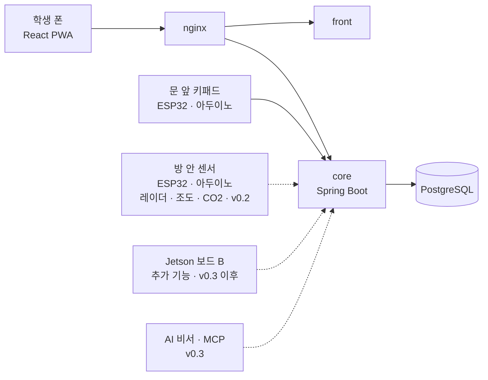
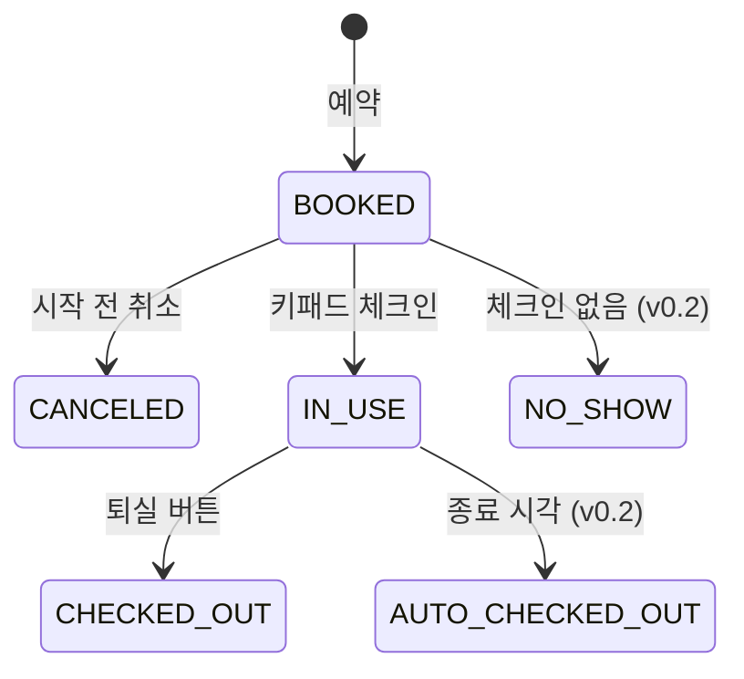

# M-space 예약 시스템 요구사항 명세 (v0.4)

| 항목 | 내용 |
|---|---|
| 버전 | v0.4 |
| 작성일 | 2026-10-30 · 최종 수정 2026-10-31 |
| 상태 | 초안. 팀 확인 후 확정 |
| 근거 | M-SPACE 예약 규칙 v2(10/30), 1·2차 팀 회의, 학생 설문 |
| 관련 문서 | `schema-v2.sql`, [인프라 · CI/CD](../infra/infra-cicd.md), [팀 컨벤션](../conventions.md), 버전 지도 |

**목차**
1. 왜 만드나
2. 어떻게 만드나
3. 버전별 범위
4. 용어와 예약 상태
5. 사용자
6. 작성 규칙
7. v0.1 요구사항 (상세)
8. v0.2 · v0.3 요구사항 (목록)
9. 미결 사항
10. 변경 이력

---

## 1. 왜 만드나

IT융합대학 M-space는 학생들이 회의와 스터디를 하는 방이다. 지금은 이렇게 쓴다.

> 교학팀에서 명부 작성 → 학생증 맡김 → 열쇠 받음 → 사용 → 열쇠 반납

이 방식은 **사람(교학팀)이 있어야만** 돌아간다. 그래서 세 가지 문제가 생긴다.

| 문제 | 실제로 겪는 일 |
|---|---|
| 관리가 끊긴다 | 교학팀은 18시에 퇴근한다. 시험 기간에는 24시간 열어 두지만 관리하는 사람이 없다 |
| 비었는지 모른다 | 방이 비었는지 직접 가 봐야 안다. 설문에서 가장 큰 불편 |
| 반납·신분증이 번거롭다 | 학과실이 닫히면 열쇠를 반납할 수 없다. 매번 학번을 적고, 학생증을 맡기는 게 불안하다 |

학생 설문(2026-10, 응답 약 6명, 추가 수집 중)에서 **열쇠 없이 예약만으로 이용하는 데 약 83%가 찬성**했다.

**그래서 우리가 만드는 것**: 사람이 없어도 "누가, 언제, 어느 방을 쓰는지"를 시스템이 기록하고 지키며, **예약만으로 문을 여는** M-space 예약·출입 시스템.

---

## 2. 어떻게 만드나

### 2.1 원칙

| 원칙 | 뜻 | 이렇게 한다 |
|---|---|---|
| 사람 대신 규칙이 지킨다 | 관리자가 없어도 규칙이 깨지지 않아야 한다 | 겹침 금지·대표자 1건·2시간 같은 규칙은 **DB 제약**으로 막는다. 동시 요청 100건에서 중복 0건 |
| 작게 만들고 바로 배포한다 | 다 만든 뒤 배포하지 않는다 | 첫날 빈 화면을 배포하고, 기능 하나를 붙일 때마다 폰으로 확인한다 |
| 갈아 끼울 수 있게 만든다 | 학교가 도입하면 실제 장비로 바꿀 수 있어야 한다 | 메일 인증 ↔ 학교 DB, 키패드 ↔ 실제 도어락, Gemini ↔ Ollama를 **인터페이스(포트) 뒤**에 둔다 |
| 카메라 없이 | 개인정보를 남기지 않는다 | 재실은 레이더·조도·CO2 센서로만 판단한다 |
| AI는 붙이기 쉽게 | 나중에 비서가 예약을 대신 해 줄 수 있어야 한다 | 모든 기능을 API로 열고 자동 문서(OpenAPI)를 만든다. 비서는 이 API를 MCP 도구로 쓴다 |

### 2.2 구성



- 서버는 학교 실습 서버 한 곳에서 `docker compose`로 띄운다. 비용 0원.
- 점선은 나중 버전에 붙는 부분이다.

### 2.3 일정

| 기간 | 할 일 |
|---|---|
| 11/2 – 11/5 | v0.1 예약 한 바퀴 |
| 11/6 – 11/10 | v0.2 사람 없이 돌아감 |
| 11/11 – 11/13 | v0.3 운영·AI. 11/13 기능 동결 |
| 11/14 – 11/19 | 발표 준비 |
| 11/20 | 발표 |

---

## 3. 버전별 범위

| 버전 | 한 줄 | 들어가는 것 |
|---|---|---|
| **v0.1** | 예약 한 바퀴 | 배포 파이프라인, 학교 메일 로그인, 방 목록, 예약(겹침·대표자 1건·2시간·30분·7일), 참여자·방별 인원, 내 예약, 시작 전 취소, 6자리 번호 → 키패드 체크인, 퇴실 |
| **v0.2** | 사람 없이 돌아감 | 자동 퇴실, 노쇼, 즉시 시작, 연장, 알림 2종, 방 현황 화면, 재실·환기 센서(ESP32·아두이노) |
| **v0.3** | 운영 · AI | 신고, 사진 체크인·아웃, 허위 신고 판정(관리자), AI 비서(MCP) |

**하지 않는 것**
- 카메라·영상
- 키박스
- 학교 학사 DB 직접 연동 (인터페이스만)
- 실제 도어락·QR (어댑터 설계만, 시연은 키패드 모형)

---

### 3.1 이용 수칙

예약할 때 동의를 받고, 위반은 신고(FR-RPT-101)와 관리자 판정(FR-RPT-103)으로 처리한다. 비서가 답하는 이용 규칙(Q-10 ③)에도 이 표가 들어간다.

| 구분 | 수칙 | 어기면 |
|---|---|---|
| 소음 | 회의·대화는 괜찮다. 옆 방에 들릴 만큼 떠들거나 장난치지 않는다 | 신고가 사실로 판정되면 경고. 심하거나 반복되면 이용 정지(퇴출) |
| 음식 | 과자·음료는 먹어도 된다 | 음료를 쏟아 기기·비품이 고장 나면 **배상을 요구**한다 |
| 정리 | 퇴실 전에 쓰레기를 버리고 자리를 정리한다 | 다음 사람이 어질러짐을 신고하고 사실로 판정되면 경고·이용 제한 등 불리하게 처리 |
| 증빙 | 체크인·퇴실 때 방 사진을 찍어 두기를 권한다(선택) | 사진이 없으면 분쟁 때 내가 정리했다는 증빙이 없어 불리할 수 있다 |

**제재 단계 (제안, 팀·교학팀 확인 필요)**

| 단계 | 조건 | 조치 |
|---|---|---|
| 경고 | 위반이 사실로 판정 1회 | 알림으로 경고, 기록에 남김 |
| 이용 정지 | 30일 안에 경고 3회, 또는 심한 소음·고의 파손 | 14일 동안 대표자·참여자 모두 예약 불가 |
| 배상 | 기기·비품 고장 | 관리자가 수리비를 따로 청구(시스템 밖에서 처리, 기록만 남김) |

---

## 4. 용어와 예약 상태

| 용어 | 뜻 |
|---|---|
| 방 | 1–5번 방. 방마다 최소·최대 인원이 있다 |
| 예약 | 대표자가 한 방을 시작–종료 시각 동안 쓰겠다는 기록. 참여자 목록을 가진다 |
| 대표자 | 예약을 만든 사람. 끝나지 않은 예약을 동시에 1건만 가진다. 참여자 목록에도 들어간다 |
| 참여자 | 예약에 함께 들어간 회원. 참여 횟수 제한 없음, 같은 시간 두 방 금지 |
| 끝나지 않은 예약 | 상태가 `BOOKED`(예약됨) 또는 `IN_USE`(사용 중)인 예약 |
| 체크인 | 키패드에 번호를 입력해 입실한 것 |
| 퇴실 | 사용을 마친 것. 버튼(즉시) 또는 종료 시각(자동). 퇴실하면 방이 바로 빈다 |
| 취소 | 시작 전에 대표자가 예약을 없애는 것 |
| 노쇼 | 정한 시간 안에 체크인하지 않은 것. 방이 풀린다 |
| 미리 예약 | 미래 시각을 잡는 예약 |
| 즉시 시작 | 지금 빈 방을 누른 시각부터 쓰는 예약 (v0.2) |
| 시간 구간 | `[시작, 종료)`. 10:00–11:00 뒤의 11:00–12:00은 겹치지 않는다 |



- `BOOKED`·`IN_USE`를 벗어나는 순간 겹침·대표자 제약에서 빠지므로 방과 대표자가 바로 풀린다.
- 상태 이름은 제안이다. `schema-v2.sql`에 다른 이름이 있으면 그쪽을 따른다.

---

## 5. 사용자

| 사용자 | 설명 | 버전 |
|---|---|---|
| 학생 | 학교 메일 인증을 마친 회원. 대표자 또는 참여자 | v0.1 |
| 문 앞 장치 | 키패드 번호를 core에 확인 요청 | v0.1 |
| 관리자 | 신고 기록을 보고 판정 | v0.3 |
| AI 비서 | 사용자 대신 core API 호출 | v0.3 |

---

## 6. 작성 규칙

| 항목 | 규칙 |
|---|---|
| ID | `<FR\|NFR>-<영역>-<번호>`. 번호는 영역별 001부터. v0.2 이후 기능은 101부터 |
| 영역 | `AUTH` 로그인 · `ROOM` 방 · `RSV` 예약 · `ACC` 출입 · `NTF` 알림 · `RPT` 신고 · `DEV` 센서 · `AGT` 비서 · `WEB` 화면 · `INF` 인프라 · `COM` 공통 |
| 우선순위 | **필수**(없으면 시연 불가) / **권장** / **선택** |
| 상태 | `초안` → `확정` → `구현 중` → `완료` / `폐기` |
| 한 건의 모양 | 설명 / 규칙(한 줄에 하나) / 수용 기준(`조건 / 행동 / 결과`) / 관련 |

- 확정된 뒤에는 지운 번호를 다시 쓰지 않는다(상태만 `폐기`).

---

## 7. v0.1 요구사항 (상세)

### 7.1 붙이는 순서

붙일 때마다 개발 서버에 배포하고 폰으로 확인한다.

| 순서 | 붙이는 것 | 폰으로 확인할 것 | 요구사항 |
|---|---|---|---|
| 0 | 배포 파이프라인 + 빈 화면 | 주소 접속, `/actuator/health`, develop 합치면 자동 반영 | NFR-INF-001–003 |
| 1 | 학교 메일 로그인 | 메일 번호 입력 → 내 이름·학번 표시 | FR-AUTH-001 |
| 2 | 방 목록 + 예약 생성 | 예약 성공, 겹침·2시간 초과·8일 뒤 거절 | FR-ROOM-001, FR-RSV-001–003 |
| 3 | 참여자 + 인원 확인 | 학번 검색(홍*동), 인원 미달 거절 | FR-RSV-004, FR-RSV-005 |
| 4 | 내 예약 + 취소 | 참여자 폰에도 보임, 취소 후 다른 팀이 예약 | FR-RSV-006, FR-RSV-007 |
| 5 | 6자리 번호 + 키패드 체크인 | 번호 입력 → 열림, 상태 사용 중 | FR-ACC-001 |
| 6 | 퇴실 | 방이 바로 비고 새 예약 가능 | FR-RSV-008 |

- 키패드가 늦어지면 5번은 웹 "입실" 버튼으로 먼저 시연한다. 키패드는 같은 API를 부르는 어댑터로 나중에 붙인다.

### 7.2 기능 요구사항 목록

| ID | 이름 | 우선순위 | API |
|---|---|---|---|
| FR-AUTH-001 | 학교 메일 인증 가입·로그인 | 필수 | `POST /api/auth/email-code`, `POST /api/auth/verify` |
| FR-ROOM-001 | 방 목록 조회 | 필수 | `GET /api/rooms` |
| FR-RSV-001 | 예약 생성 | 필수 | `POST /api/reservations` |
| FR-RSV-002 | 같은 방 시간 겹침 거절 | 필수 | `POST /api/reservations` |
| FR-RSV-003 | 대표자 끝나지 않은 예약 1건 | 필수 | `POST /api/reservations` |
| FR-RSV-004 | 참여자 추가 (학번 검색) | 필수 | `GET /api/members?studentId=` |
| FR-RSV-005 | 방별 인원, 참여자 같은 시간 두 방 금지 | 필수 | `POST /api/reservations` |
| FR-RSV-006 | 내 예약 조회 (대표자·참여자) | 필수 | `GET /api/reservations/me` |
| FR-RSV-007 | 시작 전 취소 | 필수 | `POST /api/reservations/{id}/cancel` |
| FR-RSV-008 | 퇴실 | 필수 | `POST /api/reservations/{id}/checkout` |
| FR-ACC-001 | 6자리 번호 → 키패드 체크인 | 필수 | `POST /api/access/verify` |
| FR-WEB-001 | 예약 화면 | 필수 | — |
| FR-WEB-002 | 내 예약 화면 | 필수 | — |
| FR-WEB-003 | 이용 규칙 화면 | 필수 | `GET /api/rules` |

---

### FR-AUTH-001 학교 메일 인증 가입·로그인

- **설명**: 학생은 학교 메일로 받은 인증 번호로 가입·로그인한다. 인증을 마친 회원만 예약하거나 참여자로 추가될 수 있다.
- **규칙**
  - `@chosun.ac.kr` 주소만 받는다.
  - 인증 번호는 6자리, 10분 유효. 5번 틀리면 다시 받아야 한다. 같은 주소로 1분에 1번만 보낸다.
  - 처음 인증하면 이름과 학번을 받아 회원을 만든다. 학번은 회원마다 하나.
  - 로그인하면 JWT를 준다. 토큰에 권한 범위(scope)를 둔다.
  - 본인 확인은 `IdentityVerifier` 뒤에 둔다. v0.1은 학교 메일 어댑터 하나. 학교 DB 연동은 인터페이스만.
  - 메일은 `NotificationChannel`(메일) 어댑터로 보낸다. 로컬·테스트에서는 로그에 번호를 찍는다.
- **수용 기준**
  - [ ] 조건: 가입 이력 없음 / 행동: `a@chosun.ac.kr`로 번호 요청 → 번호·이름·학번 입력 / 결과: 회원 1명 생성, 토큰 발급
  - [ ] 조건: 이미 가입 / 행동: 같은 주소로 다시 인증 / 결과: 같은 회원으로 로그인
  - [ ] 조건: — / 행동: `a@gmail.com`으로 요청 / 결과: `400` "학교 메일만 사용할 수 있습니다"
  - [ ] 조건: 번호 발급 후 11분 / 행동: 그 번호 입력 / 결과: `400` (만료)
  - [ ] 조건: 다른 회원이 학번 `20231234` 사용 중 / 행동: 같은 학번으로 가입 / 결과: `409`
- **관련**: FR-RSV-004, NFR-COM-003

### FR-ROOM-001 방 목록 조회

- **설명**: 학생은 예약할 수 있는 방과 방별 인원을 본다.
- **규칙**
  - 방은 이름, 최소 인원, 최대 인원, 사용 가능 여부를 가진다.
  - 1–4번 방은 3–5명, 5번 방은 5–8명.
  - 사용 불가(수리 중 등) 방은 목록에 나오지 않는다.
  - 방 데이터는 Flyway 초기 데이터로 넣는다. 인원 숫자는 코드가 아니라 방 테이블에 둔다.
  - 옆 방 신고(v0.3)를 위해 이웃 방 정보를 둘 자리를 만든다.
- **수용 기준**
  - [ ] 조건: 방 5개 중 1개 사용 불가 / 행동: 목록 조회 / 결과: 4개, 각각 최소·최대 인원 포함
  - [ ] 조건: 로그인 안 함 / 행동: 목록 조회 / 결과: `401`
- **관련**: FR-RSV-005, FR-WEB-001

### FR-RSV-001 예약 생성

- **설명**: 대표자는 방, 시작·종료 시각, 참여자를 골라 미리 예약한다.
- **규칙**
  - 시각은 30분 단위(정각·30분)만 받는다.
  - 1회 최대 2시간. 종료는 시작보다 뒤.
  - **시작 시각**이 오늘(서울 시간)부터 7일 안이어야 한다. 자정을 넘겨도 된다(7일째 23:00–01:00 가능).
  - 시작은 지금보다 뒤.
  - 상태 `BOOKED`로 만들고 6자리 번호를 함께 발급한다(FR-ACC-001).
  - 예약과 참여자는 한 트랜잭션에서 저장한다.
  - 7일·2시간·30분은 정책 설정값으로 둔다(시범운영 후 3일·14일로 조정 가능하게).
  - 2시간·30분은 DB `valid_length` CHECK로, 7일은 서버에서 확인한다(요청 시각 기준이라 CHECK로 못 막음).
- **수용 기준**
  - [ ] 조건: 1번 방 오늘 14:00–16:00 비어 있음, 참여자 3명 / 행동: 예약 / 결과: `201`, 상태 `BOOKED`, 번호 발급
  - [ ] 조건: — / 행동: 14:10 시작 / 결과: `400` (30분 단위 아님)
  - [ ] 조건: — / 행동: 2시간 30분 예약 / 결과: `400` (2시간 초과)
  - [ ] 조건: 7일째 23:00 / 행동: 23:00–01:00 예약 / 결과: `201` (자정 넘김 허용)
  - [ ] 조건: — / 행동: 8일째 00:00 시작 / 결과: `400` (범위 밖)
  - [ ] 조건: — / 행동: 지난 시각 / 결과: `400`
- **관련**: FR-RSV-002, FR-RSV-003, FR-RSV-005, FR-ACC-001

### FR-RSV-002 같은 방 시간 겹침 거절

- **설명**: 같은 방에서 시간이 겹치는 예약은 받지 않는다. 동시에 눌러도 한 팀만 성공한다.
- **규칙**
  - `[시작, 종료)` 반열린 구간. 끝 = 다음 시작이면 겹치지 않는다.
  - 끝나지 않은 예약(`BOOKED`, `IN_USE`)끼리만 판단한다.
  - DB 제약 `no_room_overlap`(btree_gist `EXCLUDE`)으로 막는다.
  - 제약 위반은 `500`이 아니라 `409` "이미 예약된 시간입니다"로 응답한다.
- **수용 기준**
  - [ ] 조건: 1번 방 14:00–16:00 예약됨 / 행동: 15:00–17:00 / 결과: `409`
  - [ ] 조건: 같음 / 행동: 16:00–17:00 / 결과: `201`
  - [ ] 조건: 같음 / 행동: 2번 방 14:00–16:00 / 결과: `201`
  - [ ] 조건: 14:00–16:00이 퇴실·취소·노쇼됨 / 행동: 같은 시간 / 결과: `201`
  - [ ] 조건: 비어 있음 / 행동: 서로 다른 100팀이 같은 방·시간을 동시에 요청 / 결과: 1건 `201`, 99건 `409`, DB 중복 0건
- **관련**: NFR-COM-002

### FR-RSV-003 대표자 끝나지 않은 예약 1건

- **설명**: 미래 예약을 쌓아 방을 독점하지 못하게, 대표자는 끝나지 않은 예약을 동시에 1건만 가진다. 하루 횟수 한도는 없다.
- **규칙**
  - DB 부분 유니크 인덱스 `one_active_per_owner`로 막는다.
  - 퇴실·취소·노쇼가 되는 순간 다음 예약을 할 수 있다.
- **수용 기준**
  - [ ] 조건: 내 예약 내일 14:00 `BOOKED` / 행동: 모레 예약 / 결과: `409` "끝나지 않은 예약이 이미 있습니다"
  - [ ] 조건: 끝나지 않은 예약 없음 / 행동: 같은 대표자가 다른 방·시간으로 100건 동시 요청 / 결과: 1건만 `201`
  - [ ] 조건: 내 예약을 퇴실 / 행동: 새 예약 / 결과: `201`
- **관련**: FR-RSV-007, FR-RSV-008

### FR-RSV-004 참여자 추가 (학번 검색)

- **설명**: 대표자는 학번으로 회원을 검색해 참여자로 추가한다.
- **규칙**
  - 학교 메일 인증을 마친 회원만 검색·추가된다(DB 외래 키로 한 번 더 막음).
  - 검색 결과에는 이름 일부만 보인다(예: 홍*동).
  - 중복은 학번으로 판단한다. 같은 사람을 두 번 넣을 수 없다.
  - 대표자도 참여자 목록에 들어간다.
- **수용 기준**
  - [ ] 조건: 학번 `20231234` 회원 "홍길동" / 행동: 검색 / 결과: "홍*동" 1건
  - [ ] 조건: 가입 안 한 학번 / 행동: 검색 / 결과: 빈 결과, 추가 불가
  - [ ] 조건: — / 행동: 같은 학번을 두 번 넣고 예약 / 결과: `400`
- **관련**: FR-AUTH-001, FR-RSV-005

### FR-RSV-005 방별 인원, 참여자 같은 시간 두 방 금지

- **설명**: 방마다 정한 인원 안에서만 예약하고, 한 사람이 같은 시간에 두 방에 들어갈 수 없다. 최소 인원이 있어 혼자 여러 번 잇는 "대리 연속 예약"도 줄어든다.
- **규칙**
  - 참여자 수(대표자 포함)가 방의 최소–최대 인원 안이어야 한다. 서버가 같은 트랜잭션에서 확인한다.
  - 참여자 테이블에 회원 id + 시간 범위를 복사해 `EXCLUDE` 제약으로 같은 시간 두 방을 막는다. 끝나지 않은 예약만.
  - 참여 횟수 제한은 없다.
- **수용 기준**
  - [ ] 조건: 1번 방(3–5명) / 행동: 2명으로 예약 / 결과: `400` "이 방은 3명 이상 5명 이하입니다"
  - [ ] 조건: 5번 방(5–8명) / 행동: 9명 / 결과: `400`
  - [ ] 조건: 회원 A가 1번 방 14:00–16:00 참여 / 행동: A를 넣어 2번 방 15:00–16:00 예약 / 결과: `409`
  - [ ] 조건: 같음 / 행동: A를 넣어 2번 방 16:00–17:00 / 결과: `201`
- **관련**: FR-ROOM-001, FR-RSV-004

### FR-RSV-006 내 예약 조회 (대표자·참여자)

- **설명**: 대표자와 참여자 모두 자기 화면에서 예약 내용을 본다.
- **규칙**
  - 내가 대표자이거나 참여자인 예약만 보여 준다. 대표자 여부를 표시한다.
  - 항목: 방, 시작, 종료, 상태, 참여자(이름 일부), 6자리 번호(**대표자에게만**).
  - 정렬: 끝나지 않은 예약이 위, 그 안에서 시작이 가까운 순.
- **수용 기준**
  - [ ] 조건: X가 대표자인 예약 1건, 참여자인 예약 1건 / 행동: X로 조회 / 결과: 2건, 번호는 대표자 예약에만 보임
  - [ ] 조건: 예약 없음 / 행동: 조회 / 결과: `200`, 빈 목록
- **관련**: FR-WEB-002

### FR-RSV-007 시작 전 취소

- **설명**: 대표자는 시작 전에 예약을 취소할 수 있다. 시작 후에는 취소할 수 없다.
- **규칙**
  - 대표자만, `BOOKED`이고 지금이 시작 전일 때만. 상태 `CANCELED`.
  - 조건부 UPDATE(`WHERE status = 'BOOKED' AND start_at > now()`)로 한 번만 처리한다.
- **수용 기준**
  - [ ] 조건: 내 예약 내일 14:00 / 행동: 취소 / 결과: `200`, 같은 시간 다른 팀 예약 `201`, 나도 새 예약 `201`
  - [ ] 조건: 시작 시각이 지남 / 행동: 취소 / 결과: `409` "시작한 예약은 취소할 수 없습니다"
  - [ ] 조건: 참여자 / 행동: 취소 / 결과: `403`
- **관련**: FR-RSV-003, FR-WEB-002

### FR-RSV-008 퇴실

- **설명**: 퇴실 버튼을 누르면 즉시 퇴실하고 방이 바로 빈다. 관리자 승인은 없다.
- **규칙**
  - 체크인한(`IN_USE`) 예약만, 대표자만 퇴실할 수 있다. 체크인하지 않으면 퇴실 버튼이 없다(v0.2부터 노쇼로 처리).
  - 종료 전이면 "조기 퇴실할까요?"를 한 번 확인한다.
  - 상태 `CHECKED_OUT`, 퇴실 시각 기록. 조건부 UPDATE로 두 번 눌러도 한 번만 처리한다.
  - 퇴실은 도메인 이벤트(`ReservationCheckedOut`)로 낸다. 알림·센서·비서가 구독한다.
- **수용 기준**
  - [ ] 조건: 14:00–16:00 `IN_USE`, 지금 15:00 / 행동: 퇴실 / 결과: `200`, `CHECKED_OUT`, 15:30–16:00을 다른 팀이 예약 가능
  - [ ] 조건: 같음 / 행동: 대표자가 새 예약 / 결과: `201`
  - [ ] 조건: `BOOKED` (체크인 안 함) / 행동: 퇴실 / 결과: `409`
  - [ ] 조건: `IN_USE` / 행동: 퇴실 요청 2개 동시 / 결과: 하나만 `200`
- **관련**: FR-RSV-003, FR-ACC-001, FR-WEB-002

### FR-ACC-001 6자리 번호 → 키패드 체크인

- **설명**: 예약하면 6자리 번호가 나오고, 문 앞 키패드에 입력하면 열리며 체크인된다.
- **규칙**
  - 번호는 대표자만 받는다.
  - 번호는 시작 10분 전부터 종료 전까지만 유효하다. 같은 방의 끝나지 않은 예약끼리 번호가 겹치지 않는다.
  - 장치는 `POST /api/access/verify {roomId, code}`만 부른다(`AccessDevice` 어댑터). 장치 토큰은 사람 토큰과 따로 둔다.
  - 맞으면 처음 한 번은 `BOOKED` → `IN_USE`(체크인), 이후에는 문만 연다.
  - 5번 연속 틀리면 그 방 키패드를 1분 잠근다.
  - 실제 도어락·QR은 같은 API를 부르는 다른 어댑터로 설명만 한다.
- **수용 기준**
  - [ ] 조건: 내 예약 14:00 시작, 지금 13:55 / 행동: 키패드에 번호 입력 / 결과: 열림, 상태 `IN_USE`
  - [ ] 조건: 지금 13:40 / 행동: 입력 / 결과: 거절 (아직 이름)
  - [ ] 조건: 다른 방 번호 / 행동: 입력 / 결과: 거절
  - [ ] 조건: 키패드 연결 전 / 행동: 웹 "입실" 버튼 / 결과: 같은 결과 (대체 시연)
- **관련**: FR-RSV-001, FR-RSV-008

### FR-WEB-001 예약 화면

- **설명**: 폰 브라우저에서 방·시간·참여자를 골라 예약한다.
- **규칙**
  - 방 선택(인원 표시) → 날짜(오늘부터 7일만) → 시작·종료(30분 단위, 최대 2시간) → 인원수 선택 → 그 수만큼 학번 검색 → 예약.
  - 서버 오류 메시지(`409` 등)를 그대로 보여 준다.
  - **처음 예약할 때와 수칙이 바뀌었을 때만** 이용 수칙(3.1) 동의 화면을 띄운다. 동의하면 다음부터는 묻지 않는다(회원에 동의한 수칙 버전을 저장).
- **수용 기준**
  - [ ] 폰(가로 360px)에서 가로 스크롤 없이 예약을 끝낸다.
  - [ ] 동의한 적 없는 회원은 동의 전까지 예약할 수 없다. 동의한 회원은 다시 묻지 않는다.
  - [ ] 인원 미달·겹침이면 이유가 화면에 보인다.
- **관련**: FR-ROOM-001, FR-RSV-001, FR-RSV-004, FR-RSV-005

### FR-WEB-002 내 예약 화면

- **설명**: 내 예약을 보고 취소·퇴실한다.
- **규칙**
  - 대표자 예약: 6자리 번호, 취소(시작 전)·퇴실(체크인 후) 버튼.
  - 참여자 예약: 보기만.
  - 버튼은 "취소할까요?" / "조기 퇴실할까요?" 확인을 거친다. 처리 후 목록을 새로고침한다.
- **수용 기준**
  - [ ] 퇴실 → 상태가 "퇴실"로 바뀌고 버튼이 사라진다.
  - [ ] 빠르게 두 번 눌러도 오류 화면이 없다.
- **관련**: FR-RSV-006, FR-RSV-007, FR-RSV-008

### FR-WEB-003 이용 규칙 화면

- **설명**: 이용 수칙을 앱 한 곳에 모아 두고 언제든 본다.
- **규칙**
  - 메뉴에 "이용 규칙"을 둔다. 예약 규칙(7일·2시간·노쇼 등)과 이용 수칙(3.1)을 함께 보여 준다.
  - 필요한 순간에는 한 줄만 다시 보여 준다: 퇴실 버튼에서 "자리 정리하셨나요?", 체크인 직후 "음료를 쏟으면 배상 대상이에요".
  - 수칙 내용은 화면에 박지 않고 서버(`GET /api/rules`)에서 받는다. 비서의 규칙 답변도 같은 내용을 쓴다.
- **수용 기준**
  - [ ] 로그인 전에도 이용 규칙 화면을 볼 수 있다.
  - [ ] 퇴실 확인 창에 정리 안내 한 줄이 보인다.
- **관련**: FR-WEB-001, FR-WEB-002, FR-RPT-104

---

### 7.3 비기능 요구사항

| ID | 이름 | 내용 | 확인 방법 | 우선순위 |
|---|---|---|---|---|
| NFR-COM-001 | 응답 시간 | v0.1 API는 학교 와이파이에서 1초 안 | 시연 폰으로 10회씩 | 필수 |
| NFR-COM-002 | 동시성 | 동시 요청 100건에서 중복 예약 0건. 실패는 `409` | DB 단계 확인 완료(10/30). Spring API로 재실행 + 제약 없는 "조회 후 저장" 버전과 전후 비교 | 필수 |
| NFR-COM-003 | 개인정보 | 저장하는 개인정보는 학교 메일·이름·학번뿐. 다른 사람 이름은 일부만 표시 | ERD 검토 | 필수 |
| NFR-COM-004 | 시간 기준 | 날짜 계산은 `Asia/Seoul`, DB는 `timestamptz` | 코드 리뷰 | 필수 |
| NFR-COM-005 | 오류 형식 | `{ "code": "...", "message": "..." }` | API 테스트 | 필수 |
| NFR-COM-006 | 갈아 끼우기 | 본인 확인·출입·알림·재실·LLM을 인터페이스 뒤에 둔다 (아래 표) | 코드 리뷰 | 권장 |
| NFR-COM-007 | 테스트 | v0.1 수용 기준을 자동 테스트로 (Testcontainers) | `./mvnw test` | 필수 |
| NFR-COM-008 | AI 확장성 | 비서가 붙어도 core를 고치지 않는다 (아래 5가지) | 코드 리뷰, OpenAPI | 필수 |
| NFR-INF-001 | 비밀값 | 비밀번호·키는 저장소에 올리지 않는다. Actions Secrets → 서버 `.env` | 저장소 검색 | 필수 |
| NFR-INF-002 | 로컬 실행 | `docker compose up` 한 번으로 core·DB를 띄운다 | 팀원 노트북 | 필수 |
| NFR-INF-003 | 자동 배포 | develop → 개발 서버, main → 시연 서버. 테스트 실패 시 배포 안 함 | 합친 뒤 10분 안 반영 | 필수 |

**NFR-COM-006 인터페이스 목록**

| 인터페이스 | 지금 (시연) | 나중 (도입) |
|---|---|---|
| `IdentityVerifier` | 학교 메일 인증 | 학교 학사 DB |
| `AccessDevice` | 키패드 모형 | 실제 도어락 · QR |
| `NotificationChannel` | 메일 | 텔레그램 · 푸시 |
| `PresenceDetector` | 레이더·조도·CO2 규칙 | 다른 센서 |
| `LlmClient` | Gemini | Ollama (Jetson) |

**NFR-COM-008 AI 확장성 5가지**
1. 기능은 core API로만 연다. OpenAPI 자동 문서가 MCP 도구의 근거가 된다. 비서는 DB에 직접 접근하지 않는다.
2. 기록에 `created_via`(WEB / AGENT / DEVICE)를 남긴다.
3. 상태 변경은 도메인 이벤트로 낸다.
4. JWT scope로 비서 권한을 제한한다.
5. LLM은 `LlmClient` 뒤에 둔다.

### 7.4 데이터

| 테이블 | 주요 컬럼 | 제약 |
|---|---|---|
| `users` | id, email, name, student_id, verified_at, rules_agreed_version | email·student_id 유일 |
| `email_verification` | email, code_hash, expires_at, attempts | |
| `rooms` | id, name, min_people, max_people, is_active | |
| `reservation` | id, owner_id, room_id, start_at, end_at, status, access_code, checked_in_at, checked_out_at, created_via | `no_room_overlap`, `one_active_per_owner`, `valid_length` |
| `reservation_participant` | reservation_id, user_id, start_at, end_at, active | 같은 시간 두 방 `EXCLUDE` |

- 전체 DDL은 `schema-v2.sql`이 기준이다. 다르면 그쪽을 따르고 이 표를 고친다.

### 7.5 v0.1 완료 기준

- [ ] 팀원 폰으로 메일 인증 → 참여자 3명과 예약 → 번호 확인 → 키패드 입력(열림) → 퇴실까지 한 번에 된다.
- [ ] 두 폰으로 같은 시간을 눌렀을 때 한 팀만 성공한다.
- [ ] 끝나지 않은 예약이 있는 대표자는 두 번째 예약이 막힌다.
- [ ] 퇴실·취소한 시간대를 다른 팀이 바로 예약할 수 있다.

---

## 8. v0.2 · v0.3 요구사항 (목록)

해당 버전을 시작할 때 7장처럼 상세히 쓴다.

**v0.2 사람 없이 돌아감**

| ID | 이름 | 내용 (규칙 v2) |
|---|---|---|
| FR-RSV-101 | 자동 퇴실 | 종료 시각에 `IN_USE` → `AUTO_CHECKED_OUT`. 스케줄러 + 조건부 UPDATE |
| FR-RSV-102 | 노쇼 | 미리 예약은 시작 + 15분, 즉시 시작은 누른 뒤 10분 안에 체크인 없으면 `NO_SHOW`, 방 해제 |
| FR-RSV-103 | 즉시 시작 | 지금 빈 방을 누른 시각부터. 끝은 30분 칸으로 올림(2:17 → 최대 4:30). 10분 안에 키패드. 새 예약 1건 |
| FR-RSV-104 | 연장 | 다음 예약이 없으면 끝난 뒤 바로 다시 예약(새 예약 1건). 일찍 퇴실 후 다시 즉시 시작해 이어 쓰기 허용 |
| FR-NTF-101 | 시작 안내 | 시작 10분 전, 대표자·참여자 전원. "15분 안에 체크인 안 하면 노쇼". 즉시 시작은 안 보냄 |
| FR-NTF-102 | 퇴실 안내 | 종료 10분 전, 전원. 다음 예약이 없으면 "바로 다시 예약 가능" |
| NFR-NTF-101 | 알림 중복 없음 | 예약·사람·종류별 한 번만. `notification_log` PK(예약, 사람, 종류) |
| FR-DEV-101 | 재실 센서 값 수집 | 레이더·조도·CO2 → ESP32(아두이노) → core(와이파이 HTTP). 학습 없이 규칙으로 판단, 틀리면 "있음" 쪽으로 |
| FR-DEV-102 | 방 현황 화면 | 지금 비었는지, 다음 예약 시각. 설문 1위 불편 |
| FR-DEV-103 | 재실로 노쇼·퇴실 보조 | 체크인 판정은 키패드가 기준. 센서는 보조: 사용 중인데 15분 넘게 비어 있으면 대표자에게 "퇴실할까요?" 확인 알림(Q-08) |
| FR-DEV-104 | 환기 알림 | CO2가 1000ppm을 넘으면 사용 중인 예약자에게 "환기해 주세요" 알림. 같은 방에 30분에 한 번만 |

**v0.3 운영 · AI**

| ID | 이름 | 내용 (규칙 v2) |
|---|---|---|
| FR-RPT-101 | 신고 | 비품 고장·창문 열림·어질러짐·소음. 그 방 예약자 + 옆 방 예약자만. 소음은 "정말 소란인가요?" 체크 필수 |
| FR-RPT-102 | 사진 체크인·아웃 | 선택. 안 찍으면 "신고 시 증빙이 없어 불리할 수 있음". 사람 없이 방만 찍게 안내 |
| FR-RPT-103 | 허위 신고 판정 | 관리자가 사실 / 확인 불가(벌칙 없음) / 허위로 판정. 소음은 판정 대상 아님. 기준: 비품 고장 = 가 보니 정상 작동, 창문 열림 = 가 보니 닫혀 있음, 어질러짐 = 앞 사람 퇴실 사진과 신고자 체크인 사진이 모두 깨끗함. 벌칙(제안): 1회 경고, 30일 안 3회면 14일 신고 정지 |
| FR-RPT-104 | 수칙 위반 제재 | 판정이 "사실"이면 위반자에게 경고 기록. 30일 안 3회면 14일 이용 정지(예약·참여 불가). 관리자는 사용 중인 예약을 강제 퇴실시킬 수 있다(퇴출) |
| FR-WEB-101 | 관리자 화면 | 신고 목록·판정 · 경고·정지·배상 기록 |
| FR-AGT-101 | 비서로 예약 조회·생성 | MCP 도구, 텔레그램. Gemini 기본, Ollama 교체 가능 |
| FR-AGT-102 | 내 시간표 묻기 (선택) | 시간표 1회 등록, 본인 비서만 조회 |

- **Jetson 보드 B**는 필수 기능(v0.1–v0.2)이 다 된 뒤에 붙인다. 무엇을 맡길지는 Q-10.

---

## 9. 미결 사항

**이번에 결정된 것**: 30분 단위 · 시작 전 취소 · 연장 = 새 예약 · 체크인 = 키패드 · 신고 = 그 방 + 옆 방 · 대표자 동시 1건.

| ID | 질문 | 기본안 |
|---|---|---|
| Q-01 | 즉시 시작(2:17–4:30, 2시간 13분)이 `valid_length` CHECK에 걸린다 | CHECK 조건을 바꾼다 (아래 SQL) |
| Q-02 | 알림을 어디로 보내나? | v0.2는 학교 메일. 폰 푸시는 아이폰 제약이 커서 나중. 텔레그램은 v0.3 |
| Q-03 | 즉시 시작에도 참여자·최소 인원을 받나? | 받는다. 누르기 전에 참여자 입력 |
| Q-04 | 대표자가 늦으면 참여자는 못 들어간다 | 대표자가 번호를 공유. 참여자에게도 보여 줄지는 시범운영 후 |
| Q-05 | "옆 방"은 어떻게 정하나? | 방 테이블에 이웃 방 목록. 실제 배치 확인 필요 |
| Q-06 | 관리자는 누구이고 어떻게 로그인하나? | `role = ADMIN`. 시연은 팀원 계정, 실제는 교학팀 |
| Q-07 | 남의 학번으로 가입할 수 있다 | 메일 1개 = 학번 1개. 학교 DB 연동은 인터페이스만 |
| Q-08 | 센서로 "빈 방"이라 볼 기준 시간 | 레이더 연속 없음 15분 → 대표자 확인 알림 → 5분 무응답 시 자동 퇴실 |
| Q-09 | 기존 코드·`schema-v2.sql`의 API 경로·테이블·상태 이름 | 기존 것 우선, 이 문서를 맞춤 |
| Q-10 | Jetson 보드 B에 무엇을 맡기나? | v0.3 이후. 후보: ① CO2 60분 예측으로 "곧 환기 필요" 미리 알림(교육장 공기 추론 실습의 ONNX 상시 추론 방식 재사용) ② 비서용 로컬 LLM(Ollama) ③ 이용 규칙 질문 답변(EmbeddingGemma 검색). 팀 결정 대기 |
| Q-11 | 이용 수칙의 제재 수위(경고 횟수, 정지 기간, 배상 절차)는 누가 정하나? | 3.1의 제안으로 시작. 실제 운영 기준은 교학팀과 확인 |

**Q-01 제안 SQL** (PostgreSQL 16에서 확인)

```sql
ALTER TABLE reservation DROP CONSTRAINT valid_length;
ALTER TABLE reservation ADD CONSTRAINT valid_length CHECK (
  end_at > start_at
  AND extract(epoch FROM end_at)::int % 1800 = 0
  AND end_at <= to_timestamp(ceil(extract(epoch FROM start_at) / 1800) * 1800) + interval '2 hours');
```

| 예약 | 결과 |
|---|---|
| 14:17–16:30 (즉시 시작) | 통과 |
| 14:00–16:00 | 통과 |
| 23:00–01:00 (자정 넘김) | 통과 |
| 14:00–16:30 | 거절 |
| 14:17–17:00 | 거절 |
| 14:00–15:10 | 거절 |

- 끝은 정각·30분이고, 끝 ≤ (시작을 30분 칸으로 올린 시각 + 2시간)이면 통과한다.
- 미리 예약의 시작이 정각·30분인지는 서버가 확인한다.

---

## 10. 변경 이력

| 버전 | 날짜 | 바뀐 내용 |
|---|---|---|
| v0.1 | 10/30 | 틀 작성, 첫 줄기(예약 → 반납) 초안 |
| v0.2 | 10/30 | 2차 회의: 최대 2시간, 7일, 대표자 1건 |
| v0.3 | 10/30 | 먼저 배포하고 붙이는 MVP 방식, AI 확장성 |
| v0.4 | 10/30 | 예약 규칙 v2 반영(메일 인증, 반납 → 퇴실, 취소, 참여자·인원, 자정 넘김, 즉시 시작, 알림, 신고). 왜·어떻게 장 추가. 버전별 범위 재정리. 인프라를 학교 서버로. ID·미결 번호를 순서대로 다시 매김(초안 단계라 가능) |

---

## 부록. 새 요구사항 빈 칸

```markdown
### FR-XXX-000 요구사항 이름

- **설명**: (누가) (무엇을) (왜).
- **규칙**
  - 규칙 1
- **수용 기준**
  - [ ] 조건: … / 행동: … / 결과: …
- **관련**: 다른 요구사항 ID
```
